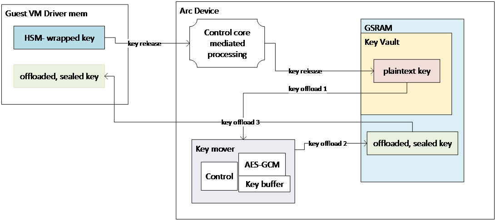
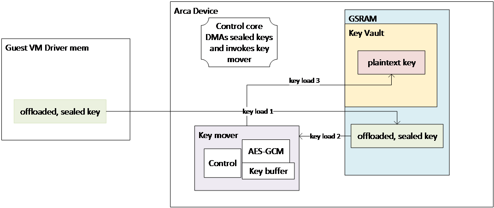

Arca – Integrated HSM

Chip Requirements Specification

0.5.0

Author: Bryan Kelly

Author: Vishal Soni

# Version History

Versions and revisions are made to this document and logged here. Errata is a separate document such that the contribution specification document it refers to was not revised. In alignment with Open Compute documentation, the version numbering for revisions follows <major>.<minor>.<errata>

|  |  |  |  |
| --- | --- | --- | --- |
| **Date** | **Version #** | **Author** | **Description** |
| 04/10/2026 | 0.1.0 | Zahra Lak | Initial base derived from Azure Integrated HSM Chip Requirements Document |
| 06/18/2026 | 0.3.0 | Bryan Kelly | Port to Arca and refine general flows. |
|  |  |  |  |
|  |  |  |  |
|  |  |  |  |
|  |  |  |  |

## Known Opens

|  |  |  |  |
| --- | --- | --- | --- |
| **Area** | **Description** | **Est.**  **Closure** | **Closure Plan and Comments** |

Table of Contents

[1 Version History 3](#_Toc239446314)

[1.1 Known Opens 4](#_Toc239446315)

[2 Introduction 8](#_Toc239446316)

[2.1 Scope 8](#_Toc239446317)

[2.1.1 Purpose and In-Scope Content 8](#_Toc239446318)

[2.1.2 Out-of-Scope Content 8](#_Toc239446319)

[2.1.3 Assumptions and Dependencies 8](#_Toc239446320)

[2.2 Requirement Definition 9](#_Toc239446321)

[2.2.1 PCIe Link Encryption 9](#_Toc239446322)

[2.3 Reference Documents 10](#_Toc239446323)

[3 System Context and Product Overview 11](#_Toc239446324)

[3.1 Product Overview 11](#_Toc239446325)

[3.2 Theory of Operation Overview 11](#_Toc239446326)

[4 Base Platform Requirements 12](#_Toc239446327)

[5 Security and Trust Requirements 14](#_Toc239446328)

[5.1 Security Platform Infrastructure 14](#_Toc239446329)

[5.1.1 Physical Security 14](#_Toc239446330)

[5.1.2 TDISP, CMA, and DOE 14](#_Toc239446331)

[5.1.3 Root of Trust 15](#_Toc239446332)

[5.1.4 Firmware Security 16](#_Toc239446333)

[5.2 Chassis Intrusion and Tamper Requirements 16](#_Toc239446334)

[6 Key Management and Storage Requirements 17](#_Toc239446335)

[6.1 Key Types 17](#_Toc239446336)

[6.2 Key Organization 18](#_Toc239446337)

[6.3 Offloaded Key Storage 18](#_Toc239446338)

[6.4 Pinned Key Store 19](#_Toc239446339)

[6.5 Key Management 19](#_Toc239446340)

[7 Cryptographic Function Requirements 20](#_Toc239446341)

[7.1 General Requirements 21](#_Toc239446342)

[7.1.1 Pool Manager Requirements 21](#_Toc239446343)

[7.1.2 Other General Requirements 22](#_Toc239446344)

[7.2 Cryptographic Functions 22](#_Toc239446345)

[7.2.1 PCIe IDE 23](#_Toc239446346)

[7.2.2 Security Processor 23](#_Toc239446347)

[7.2.3 Host Memory Hashing 24](#_Toc239446348)

[7.2.4 Key Mover 25](#_Toc239446349)

[7.2.5 Accelerator Pools 27](#_Toc239446350)

[7.2.6 Random Numbers 27](#_Toc239446351)

[7.3 Cryptographic Algorithms 28](#_Toc239446352)

[7.3.1 Symmetric Encryption 28](#_Toc239446353)

[7.3.2 Hashing 29](#_Toc239446354)

[7.3.3 RSA Cryptography 30](#_Toc239446355)

[7.3.4 Elliptic Curve Cryptography 31](#_Toc239446356)

[7.3.5 PQC Cryptography 31](#_Toc239446357)

[7.3.6 PQC-Classical Hybrid Algorithms 32](#_Toc239446358)

[8 HSM and Tenant Service Requirements 32](#_Toc239446359)

[8.1 Service Model Overview 32](#_Toc239446360)

[8.2 HSM and Secure Key Release Services 32](#_Toc239446361)

[9 Performance, Scalability, and QoS Requirements 33](#_Toc239446362)

[9.1 Performance Requirements 33](#_Toc239446363)

[9.2 Scalability Requirements 34](#_Toc239446364)

[9.3 QoS Requirements 34](#_Toc239446365)

[9.3.1 QoS Rationale and Operating Model 34](#_Toc239446366)

[9.3.2 QoS Hardware Requirements 35](#_Toc239446367)

[9.3.3 Cryptographic Service QoS 35](#_Toc239446368)

[10 Firmware and Lifecycle Requirements 35](#_Toc239446369)

[10.1 Firmware Development and Compliance 35](#_Toc239446370)

[10.2 Firmware Update and Rollback 36](#_Toc239446371)

[10.3 Firmware Services, Recovery, Telemetry, and Maintenance 37](#_Toc239446372)

[10.3.1 Crash Dump 37](#_Toc239446373)

[10.3.2 Crash Detection, Dump Collection, and Recovery 37](#_Toc239446374)

[10.3.3 Maintenance Mode Firmware 38](#_Toc239446375)

[10.3.4 Telemetry 38](#_Toc239446376)

[10.4 Firmware System Requirements 38](#_Toc239446377)

[11 Hardware Implementation Requirements 39](#_Toc239446378)

[11.1 Reset Architecture 39](#_Toc239446379)

[11.2 Processor Complex and Memory 40](#_Toc239446380)

[11.2.1 Control Processor Cores and General Memory 40](#_Toc239446381)

[11.2.2 GDMA 40](#_Toc239446382)

[11.2.3 GSRAM 40](#_Toc239446383)

[11.2.4 Sequencers 41](#_Toc239446384)

[11.3 Hardware Interfaces 41](#_Toc239446385)

[11.3.1 Real-Time Clock and Chassis Intrusion 41](#_Toc239446386)

[11.3.2 QSPI 42](#_Toc239446387)

[11.3.3 I2C, I3C and USB 42](#_Toc239446388)

[11.3.4 GPIO 43](#_Toc239446389)

[11.3.5 Interrupt Requirements 43](#_Toc239446390)

[11.3.6 Counters and Timers 43](#_Toc239446391)

[11.3.7 Debug 44](#_Toc239446392)

[11.4 Power Requirements 44](#_Toc239446393)

[11.5 Thermal Requirements 45](#_Toc239446394)

[11.5.1 Operating Requirements 45](#_Toc239446395)

[11.6 Package and Mechanical Requirements 46](#_Toc239446396)

[12 Manufacturing and Provisioning Requirements 46](#_Toc239446397)

[12.1 Manufacturing Key Provisioning 46](#_Toc239446398)

[12.2 ATE Provisioning and Factory Interfaces 46](#_Toc239446399)

[13 Reliability and Serviceability Requirements 47](#_Toc239446400)

[13.1 Memory Reliability and Error Handling 47](#_Toc239446401)

[13.2 Soft Error Rate 47](#_Toc239446402)

[14 Appendices - Detailed Data Flow and Host-Memory Interaction 49](#_Toc239446403)

[14.1 Cryptographic Service Data Flow 49](#_Toc239446404)

[14.2 Working Space and Buffering 49](#_Toc239446405)

# Introduction

## Scope

This Chip Requirements Document outlines the requirements for the next generation Azure Integrated HSM developed in the open under Open Compute, named Arca. The scalable HSM solution is being developed to provide strong hardware-backed key isolation cryptographic services, protected key storage, and confidential-compute security capabilities to defend against modern cybersecurity attacks.

This document includes the high-level chip requirements, system context, trust boundaries, interfaces, and theory of operation needed to define and interpret the product requirements, the detailed implementation specifications for the Arca product will be found in Github repository for the project.

### Purpose and In-Scope Content

This CRD outlines the requirements for the next-generation Arca integrated HSM, codenamed Arca, including hardware isolated key protection, cryptographic services, and confidential-compute security capabilities.

The document includes the following topics already specified in the CRD:

* PCIe endpoint operation, NVMe-like host commands, PF/VF organization, queues, interrupts, multi-host support, GSRAM, and Key Vault sizing.
* Caliptra 2.2, secure boot, recovery, device identity, measurements, attestation, SPDM, PCIe IDE, TDISP, anti-rollback, and chassis intrusion.
* Key types, key organization, pinned and offloaded key storage, key management, key export, key sealing, and zeroization.
* Cryptographic functions, HSM services, performance, scalability, QoS, firmware, processor complex, hardware interfaces, power, thermal, package, manufacturing, and reliability requirements.

### Out-of-Scope Content

Detailed implementation specifications for the Arca product are outside the scope of this CRD. The CRD includes only the high-level architecture, system context, trust boundaries, interfaces, and theory of operation needed to define and interpret the product requirements.

### Assumptions and Dependencies

The requirements in this CRD depend on the following items already stated in the document:

* Arca operates as a PCIe endpoint and uses NVMe-like commands, PFs, VFs, submit queues, completion queues, MSI-X interrupts, PRP, and SGL as specified in the Base Requirements.
* Arca adopts the Caliptra 2.2 subsystem for Root of Trust for Identity and Root of Trust for Measurements.
* Arca imports or receives keys through Secure Key Release, authorized external key sources, or customer HSMs, as described in the Theory of Operation and key-management requirements.
* Arca supports host, VM, partition, and HSM interactions as specified in the service, interface, and data-flow requirements. Future partition models may support container-oriented deployment scenarios.
* The PCIe, Caliptra, NIST, FIPS, TCG, SPDM, MCTP, and related specifications listed in 2.3 are referenced by requirements in this CRD.
* Items marked TBD, FUTURE, INFORMATIONAL, or derived are interpreted according to 2.2 Requirement Definition.

## Requirement Definition

All requirements in this document are found in tables whose first column has the ID (e.g. “REQ-0”) of the requirement, or as a boldface ID highlighted before a paragraph in the text.

Items not marked in this way have been included for reference only or are derived requirements. In the event of a conflict between the derived requirement and the requirement(s), the numbered requirement(s) shall be considered correct and the derived requirement incorrect.

MUST -This word, or the terms “REQUIRED” or “SHALL”, mean that the definition is an absolute requirement of the specification.

MUST NOT – This phrase, or the phrase “SHALL NOT”, means that the definition is an absolute prohibition of the specification.

SHOULD – This word, or the adjective “RECOMMENDED”, mean that there may exist valid reasons in particular circumstances to ignore a particular item, but the full implications must be understood and carefully weighed before choosing a different course.

SHOULD NOT – This phrase, or the phrase “NOT RECOMMENDED” mean that there may exist valid reasons in particular circumstances when the behavior is acceptable or even useful, but the full implications should be understood and the case carefully weighed before implementing any behavior described with this label.

MAY – This word, or the adjective “OPTIONAL,” mean that an item is truly discretionary.

FUTURE – This word means that objectives are provided as guidance or expectation and may or may not be accurate.

SEPARATION – This word means the prevention of reachability to designated resources.

APPROVED – This when applied to a cryptographic function means that the function is to be allowed for that use by FIPS 140-3.

INFORMATIONAL – This word precedes informational material that may serve as a guide or clarification. It is specified with a shaded background.

### PCIe Link Encryption

|  |  |  |
| --- | --- | --- |
| **ID** | **Name** | **Description** |
| SEC-PCIE-1 | GCM encryption | The ASIC must support AES 256 GCM with 96bit TAG as per PCIe Gen6 IDE specification. |
| SEC-PCIE-2 | TDISP | The ASIC must support PCIe TEE Device Interface Security Protocol (TDISP) |
| SEC-PCIE-3 | Key agreement | AES Key agreement algorithm shall follow NIST Special Publication 800-133 Recommendation for Cryptographic Key Generation, and (pending approvals in standard bodies) for key establishment. |
| SEC-PCIE-4 | Attestation | Attestation of the PCIe Endpoint device shall support Identity and device measurement claims according to SPDM 1.5 pending approvals in the standard bodies. |
| SEC-PCIE-5 | Arca identity | Arca hall support authentication chained to Caliptra’s Device Identity Certificate. |
| SEC-PCIE-6 | PCIe IDE keys private | Arca will not expose the PCIe IDE keys to any entity other than the PCIe IP itself and the security processor. |
| SEC-PCIE-7 | Selective and Link support | Device shall support at least two Selective IDE streams when TDISP disabled and 1 Selective IDE stream when TDISP enabled. Link IDE shall be supported. |
| SEC-PCIE-8 | Key sets | Each IDE stream shall support storage of at least two key sets for encrypted TLPs. |

## Reference Documents

1. [PCIe Base Specification 6.2](https://microsoft.sharepoint.com/teams/Kraken23/Shared%20Documents/General/Specifications/Requirements/PCI%20Express%20Base%20Specification%20Revision%206.2)
2. [Caliptra](https://www.opencompute.org/documents/caliptra-silicon-rot-services-09012022-pdf)
3. [PCIe Integrity and Data Encryption (IDE) ECN](https://members.pcisig.com/wg/PCIe-Protocol/document/previewpdf/13417)
4. [PCIe TDISP ECNPCIe TDISP ECN](https://members.pcisig.com/wg/PCI-SIG/document/previewpdf/18268)
5. [ECN - Component Measurement and Authentication (CMA-SPDM)](https://members.pcisig.com/wg/PCI-SIG/document/20110)
6. [PCIe ECN -- Architectural Out-of-Band Management](https://members.pcisig.com/wg/PCIe-Protocol/document/19507)
7. [NIST Special Publication 800-801r1 Recommendation for Key Derivation Using Pseudorandom Functions](https://nvlpubs.nist.gov/nistpubs/SpecialPublications/NIST.SP.800-108r1-upd1.pdf)
8. [NIST Special Publication 800-57 Recommendations for Key Management](https://nvlpubs.nist.gov/nistpubs/SpecialPublications/NIST.SP.800-57pt1r5.pdf)
9. [NIST Special Publication 800-90A, Recommendations for Random Number Generation Using Deterministic Random Bit Generators](https://nvlpubs.nist.gov/nistpubs/SpecialPublications/NIST.SP.800-90Ar1.pdf)
10. [NIST Special Publication 800-90B, Recommendation for Entropy Sources Used for Random Bit Generation.](https://nvlpubs.nist.gov/nistpubs/SpecialPublications/NIST.SP.800-90B.pdf)
11. [NIST Special Publication 800-90C Recommendations for Random Bit Generator Constructions.](https://csrc.nist.gov/CSRC/media/Publications/sp/800-90c/draft/documents/sp800_90c_second_draft.pdf)
12. [NIST Special Publication 800-133 Recommendation for Cryptographic Key Generation](https://nvlpubs.nist.gov/nistpubs/SpecialPublications/NIST.SP.800-133r1.pdf)
13. [NIST Special Publication 800-108 Recommendation for Key Derivation using Pseudorandom Functions](https://nvlpubs.nist.gov/nistpubs/Legacy/SP/nistspecialpublication800-108.pdf)
14. [<u>NIST SP 800-227 initial public draft, Recommendations for Key-Encapsulation Mechanisms</u>](https://nvlpubs.nist.gov/nistpubs/SpecialPublications/NIST.SP.800-227.ipd.pdf)
15. [TCG Publication for Hardware Requirements for a Device Identifier Composition Engine](https://trustedcomputinggroup.org/wp-content/uploads/Hardware-Requirements-for-Device-Identifier-Composition-Engine-r78_For-Publication.pdf)
16. [Open Compute Security Project Publication for Secure Boot Requirements](https://docs.google.com/document/d/1Se1Dd-raIZhl_xV3MnECeuu_I0nF-keg4kqXyK4k4Wc/edit)
17. [CKM\_AES\_KEY\_SEAL\_PAD (RFC5649](https://www.rfc-editor.org/rfc/rfc5649))
18. [NIST Recommendation for Cipher Modes of Operation Methods for Key Sealing](https://nvlpubs.nist.gov/nistpubs/SpecialPublications/NIST.SP.800-38F.pdf)
19. [NIST Special Publication 800-152 Cryptographic Key Management Systems](https://nvlpubs.nist.gov/nistpubs/SpecialPublications/NIST.SP.800-152.pdf)
20. [FIPS 186-5 Digital Signature Standard (DSS)](https://doi.org/10.6028/NIST.FIPS.186-5)
21. [FIPS-203, Module-Lattice-Based Key-Encapsulation Mechanism Standard](https://csrc.nist.gov/pubs/fips/203/ipd)
22. [FIPS 204, Module-Lattice-Based Digital Signature Standard](https://csrc.nist.gov/pubs/fips/204/ipd)
23. [FIPS 205, Stateless Hash-Based Digital Signature Standard](https://csrc.nist.gov/pubs/fips/205/ipd)
24. [Commercial National Security Algorithm Suite](https://apps.nsa.gov/iaarchive/programs/iad-initiatives/cnsa-suite.cfm)
25. [Security Protocol and Data Model Specification 1.2.x](https://www.dmtf.org/sites/default/files/standards/documents/DSP0274_1.2.1.pdf)
26. [Management Component Transport Protocol (MCTP) Base Specification v1.3.1](https://www.dmtf.org/sites/default/files/standards/documents/DSP0236_1.3.1.pdf)
27. [Management Component Transport Protocol (MCTP) I3C Transport Binding Specification v1.0.0](https://www.dmtf.org/sites/default/files/standards/documents/DSP0233_1.0.0.pdf)
28. [Management Component Transport Protocol (MCTP) PCIe VDM Transport Binding Specification v1.2.0](https://www.dmtf.org/sites/default/files/standards/documents/DSP0238_1.2.0.pdf)

# System Context and Product Overview

## Product Overview

Arca is the project name of the open-source scalable HSM ASIC that was inspired by Azure Integrated HSM. Arca (“the ASIC” or “Arca”) provides an evolutionary but critical improvement in platform security via post-quantum cryptography (PQC) services, and robust mechanisms for shielded secrets specifically focusing on cryptographic keys. *Arca will be certified to NIST FIPS 140-3 Level 3, requiring robust physical and system design toward this specific target.*

Fundamentally, Arca is a Confidential Computing attached (TDISP) HSM device providing a strong key isolation and high rate of cryptographic services. The ASIC’s security features support deployment in hostile environments, protect keys from infrastructure-operator access, and enable ownership-transfer and lifecycle-management capabilities for dedicated systems.

Descriptions of system visible features in Arca are shown below.

## Theory of Operation Overview

Arca allows key vault and HSM scaling. Arca can receive non-extractable keys from other HSMs through a process known as key and partition transfer. These capabilities are exclusive to HSMs that meet the same security bar and uphold the same fundamental key management enforcement. Arca devices support both partition and key transfer from other HSMs.

**Key Management.** Arca supports two modes of operation for (a) Pinned key mode (b) Offloaded key mode.

The pinned key mode is like Key Management with some overhead for managing variable key sizes. Keying material is securely transferred into Arca from another HSM. The key will be stored encrypted in the transfer masking key, and Arca masking key.

In the offloaded model keys released to Arca are cryptographically sealed with an ephemeral key known only to Arca and unique to the partition. The sealed key is immediately returned to the host VM driver as opaque data. For every operation, the sealed keying material is supplied at time of use, unsealed through a hardware path, and used only for that single operation. The latency of fetching the key from host side memory is small compared to the time taken for a single crypto operation, and there will be dedicated hardware for checking permissions, and unsealing the key.

**Key Invalidation.** Invalidation of keys in Arca by guest VM commands is straightforward.

Offloaded keys are all encrypted by an ephemeral key known only to Arca, and held by the VM client or driver, so do not need invalidation per-se on the level of Arca. Since they are protected with approved encryption, they do not figure into FIPS zeroization requirements. It is only necessary to zeroize the one and only instance of the sealing key when the session is closed.

**Secure Key Release (SKR) and Key Transfer.** Secure Key Release into Arca necessarily requires the use of a micro-controller core (uC) to parse the encoded and sealed private key that has been transported from the HSM an authorized external key source where key transfer is not support. The micro-controller core does not have access to the key in plain text, only the wrapped key in GSRAM.

The distinction between the process known as Key Release and Key Transfers comes down to how keys and partitions are managed within the HSM of origin. Key Release requires certain attributes such as CKA\_EXTRACTABLE to be set on the key within the source HSM. Key Transfer does not require the setting of any specific attributes, instead Key Transfer relies on partition policies and 3 levels of HSM partition endorsement. These flows are described in the Arca Architecture specifications.

In the case of SKR and Arca, the extraction and unsealing of private keys should enable the uC only to perform one-way writes into protected memory and invoke accelerators and controllers with constrained functions for further manipulation. General uC flows must not require plaintext access to private keys to achieve device functionality. Converting any sealed key into plaintext form must be performed by a hardware state machine (or dedicated controller) with constrained functionality and access that is called by the uC. This mechanism must not allow exfiltration of the plaintext private keys due to improper activation, use or error conditions that may arise while performing crypto operations with the private keys.

# Base Platform Requirements

Related requirement domains: See 5 for PCIe IDE and TDISP security behavior; 6 for Key Vault and key-storage behavior; 9 for performance, scalability, and QoS; 10 for firmware deployment and telemetry; 11 for processor, reset, power-management, and hardware-interface implementation; and 13 for reliability and serviceability.

Arca is fundamentally a PCIe device (endpoint) that will use NVMe-like commands for host interactions. Summary of such capabilities:

|  |  |  |
| --- | --- | --- |
| **ID** | **Requirement** | **Details** |
| BASE-1 | PCIe Standard: | Gen6 |
| BASE-2 | Number of Lanes: | 4 |
| BASE-3 | Bifurcation: | 2x2 with multi-host support, 1x4 single host |
| BASE-4 | NVMe Version | 2.0 as the baseline, on PF0 only. Commands will be vendor specific. |
| BASE-5 | NVMe CMD descriptor format | Both PRP and SGL modes supported. HW acceleration of PRP required, SGL required |
| BASE-6 | NVMe CMD max IO size | 16 MiB |
| BASE-7 | NVMe SQs | 1536+8 on PF0 |
| BASE-8 | NVMe CQs | 1536+8 on PF0 |
| BASE-9 | Flexible allocation of SQ/CQ pairs to VF | Required. Shall be able to flexibly allocate # of SQ/CQ pairs per VF from 3 to 1536 |
| BASE-10 | Processor Complex size | At least 4x M7 or E6 class cores, at least 900MHz. At least 64kB instruction cache and 64kB data cache per core. |
| BASE-11 | GSRAM size | At least 8MB |
| BASE-12 | Key Vault Size | Configurable partition of GSRAM, that will contain obfuscated key material; operation with minimum KV size of 4MB MUST be supported. |
| BASE-13 | Max number of private keys for asymmetric crypto | Offloaded (off Arca, encrypted on host) memory: Depending only on driver and application resources. Pinned mode: depending on GSRAM configuration. |
| BASE-14 | Number of Physical Functions (PF): | 2 per EP.  In single port mode, this is a total of 2PFs. For dual port (bifurcated 2x2 mode) 2 PFs per port, total of 4. |
| BASE-15 | Number of Virtual Functions (VF): | |  |  |  | | --- | --- | --- | | Config | Per port PF0 | Per port PF1 | | Single port (1x4) | 512 VF | 512 VF | | Dual port (2x2) | 256 VF | 256 VF | |
| BASE-16 | Interrupt support | MSI-X |
| BASE-17 | MSI-X Interrupt vector | ≥ 1544 (1536+ 8) for PF0  ≥ 2052 (2048+ 4) for PF1  MSI-X Interrupt vectors must be freely assignable to VMs, to accommodate a range of VM sizes. |
| BASE-18 | End Point Security | PCIe Integrity and Data Encryption (IDE) |
| BASE-19 | Confidentiality | TDISP/TEE-IO |
| BASE-20 | Max payload size (MPS) supported | 512, 1024 bytes |
| BASE-21 | Max Read Request Size support | 4KB |
| BASE-22 | PCIe Tag Support | 10-bit tag support is required. 14-bit tag is desired |
| BASE-23 | Multi Host | Supported (including separate refclk, PERST, Link PM, isolated data path) |
| BASE-24 | Completion Timeout Control | Supported |
| BASE-25 | Function Level Reset | Supported |
| BASE-26 | Virtual Function level Reset | Supported |
| BASE-27 | Advanced Error Reporting | Supported |
| BASE-28 | PCIe FLIT logging support | Required. FBER measurements and lane error status |
| BASE-29 | PCIe Relaxed Ordering | Support configurable relaxed ordering for different transactions. |
| BASE-30 | PCIe FLIT performance measurement capability | Desired support |
| BASE-31 | Host Read latency tolerance | 2us+ |
| BASE-32 | L0p support | Required |
| BASE-33 | Power Management | D0 and D3 (exit latency ~200ms), Link L0, L1.1 and L1.2 -ASPM (exit latency < 15us) and L2 (or equivalent low power state)  Dynamic Link Width Control |
| BASE-34 | PCIe ECNs | Security related: PCIe Gen6 IDE, TDISP. Other: Architectural out-of-band management over I3C |
| BASE-35 | Common REFCLK (With/Without SSC) | Supported |
| BASE-36 | Separate REFCLK (SRIS/SRNS) | To support HPAR/multi-host. |
| BASE-37 | Hot Plug/Surprise Removal | Support hot plug/surprise removal of one host in a Multi Host configuration without impacting functionality/performance of the other connected host.  Enhanced Downstream Port Containment support shall be required. |
| BASE-38 | MCTP Base Specification 1.3.1 | MCTP over PCIe 1.2.0: Support for telemetry & FW deployments  MCTP over I3C 1.0.0: Support for telemetry (incl FW logs). Required on all I3C interface. |
| BASE-39 | Performance and functional telemetry | HW shall facilitate important performance, error status and functional telemetry to help root cause the functional and performance issues in the fleet |
| BASE-40 | Import/Export | Arca, silicon and firmware, shall be exportable to all current and future deployment regions |

# Security and Trust Requirements

## Security Platform Infrastructure

### Physical Security

Arca SHALL be certified to FIPS 140-3 level 3 at the full chip boundary.

Arca’s cryptographic acceleration blocks, memories, and buffers storing keys in plain text SHALL have the following tamper defense mechanisms:

1. Tamper Shield
2. Temperature Sensor
3. Multi Register and Multi bit Registers with parity protection on memory protection configuration.
4. Security sensitive registers shall be multi-bit. Example: a single bit should not represent debug enabled.
5. Frequency and Voltage monitors

### TDISP, CMA, and DOE

|  |  |  |
| --- | --- | --- |
| **ID** | **Name** | **Description** |
| SEC-PCIE-FEATURES-1 | CMA BaseAsymAlgo | Arca SHALL have hardware support for the following sign and verify (“BaseAsymAlgo”) operations specified within Component measurement and authentication (CMA/SPDM1.4):  RSASSA-3072  ECDSA P-256  ECDSA P-384  ECDSA P-521 |
| SEC-PCIE-FEATURES-2 | SPDM PQC support | Arca SHALL have hardware support for the following sign and verify (“PqcAsymAlgo”) operations specified within Component measurement and authentication (CMA/SPDM1.4): ML-DSA-44, ML-DSA-65, ML-DSA-87 |
| SEC-PCIE-FEATURES-3 | SPDM Hashing support | Arca SHALL have hardware support for the following hashing (“BaseHashAlgo”) operations specified within CMA: SHA\_256, SHA\_384,SHA\_512. |
| SEC-PCIE-FEATURES-4 | SPDM RNG support | Arca SHALL have access to an on-chip random number generator per NIST guidelines for secured SPDM session establishment. |
| SEC-PCIE-FEATURES-5 | SPDM over DOE | SPDM and Secured SPDM messages for CMA SHALL be supported in-band over PCIe via DOE. |
| SEC-PCIE-FEATURES-6 | Encrypted SPDM | Secured SPDM messages SHALL be encrypted and authenticated using the AES-256 GCM option. |
| SEC-PCIE-FEATURES-7 | SPDM key exchange methods | Secured SPDM session key exchange SHALL support both options: pre-shared secret and SIGMA option (based on ephemeral Diffie-Hellman and digital signatures). |
| SEC-PCIE-FEATURES-8 | Hardware accelerated SPDM | Arca SHALL have hardware assisted support for encryption and decryption of secured SPDM messages transmitted via DOE using Caliptra features. |
| SEC-PCIE-FEATURES-9 | DOE availability | Each upstream port capable of IDE SHALL support one instance of DOE hardware. |
| SEC-PCIE-FEATURES-10 | DOE buffering | Each DOE instance shall allow buffering of messages with at least ~~16 KiB~~ 4kB capacity in each direction. |
| SEC-PCIE-FEATURES-11 | Doorbell stride | Doorbells SHALL be configurable at 2kB stride to allow the doorbells for a single queue pair to appear exclusively in a single 4kB page. |

### Root of Trust

Arca will incorporate the Caliptra 2.2 root of trust in the subsystem configuration as the security processor and fully utilize applicable features. Caliptra specifications and links to source repositories can be found here: [Caliptra](https://chipsalliance.github.io/Caliptra/)

|  |  |  |
| --- | --- | --- |
| **ID** | **Name** | Arca’s temperature thresholds SHALL be provided as follows: |
| ROT-1 | Caliptra 2.2 | Arca MUST have a Caliptra 2.2 subsystem root of trust, isolated from the data path and control processors of the ASIC as the security processor |
| ROT-2 | Caliptra exclusively | There SHALL NOT be any other root of trust on Arca. |
| ROT-3 | Caliptra streaming boot and recovery | Arca MUST implement OCP secure boot, OCP recovery, and OCP streaming boot through one of Caliptra’s dedicated I3C interfaces, and this MUST be the basis of booting every processor on Arca in production operational mode. |
| ROT-4 | Caliptra SPDM, DOE | Caliptra v2.2 subsystem SHALL implement SPDM and MUST have exclusive access to the DOE interface. |
| ROT-5 | Caliptra fuse lifecycle, decommissioning | Arca’s Caliptra integration MUST support fuse zeroization of the UDS and Field Entropy for decommissioning. |
| ROT-5A | Stable Device Identity | Arca SHALL derive stable device identity material from the Caliptra identity hierarchy such that firmware updates, warm resets, and operational lifecycle events do not change the device's attestation identity unless the underlying device identity root material is intentionally re-provisioned or zeroized. |
| ROT-5B | Derived Identity Keys | Arca SHALL support deterministic derivation of attestation-related identity keys from Caliptra-managed root identity material and SHALL document the derivation hierarchy and lifecycle behavior. |
| ROT-6 | Attestation | Caliptra SHALL attest all claims about the security relevant SOC configurations and properties of Arca. |
| ROT-7 | Measurement | Caliptra SHALL load and measure all firmware loaded on Arca. Boot and runtime measurements SHALL be supported independently. |
| ROT-8 | SPDM support, version | Arca SHALL support attestation claims in accordance with SPDM 1.5 and PCIe Integrity and Data Encryption (IDE) ECN. |
| ROT-9 | Interface enabling | Arca SHALL support enable and disablement of the PCIe attestation interfaces. |
| ROT-10 | Caliptra integration | Caliptra’s integration guidelines MUST be adhered to, and all relevant Caliptra trademarks MUST be acquired. |
| ROT-11 | Anti-rollback | Arca’s Caliptra integration MUST support an anti-rollback counter for non-Caliptra firmware with at least 32 counts. |
| ROT-12 | SAFE review of Caliptra integration | An OCP-SAFE Scope 3 review of Arca’s Caliptra integration MUST be acquired. |
| ROT-13 | Immutable Ownership State | Device ownership and lifecycle state information used for attestation, provisioning authorization, and ownership transfer decisions SHALL be protected against modification by non-Caliptra firmware and SHALL be derived from immutable or securely managed root-of-trust controlled state. |
| ROT-14 | Physical Unclonable Function | Arca SHALL incorporate a Physical Unclonable Function (PUF) that may be used as a source of device-unique entropy and identity material for the Caliptra root-of-trust subsystem. |
| ROT-15 | PUF Integration | The architecture SHALL define how PUF-derived material, fuse-derived material, or a combination thereof is incorporated into Caliptra identity derivation and attestation flows. |

### Firmware Security

|  |  |  |
| --- | --- | --- |
| **ID** | **Name** | **Description** |
| FW-SEC-1 | Auditable | All firmware SHALL be auditable for malware and security vulnerabilities. |
| FW-SEC-2 | Signed | All system firmware SHALL be signed by digital signature. |
| FW-SEC-3 | Loaded and attested by Caliptra | All system firmware SHALL be loaded, measured, and attested by the Caliptra ROT. |
| FW-SEC-4 | No magic | Firmware SHALL NOT contain secrets in source such as passwords, private keys or key entropy. |
| FW-SEC-5 | Partitioning | Firmware design SHOULD include a defense in-depth approach, feature partitioning functional areas, whereby compromise of one area does not lead to compromise of others. |
| FW-SEC-6 | Defensive design | Firmware code SHALL be written securely, operating under least privilege, sanitizing all inputs, authentication actions and payload where necessary. Input values of all internal and external queued commands SHALL be validated. |
| FW-SEC-7 | Removable test/debug | Firmware SHALL be able to be built for production with code test and debug functionality removed. Unused interfaces shall be disabled. |
| FW-SEC-8 | SDL | Firmware development SHALL follow recommendations in Security Development Lifecycle |
| FW-SEC-9 | OCP SAFE | An OCP-SAFE Scope 2 review of Arca’s firmware MUST be acquired. |

## Chassis Intrusion and Tamper Requirements

Arca provides power-off tamper detection functionality to the server in which it is housed. The physical tamper detection of the server chassis is performed using intrusion sensors on the chassis connected to Arca. When an intrusion detection sensor asserts low a timestamp is captured from the RTC powered registers, allowing Arca to know tamper has occurred. After power is restored, Trusted FW on a secure processor (SP) receives an interrupt and can read the tamper registers to know when tamper occurred.

|  |  |  |
| --- | --- | --- |
| **ID** | **Name** | **Description** |
| CINTR-1 | Anti-tamper feature | Arca SHALL support 2 x tamper detection 16-bit RTC battery backed registers and input pins, powered from the RTC power rail. |
| CINTR-2 | RTC domain power | Arca’s tamper pins SHALL be RTC-domain powered to enable intrusion detection when the main power to the system is not present. |
| CINTR-3 | Timestamp registers from RTC | Arca’s SP SHALL have 2x 16-bit tamper detection timestamp registers powered from RTC |
| CINTR-4 | Two input pins for tamper events | The device SHALL have 2x input pins for tamper detection events powered from RTC. |
| CINTR-5 | Only external coin cell power | The ultra-low power (deep sleep mode) power mode powers only the RTC and BBRAM and input pins and the timestamp registers. Arca’s BBRAM input SHALL be powered from the external CR2032 battery and SHALL NOT use any alternative battery. |
| CINTR-6 | Tamper detection raises level interrupt to SP | Arca MUST allow tamper detection events after power restore to interrupt the SP, so that SP firmware is the first actor on system intrusion. |
| CINTR-8-INFORMATIVE | Voltage requirements | Arca’s input pins for intrusion detection purposes need support only the 1.2v voltage level. They do not need to support 1.8v. |

# Key Management and Storage Requirements

## Key Types

Arca SHALL support the following key types:

|  |  |  |  |  |  |
| --- | --- | --- | --- | --- | --- |
| **Secret Key Type** | **Count** | **Imported** | **Write Access** | **Read Access** | **Notes** |
| Device ID Keys | 4 | N | Caliptra FW | Caliptra FW |  |
| Host ID Keys | 2 | Y | Trusted FW | - | Stored encrypted in external flash |
| SPDM Session Keys | 2 | Y/N | DSM FW | DSM FW | Pre-shared/SIGMA model |
| IDE Keys | 4 | Y | DSM FW | DSM FW |  |
| HSM Tenant Keys | Various | Y | - | - | See key storage tables below. |
| HSM sealing Keys | Various | N | - | - | Per tenant ephemeral sealing keys for secure key release; these are asymmetric and based on RSA and/or PQC. These keys will be stored in sealed form inside the host driver. |
| Sealing Keys | Various | N | - | - | Used for AEAD encryption sealing of keys released to Arca and offloaded to host. There will be at least one sealing key for each session. |

## Key Organization

INFORMATIONAL.

The global key vault storage is used for operations on behalf of tenants, using keys that have been offloaded by authorized external key sources or customer HSMs to Arca and are resident for immediate use.

|  |  |  |
| --- | --- | --- |
| **ID** | **Name** | **Description** |
| KEY-1 | Restricted plaintext storage | Keys in plaintext format SHALL be stored only in dedicated key store locations that are configurably protected from general firmware access. |
| KEY-2 | Write restriction | Write access to key store locations SHALL be restricted to specified HW components or by FW executing on specified cores. |
| KEY-3 | Read restriction | Read access to key store locations SHALL be restricted to specified HW components or by FW executing on specified cores. |
| KEY-4 | Key storage models | Arca SHALL support a mode of operation where the plaintext keys for any individual operation is already resident in the device’s key vault called ‘pinned mode’ and another mode of operation where the keying material used for any operation is provided in encrypted form along with the operation and decrypted into the key vault for that one use, called ‘offloaded mode’. |

## Offloaded Key Storage

Arca’s offload key storage model supports a large number of VMs using limited GSRAM by encrypting keys that have been released to it with a single purpose single instance ephemeral AES-GCM key unique to the VM and session and returning them to the host driver. Then the keying material is provided in sealed form with every encryption operation, unsealed into plaintext, and used just once before being zeroized. This is viable because the data bandwidth needed to provide the keying material is small compared to the total PCIe bandwidth to the host, and the transfer time is small compared to the latency of the cryptographic operation.

|  |  |  |  |
| --- | --- | --- | --- |
| **ID** | **Name** | **Quantity** | **Description** |
| KEY-OFF-1 | Offloaded model |  | Arca SHALL support a mode of operation where the keys for every asymmetric operation are provided in encrypted ‘sealed’ form along with the operation and its arguments. |
| KEY-OFF-2 | Offload encryption |  | Offloaded keys SHALL be AES-GCM encrypted. |
| KEY-OFF-3 | Sealing key size | 256 bits | The sealing encryption key size SHALL be 256 bits. |
| KEY-OFF-4 | Sealing key IV | 96 bit counter deterministic | The AES GCM IV SHALL be 96 bits counter deterministic, 0 at initialization. |
| KEY-OFF-5 | VM zeroization |  | The ephemeral sealing keys associated with any VM SHALL be zeroized on any VM disconnect. |
| KEY-OFF-6 | Session zeroization |  | The ephemeral sealing key associated with any session SHALL be zeroized when that session is closed. |
| KEY-OFF-7 | Dedicated hardware |  | Arca SHALL incorporate a ‘key mover’ handling AES-GCM decryption and validation of sealed keys. |
| KEY-OFF-8 | Sealing key derivation |  | The AES-GCM sealing keys SHALL be derived using an APPROVED KDF incorporating at least 256 bits from an APPROVED DRBG, a 256 bit nonce from the tenant VM, and a 256 bit value derived from the individual Arca’s device identity. |
| KEY-OFF-9 | Sealing key derivation time |  | The sealing key for an individual session SHALL NOT be derived before the session has been opened. |
| KEY-OFF-10 | Sealing key validation |  | Source, usage and type of key expected SHALL be validated ~~with the authenticated data in the offloaded key~~ and a distinct error SHALL be indicated on any failure. |
| KEY-OFF-11 | GCM validation |  | If AES-GCM authentication is not successful a distinct error SHALL be indicated. |

## Pinned Key Store

In the pinned key-store model keys for asymmetric encryption will be stored in the Key Vault region of GSRAM.

|  |  |  |
| --- | --- | --- |
| **ID** | **Name** | **Description** |
| KEY-PIN-1 | Pinned KV | Arca SHALL support configuring at boot a Key Vault region of the GSRAM for storing pinned keys. |
| KEY-PIN-2 | KV Max size >= 4MB | Arca SHALL support full performance while providing 8kB of pinned key vault space for each of 512 tenants. |

## Key Management

Arca will support a Key Encryption Key (KEK) flow for specific key slot import functionality, and must support FIPS compliant key attributes.

INFORMATIONAL: Note that key export under an externally known key is distinct from key offloading performed by Arca. Key export is for moving or releasing keying material somewhere else, using a key or key pair known by the recipient. Key offloading uses only a key uniquely present in Arca’s key offloading hardware.

|  |  |  |
| --- | --- | --- |
| **ID** | **Name** | **Description** |
| KEY-MGT-1 | FIPS 140-3 | The Key management scheme and its associated metadata SHALL be FIPS140-3 Level 3 certifiable. |
| KEY-MGT-2 | Key attributes | Key attributes aka key metadata SHALL include a subset of attributes represented in the Arca key-management interface metadata format and follow practices in [*NIST Special Publication 800-152 Cryptographic Key Management Systems*](https://nvlpubs.nist.gov/nistpubs/SpecialPublications/NIST.SP.800-152.pdf). |
| KEY-MGT-3 | Per-key attributes | Key storage SHALL store key attributes on a per key basis. |
| KEY-MGT-4 | Key export | When a key is marked as exportable, the device SHALL support sealing and exporting the key using a KEK. |
| KEY-MGT-5 | Key seal for export | The KEK sealing function SHALL follow: [*AES\_KEY\_SEAL\_PAD (RFC5649)*](https://tools.ietf.org/html/rfc5649) *and* [*NIST Recommendation for Cipher Modes of Operation Methods for Key Sealing*](https://nvlpubs.nist.gov/nistpubs/SpecialPublications/NIST.SP.800-38F.pdf) |
| KEY-MGT-6 | Internal transport of plaintext keys. | Keys SHOULD be moved from key registers to hardware acceleration blocks without control core firmware having visibility to the plain text key values. |
| KEY-MGT-7 | Zeroization | Arca’s architecture MUST explicitly identify any memories, GSRAM or otherwise, inside or outside accelerators that can hold obfuscated plaintext keys and support explicit mechanisms for firmware to zeroize individual keys inside them. |

# Cryptographic Function Requirements

INFORMATIONAL. All operations listed in this section must be hardware accelerated with minimal involvement of firmware on the main application processing cores. Keeping the firmware out of the loop except between stages of an algorithm has performance, logistical and security benefits. Main core firmware must be able to enqueue a cryptographic operation to a pool of identical accelerators and receive a completion specific to the core that initiated the operation.

Logistical benefits come from speeding up review processes, validation, and certification. Known-answer tests for FIPS CMVP that need to be executed on demand in silicon are required at the algorithm level and not the component level and must use the same calling paths as operational flows. Security benefits are derived from clear partitioning of memories and code that handles cryptographic operations from that handling overall tenant flows.

Performance benefits from offloading expensive CPU cycles are obvious. Furthermore, overall processing rates limit the number of times control core firmware can interact with hardware to complete a job.

It is specifically **not** viable to have iterative or nested invocations of hash and symmetric encryption accelerators as are needed in key derivation functions and mask generation functions mediated by control core firmware, because the coordination overhead soon exceeds the time needed in accelerators that complete the underlying asymmetric cryptography. So, while generic encryption and hashing algorithms must be directly available, specific algorithms that are built on these primitives must be able to complete with minimal involvement of a control core.

The need to implement additional algorithms with firmware cannot be ruled out, especially for post-quantum operations. For the operations specified in detail now, such as RSA-OAEP, control core FW involvement should only be involved in initiating long running HW operations or sequences of operations orchestrated by cores with smaller scope of access.

## General Requirements

|  |  |  |
| --- | --- | --- |
| **ID** | **Name** | **Description** |
| CRYPT-1 | HW acceleration | All cryptographic primitive operations (hashing, symmetric encryption, and the fundamental RSA, PQC, and ECC operations) MUST be executed in hardware accelerators, not in control core firmware. |
| CRYPT-2 | Pooled submission | the control core cluster SHOULD access accelerators and plaintext keys by submitting requests to programmable entities that complete the entire operation and mediate access to the key vault. |
| CRYPT-3 | Open parameters | Arca’s mutable firmware, ROMs, silicon design, or any individual Arca die MUST NOT contain any static keys, obfuscation keys, serial numbers, default IVs, or constant numbers over 64 bits in size in ANY built production firmware, ROM settings, RTL strappings, or default fuse settings whose values are not among or derived from values among the following exceptions:   * under the control of Caliptra and attestable * evident in OCP-SAFE reviewed sources * derived or added by open or third party or foundry provided toolchains * the result of physical calibration, trimming, yield recovery * evidently physically separated from influencing Arca’s operation in any mode |

The device architecture should support operation where firmware executing on the control core cluster does not have direct read and write access to the key vault or other regions of GSRAM where data of equivalent sensitivity to plaintext keys (such as hash engine context) is stored. Instead, such access and ability to use plaintext keys should be delegated to programmable entities of restricted access and scope. These could be realized as minimal sized cores using tightly coupled memory, orchestrating several identical instances of a crypto accelerator and returning notifications on completion.

### Pool Manager Requirements

Pool managers must support features to allow FIPS certification and a useful interface to the control cores.

|  |  |  |
| --- | --- | --- |
| **ID** | **Name** | **Description** |
| POOL-1 | No bottlenecks | Pool managers MUST accept commands and return completions to firmware control cores at the rate necessary to meet the system performance goals based on the accelerators they manage. |
| POOL-2 | No overlap | Pool managers MUST not share any underlying hardware accelerator resources with other pool managers. |
| POOL-3 | No direct addressing | Operations into the pool from control core firmware MUST not be **required** to specify which physical accelerator to use. |
| POOL-4 | Multi step operations | Pool managers or subsidiary sequencers MUST support all multi-step accelerator operations that require preserving individual context in an accelerator. |
| POOL-5-INFORMATIVE | FIPS self-test support | Pool managers must support the ability to address runtime self tests on individual crypto engines without more impact on the pool as a whole than the individual engine being tested. |

### Other General Requirements

|  |  |  |
| --- | --- | --- |
| **ID** | **Name** | **Description** |
| CRYPT-GEN-1 | OpenSSL format | Cryptographic hardware handling tenant data MUST align to the OpenSSL (big endian) byte ordering convention. |
| CRYPT-GEN-2 | KAT support | All cryptographic functions in the device MUST have provisions for executing FIPS-140 compliant boot and runtime known answer tests, and the architecture MUST specify in detail how this is achieved. |
| CRYPT-GEN-3 | FW interactions | Signing, encryption, and key release HSM flows SHOULD require the control core firmware to have fewer than 10 interactions with SoC hardware, a pool manager, or sequencer in the overall itinerary of any individual tenant operation. |
| CRYPT-GEN-4 | Plaintext access | Arca SHOULD be able to be configured for operation with only sequencers, pool managers, hardware accelerators, the security processor, and specifically privileged DMA engines having access to key vault regions of GSRAM where plaintext keys and equivalently sensitive engine context is stored. |
| CRYPT-GEN-5 | Context save/restore | Arca’s hashing and encryption IPs handling tenant data SHALL support context save/restore to GSRAM. |

## Cryptographic Functions

This section describes the distinct categories of cryptographic functions that must appear in the device. Note that different underlying forms of the same primitive algorithm may appear in different functions. Every instance of every cryptographic function must support boot and runtime KATs.

|  |  |
| --- | --- |
| **Function group** | **Purpose** |
| PCIe IDE | AES-GCM engines used in IDE |
| Security Processor | Engines used in root of trust and other security processor functions |
| Host memory hasher | SHA2/SHA3 at rate to support PKI signing ops, including DMA from host VM |
| Key mover | AES-GCM-256 for offloading keys back to VM and reloading |
| Classical PKI pool | RSA and ECC acceleration capability |
| PQ PKI pool | ML-DSA and ML-KEM acceleration capability |
| Utility pool | AES and SHA for support, at utility rate, control enhancement for common higher level usages such as OAEP, AES-KW-PAD |
| Random | TRNG and DRBG services for tenant cryptography |

The PQC, RSA/ECC, host memory hasher, and utility pool functions cover operations needed for the user-visible function of the device. While these functions are discussed separately, it is acceptable to physically organize them in the SoC architecture in a variety of different ways. For instance, the utility pool, PQC pool, and RSA/ECC pools could all have a common work submission point and share the same pool manager, or these could be in separate entities.

The PCIe IDE, Security processor, and key loader encryption functions are invisible to the tenant and exist for the device’s secure functioning, and MUST exist as physically separate entities.

### PCIe IDE

|  |  |  |
| --- | --- | --- |
| **ID** | **Name** | **Description** |
| CRYPT-IDE-1 | Direct Release | AES GCM PCI IDE keys MUST be released to the PCIe controller directly from the security processor that terminates SPDM. |
| CRYPT-IDE-2 | Periodic self-test | The PCIe IP MUST be capable of a FIPS-140 compliant self-test at startup and periodically during operation without interrupting or disabling any existing sessions. |

### Security Processor

The Security Processor inside Arca MUST be Caliptra 2.2. Caliptra 2.2 incorporates side-channel hardened implementations of the following primitives:

ECDH (secp384, secp512) (signing, key exchange)

AES (ECB)

SHA3, SHA2

XMS-LMSS (firmware signing)

ML-DSA (Adams Bridge, signing)

ML-KEM (Adams Bridge, key exchange)

None of Caliptra’s integrated crypto functionalities are available for use in any other part of the system and exist only to support Caliptra’s functions.

#### AES-GCM

AES-GCM FIPS certification requires the IV corresponding to a GCM key to be handled inside the FIPS boundary. This processing must happen after the user and key access properties of the SQE are validated, and will uniquely derive the IV to be used in the following GCM operation. The scenarios that must be supported cover the per-encryption IV handling work mentioned in the AES-GCM standard and the TLS 1.3 GCM usage scenario. The legacy non-compliant mode where the IV is supplied in the SQE must remain, and there must be a facility for firmware to calculate the IV to allow for future flexibility.

|  |  |  |
| --- | --- | --- |
| **ID** | **Name** | **Description** |
| CRYPT-GCM-1 | IV handling | In each AES-GCM key slot in addition to the plaintext key itself and any other attributes, there MUST be two additional 12 byte fields. For hardware handling, one of these is a 12 byte IV counter (‘IVctr’) interpreted as a 96 bit big endian nonnegative integer, and the other 12 byte field for additional data (‘AD’) interpreted as a 96 bit field. |
| CRYPT-GCM-2 | IV Init | When the key slot is first populated, the IVctr field MUST be able to be initialized with either a fixed value or bits from an approved RNG. |
| CRYPT-GCM-3 | Legacy mode | The non-FIPS compliant GCM mode where the 96 bit IV is supplied in the SQE MUST be supported at the measured submission rate. |
| CRYPT-GCM-4 | Firmware mode | The HW and FW design MUST make it possible to calculate the IV per submission with firmware, with capability to refer to and update the IV context data in the key vault. |
| CRYPT-GCM-5-INFORMATIVE | FW mode restrictions | The firmware-flexible submission mode in CRYPT-GCM-5 is not required to meet measured IOPS performance and may only be available from the HSM side. |

### Host Memory Hashing

Signing flows in practical standards often sign a hash (digest) of the message being signed rather than the whole message. FIPS 140-3 requires that the hashing operation itself for a conforming signature operation must happen inside the device’s FIPS boundary. Therefore, every HSM signing operation will usually fetch and hash some host data as a preliminary to invoking an asymmetric crypto accelerator.

This function could be realized by a dedicated small core with its own hashing engine and access to GDMA. It is discussed separately from other hashing functionality needed for some HSM signing and encryption operations that do not otherwise require managing host DMA.

|  |  |  |  |
| --- | --- | --- | --- |
| **ID** | **Name** | **Value** | **Description** |
| CRYPT-HMH-1 | Host hashing function |  | The control core firmware MUST be able to specify a host buffer (in the form of a PRP or SGL list) for SHA2 or SHA3 hashing, with the resulting digest directed to a specified GSRAM location and receive a notification when the resulting DMA and hashing work is complete |
| CRYPT-HMH-2 | Host hashing rate | >3.2GB/sec | The host memory hashing throughput MUST be at least 3.2GB/sec |
| CRYPT-HMH-3 | Host hashing max directive size | 16MB | The max amount of data allowed to be hashed in a single command MUST be at least 16MB |
| CRYPT-HMH-4 | No size limit |  | The hashing context MUST be able to be saved and restored to the hash engine, to allow hashing documents of unlimited size or ones that are streamed into the host. |
| CRYPT-HMH-5 | Threads | >32 | The hashing functionality MUST be able to make progress on at least 32 pending directives at one time. This is to avoid head of line blocking owing to a single VM. |
| CRYPT-HMH-6 | Quantum | <=4kB | The hasher MUST process no more than 4kB of data from any one pending command before making progress on another pending command. |
| CRYPT-HMH-7 | GDMA priority |  | The hasher MUST have its own unique priority level to the GDMA engine. |
| CRYPT-HMH-8 | Concurrent perf |  | Host hashing performance MUST be achieved simultaneously with the hashing performance required to keep up with mask generation operations needed for some public key signing and encryption operations. |
| CRYPT-HMH-9-INFORMATIVE | Large hashes |  | Larger hashes than can be supported in a single command are to be supported using CRYPT-HMH-4. The amount of hashing done between interactions with the HSM control processor must be at least 256kB. Session encryption does not need to be applied to data transferred into the device for the purposes of hashing. |

### Key Mover

The key mover is hardware to encrypt and decrypt keying material that has been released to Arca. The keys will be kept in the tenant VM driver memory, allowing Arca to support many keys per tenant without needing unfeasibly large GSRAM. The tradeoff is that when using the key mover, the key to use must be sent with any encryption operation, taking up PCIe bandwidth, but even at maximum rates and key sizes this is much less than PCIe link capacity. Sealed keying material may be cached in plaintext form in the key vault between operations, but performance must be maintained with no hits, and zeroization requirements must be adhered to.

Figure 3: Key mover offload

Figure 4: Key mover load

#### Discussion

Arca HSM flows will allow keys that a tenant VM has released to Arca to be re-encrypted by the key mover into a ‘sealed’ key using an ephemeral encryption key known only to Arca and unique to that tenant’s individual session. These ‘sealed’ tenant keys will then be returned to the tenant VM’s driver as opaque data. Note that the level of cryptographic protection on these sealed keys, is no less than that protecting their initial release to Arca via the tenant VM originally, and there is known to be only one instance of the decryption key in any form – the one used by the key mover. One could view sealing a key as processing it locally for high speed future release.

Later, when the tenant wants to use the sealed key, it will be supplied along with other arguments, validated and decrypted at high rate by the key mover, and then used one or more times. Zeroizing the ephemeral session key renders all the keying material sealed with it permanently unintelligible, because that is the only stored instance.

#### Performance

The key mover is used whenever a key in the key vault needs to be sealed and sent to the owning VM, and whenever the owning VM wants to use the resulting opaque key in an operation. The purpose of isolating this common function in the key mover is to provide reliable performance for the offloaded keys mode. It will be the responsibility of CP firmware to arrange DMA of the keying material along with arguments from the host. The performance needed for the key mover is set by the asymmetric operation rate and the corresponding key sizes.

|  |  |  |  |
| --- | --- | --- | --- |
| **ID** | **Name** | **Value** | **Description** |
| CRYPT-KM-1 | KM rate | >400,000 | The key mover SHALL be capable of validating 400k keys per second. |
| CRYPT-KM-2 | KM encryption |  | The key mover SHALL use AES-GCM encryption with a 256 bit key size and a 96 bit deterministic incrementing IV. |
| CRYPT-KM-3 | KM attribute validation |  | The key mover SHALL include and validate all applicable attributes in the additional authenticated data. |
| CRYPT-KM-4 | KM caching and performance |  | The key mover MUST support full rate device operation with every key involved being moved from the host. Firmware MAY cache keying material but MUST remain FIPS 140-3 compliant. |

The 400K scenario rate only applies when doing full rate PQC and ECC signing independently, where key sizes are 2.5kB and a few hundred bytes respectively. The maximum data rate of key material is achieved with hybrid PQC/ECC signing (3kB at 200kOps) in tandem with RSA signing (3kB at 100kOps), but headroom is desired to support potential future hybrid standards.

#### Command Set

Key mover commands may be issued from multiple CP cores. The key mover will work on sealed keying data that the CP cores have already GDMAed into GSRAM and put its output into a key vault aperture in GSRAM.

key mover MUST have the following commands:

|  |  |  |  |
| --- | --- | --- | --- |
| **Command** |  | **Args** | **Operation** |
| Load |  | Src, dest, sealing key location | Fetch data, check attributes, decrypt and check authentication, then copy into GSRAM. |
| Seal |  | Src, dest, sealing key location | Check key ownership and attributes, encrypt. |
| Rebind |  | Src, dest, sealing key location, rebind key location | Decrypts key into plaintext then immediately re-encrypts using a specified key and IV, used for Arca-Arca key transport. |

### Accelerator Pools

Accelerators of the same type should be grouped into pools, each with a pool manager capable of managing submissions and completions and having exclusive control of all the accelerators beneath it. These pools are where all the tenant-visible operations are to be performed.

These pools are discussed in three categories: RSA and ECC acceleration, PQC acceleration, and utility hash and encrypt acceleration. The pool organization of the asymmetric crypto accelerators is to solve the problem of interfacing with many identical accelerators from multiple control cores.

The utility pool provides hashing and encryption operations. It provides SHA1, SHA2, and SHA3 hashing, and AES modes. Beyond supplying these operations to tenants directly, it also is heavily used in padding operations needed for asymmetric cryptography and symmetric key sealing operations. Unlike host memory hashing functionalities, these operations require many invocations on small amounts of data. Also, these support operations require holding context over multiple calls to an individual accelerator, so utility pool functionality will require enough control performance in the pool manager and additional sequencers to keep up.

Utility pool functions may be physically organized together with the host memory hasher or other pools. For instance, hash based utility pool functions could be aggregated with the host memory hasher or associated with the pool involving the RSA accelerators.

### Random Numbers

Arca will have a random number generator, separate from the one in the Caliptra SP, for use in generating random numbers needed for tenant operations.

|  |  |  |
| --- | --- | --- |
| **ID** | **Name** | **Description** |
| CRYPT-RNG-1 | RNG compliance | Arca SHALL have a FIPS140-3 and NIST 800-90C compliant random number generation directly accessible to the control core cluster, pool managers, crypto IPs. |
| CRYPT-RNG-2 | RNG perf | Arca RNG SHALL have the performance needed to meet random number generation requirements of full rate ECC, PQC, and GCM operations that require random number generation, as well as for GCM IV generation. |
| CRYPT-RNG-3 | RNG | All cores running firmware must be able to access RNG to sample entropy. |

## Cryptographic Algorithms

This section is complementary to the previous section and discusses each cryptographic algorithm in the device, and where they are expected to be available, together with performance and usage.

### Symmetric Encryption

Symmetric encryption is based on the AES block cipher standardized in [FIPS 197, Advanced Encryption Standard (AES)](https://csrc.nist.gov/pubs/fips/197/final). The other AES modes of operation need to be executed in hardware but not required to have equivalent performance, and their execution is often as part of another algorithm such as a KDF.

In general, all key sizes for AES are required, and all data sizes and granularities quoted in the standard must be supported unless there is a specific exception. It must be possible to save and restore any AES engine’s state to GSRAM without the CP cores seeing the data.

#### Basic Algorithms

Basic AES algorithms are standardized in the NIST SP-800 38 series and are found in the utility pool and the key mover. The AES performance in the utility pool must be achieved for any of the modes as individuals but does not need to be met for all of them simultaneously.

|  |  |  |  |  |  |  |  |
| --- | --- | --- | --- | --- | --- | --- | --- |
| **ID** | **AES-** | **Key sizes** | **Utility Pool** | **Key Mover** | **Perf** | **Standard** | **Notes** |
| CRYPT-AES-1 | ECB | 128,192,256 | Y | N | 1.6 GB/sec | [SP 800-38A](https://csrc.nist.gov/pubs/sp/800/38/a/final) |  |
| CRYPT-AES-2 | CBC | 128, 192, 256 | Y | N | 1.6 GB/sec | [SP 800-38A](https://csrc.nist.gov/pubs/sp/800/38/a/final) |  |
| CRYPT-AES-3 | CTR | 128, 192, 256 | Y | N | 1.6 GB/sec | [SP 800-38A](https://csrc.nist.gov/pubs/sp/800/38/a/final) |  |
| CRYPT-AES-4 | CFB | 128, 192, 256 | Y | N | 1.6 GB/sec | [SP 800-38A](https://csrc.nist.gov/pubs/sp/800/38/a/final) |  |
| CRYPT-AES-5 | OFB | 128, 192, 256 | Y | N | 1.6 GB/sec | [SP 800-38A](https://csrc.nist.gov/pubs/sp/800/38/a/final) |  |
| CRYPT-AES-6 | GCM | 128, 192, 256 | Y | Y (256) | 1.6 GB/sec in utility pool, 3.2 GB/sec in key mover | [SP 800-38D](https://csrc.nist.gov/pubs/sp/800/38/d/final) | 1 byte granularity on data and AAD, 0 length data and 0 length AAD must be supported. |

#### Algorithms Based on AES

Certain algorithms are composed of multiple invocations of AES primitives. It is acceptable to coordinate these operations using a pool manager or sequencer, but like basic encryption they must all be invoked with only a single command from a control core. These algorithms must all be supported with a single call from a CP core to the utility pool. The performance of AES based algorithms does not need to be met concurrently with the basic AES variant performance.

|  |  |  |  |  |  |
| --- | --- | --- | --- | --- | --- |
| **ID** | **Algorithm** | **Key Sizes** | **Standard** | **Perf** | **Notes** |
| CRYPT-AES-7 | AES-KW | 128, 192, 256 | [NIST SP 800-38F](https://csrc.nist.gov/pubs/sp/800/38/f/final) | 20k ops/sec on 4kB | Seal and unwrap both required |
| CRYPT-AES-8 | AES-KW2 | 128, 192, 256 | [RFC3394](https://datatracker.ietf.org/doc/html/rfc3394) | “ | “ |
| CRYPT-AES-9 | AES-KWPAD | 128, 192, 256 | [RFC5649](https://datatracker.ietf.org/doc/html/rfc5649) | “ | “ |

### Hashing

Hashing acceleration in Arca is primarily to hash digests for signatures and to complete necessary padding and key derivation operations that are parts of larger public key operations. It must be possible to save and restore any hash engine state to a region of GSRAM without revealing that state to cores on the main processing cluster. Separate engines may be present for host memory hashing and utility use. Bulk hashing and hashing-based algorithms are both required in the course of asymmetric crypto operations, so performance must be met on both categories of operations simultaneously.

#### Basic Algorithms

|  |  |  |  |  |  |  |  |
| --- | --- | --- | --- | --- | --- | --- | --- |
| **ID** | **Algorithm** | **Sizes** | **Utility Pool** | **Host Memory Hasher** | **Perf** | **Standard** | **Notes** |
| CRYPT-HASH-1 | SHA1 |  | Y | N | 2.8 GB/sec | [FIPS 180-4](https://nvlpubs.nist.gov/nistpubs/FIPS/NIST.FIPS.180-4.pdf) |  |
| CRYPT-HASH-2 | SHA2 | All | Y | Y | 3.2 GB/sec | [FIPS 180-4](https://nvlpubs.nist.gov/nistpubs/FIPS/NIST.FIPS.180-4.pdf) | 3.1 GB/sec acceptable for SHA2-224 and SHA2-256 |
| CRYPT-HASH-3 | SHA3 | All | Y | Y | 3.2 GB/sec | [FIPS 180-4](https://nvlpubs.nist.gov/nistpubs/FIPS/NIST.FIPS.180-4.pdf) |  |
| CRYPT-HASH-4 | SHAKE | All | Y | Y | 3.2 GB/sec | [FIPS 202](https://csrc.nist.gov/pubs/fips/202/final) |  |

#### Hash-Based Algorithms

Some key derivation functions and padding operators require sequencer support and must be implemented in the utility pool. Hash based algorithms’ performance is not measured concurrently with utility pool hashing.

|  |  |  |  |  |  |
| --- | --- | --- | --- | --- | --- |
| **ID** | **Algorithm** | **Sizes** | **Perf** | **Standard** | **Notes** |
| CRYPT-HASH-5 | HMAC-SHA2 | 256,384, 512 | 3 GB/sec input, 100K ops/sec | [FIPS 198-1](https://nvlpubs.nist.gov/nistpubs/FIPS/NIST.FIPS.198-1.pdf),  [RFC-4231](https://www.rfc-editor.org/rfc/rfc4231.txt) |  |
| CRYPT-HASH-6 | HMAC KDF, counter mode | 256, 384, 512 | 1 GB/sec output,  100k ops/sec | [NIST SP800-108r1](https://nvlpubs.nist.gov/nistpubs/SpecialPublications/NIST.SP.800-108r1-upd1.pdf) |  |
| CRYPT-HASH-7 | HMAC extract/expand KDF (HKDF) | 256, 384, 512 | 1 GB/sec extract, 1 GB/sec expand,  100k ops/sec | [RFC 5869](https://datatracker.ietf.org/doc/html/rfc5869) |  |

RSA public key operations normally require a padding operation to match the size of the digest being signed or secret being encrypted with the size of the RSA modulus involved. These padding operations only hash a total of a few kilobytes, but this total is split among a few dozen sequential and or nested calls to the hashing accelerator. For example, overall required hashing performance must meet the host memory hashing throughput performance AND sufficient padding performance to keep up with 100,000 OAEP padding operations per second in support of 2kilobit RSA-OAEP operations. Performance of padding operations is not measured concurrently with utility pool hashing but is concurrent with host memory hashing.

|  |  |  |  |  |  |
| --- | --- | --- | --- | --- | --- |
| **ID** | **Algorithm** | **Hashes/sizes** | **Perf** | **Standard** | **Notes** |
| CRYPT-HASH-8 | RSA-PKCS 1.5 padding | SHA1 + SHA2 | Matching RSA performance |  | Independently but not concurrently for all RSA key sizes |
| CRYPT-HASH-9 | RSA-PSS padding | SHA2: 256, 384, 512 | Matching RSA performance | [RFC7518](https://tools.ietf.org/html/rfc7518) |  |
| CRYPT-HASH-10 | RSA-OAEP padding | SHA1 + SHA2 | Matching RSA performance |  |  |
| CRYPT-HASH-11 | MGF1 calculation | SHA1 + SHA2 | 200K 512B masks for 32B data |  | Must be an independently available operation to firmware. |

### RSA Cryptography

RSA operations must be supplied for encryption and decryption, as well as for signing and verification. Each operation will typically engage with the utility pool as well as the RSA/ECC pool and measured throughput must include the complete operation. RSA operations performance are to be met according to the base requirement rates at each key size and key format.

|  |  |  |
| --- | --- | --- |
| **ID** | **Name** | **Description** |
| CRYPT-RSA-1 | CRT and compact support | RSA keys SHALL be supported in compact or expanded for CRT (Chinese Remainder Theorem) form. |
| CRYPT-RSA-2 | OpenSSL conversion | CRT formats MAY follow different equivalent schemes but conversion to and from OpenSSL notation without control core FW visibility of private keys SHALL be supported in the pool manager. |
| CRYPT-RSA-3 | Key sizes | All RSA operations SHALL be supported on 2048, 3072, and 4096 bit modulus sizes. |

Diffie-Hellman operations over prime order fields (GF(p)) are not required.

|  |  |  |  |  |
| --- | --- | --- | --- | --- |
| **ID** | **Algorithm** | **Sizes, parameters** | **Standard** | **Notes** |
| CRYPT-RSA-4 | RSAES-PKCS1-V1\_5 |  | [RFC8017](https://www.rfc-editor.org/rfc/rfc8017) | Encrypt/decrypt for key transport |
| CRYPT-RSA-5 | RSA-OAEP | SHA1, SHA256, SHA384, SHA512 all supported in MGF1 | [RFC8017](https://www.rfc-editor.org/rfc/rfc8017) | Encrypt/decrypt for key transport |
| CRYPT-RSA-6 | RSASSA-PSS | SHA256, SHA384, SHA512 for digest and MGF1 | [RFC7518](https://tools.ietf.org/html/rfc7518) | Sign and verify |
| CRYPT-RSA-7 | RSASSA-PKCS-v1\_5 | SHA256, SHA384, and SHA512 supported for digest |  |  |

### Elliptic Curve Cryptography

All operations must be supported on the following 4 curves. Support for the x448 and x25519 curves is NOT required.

1. **P-256** - The NIST curve P-256, defined at .
2. **P-256K** - The SEC curve SECP256K1, defined at [SEC 2: Recommended Elliptic Curve Domain Parameters](https://www.secg.org/sec2-v2.pdf)
3. **P-384** - The NIST curve P-384, defined at .
4. **P-521** - The NIST curve P-521, defined at .

Elliptic curve operations must be supported for signing and verifying as well as Diffie-Hellman key exchange at the base requirement rates.

|  |  |  |  |  |
| --- | --- | --- | --- | --- |
| **ID** | **Algorithm** | **Parameters** | **Standard** | **Notes** |
| CRYPT-ECC-1 | E256 | SHA256 digest, P-256 curve | [RFC7518](https://tools.ietf.org/html/rfc7518), [RFC6979](https://tools.ietf.org/html/rfc6979) |  |
| CRYPT-ECC-2 | E256K | SHA256 digest, P-256K curve | [RFC7518](https://tools.ietf.org/html/rfc7518), [RFC6979](https://tools.ietf.org/html/rfc6979) |  |
| CRYPT-ECC-3 | E384 | SHA-384 digest, P-384 curve | [RFC7518](https://tools.ietf.org/html/rfc7518), [RFC6979](https://tools.ietf.org/html/rfc6979) |  |
| CRYPT-ECC-4 | E521 | SHA-512 digest, P-521 curve | [RFC7518](https://tools.ietf.org/html/rfc7518), [RFC6979](https://tools.ietf.org/html/rfc6979) |  |
| CRYPT-ECC-5 | ECDH key exchange | All curves | [SP800-56A](https://csrc.nist.gov/pubs/sp/800/56/a/r3/final) | Section 5.7.1.2, 5.7.1.3.  See also SP800-227 |

### PQC Cryptography

|  |  |  |
| --- | --- | --- |
| **ID** | **Name** | **Description** |
| CRYPT-PQC-1 | Key as seed | For both ML-DSA and ML-KEM, accelerator commands to the pool MUST work with keys both stored in their native expanded form and as a random seed. Key generation/expansion from a seed is not counted in throughput performance requirement. |
| CRYPT-PQC-2 | ML-DSA ops | ML-DSA MUST support key generation, signing, and verification operations |
| CRYPT-PQC-3 | ML-KEM ops | ML-KEM MUST support key generation, encapsulation, and decapsulation operations. |
| CRYPT-PQC-4 | Deterministic variants | PQC algorithms MUST be provided in ‘deterministic’ and ‘nondeterministic’ versions. The hardware accelerators must support a ‘deterministic’ version of all operations and use this for KATs. |
| CRYPT-PQC-5 | ‘External mu’ | ML-DSA signing MUST be able to use an external or internal SHAKE engine in a compliant manner to efficiently achieve whole document signing at the data throughput rate specified for host memory hashing. |

|  |  |  |  |  |
| --- | --- | --- | --- | --- |
| **ID** | **Algorithm** | **Parameters** | **Standard** | **Notes** |
| CRYPT-PQC-6 | ML-DSA | 44, 65, 87 | [FIPS 204](https://csrc.nist.gov/pubs/fips/204/final) |  |
| CRYPT-PQC-7 | ML-KEM | 512, 768, 1024 | [FIPS 203](https://csrc.nist.gov/pubs/fips/203/final) |  |

### PQC-Classical Hybrid Algorithms

Hybrid asymmetric cryptography algorithms depend on completing both a PQC and a classical (RSA or ECC) operation, each with their own separate keys, and combining the results in a way that requires defeating both the post quantum and classical legs of the algorithm to compromise its security.

Inside Arca, coordinating each part of the hybrid algorithm -- each public key portion, and in the case of key agreement schemes a combining function -- will be handled by control core firmware. Single pool manager commands that support the accelerated cryptography needed for each of these steps must be provided, to the extent that the formats for hybrid keys may differ from those of single-algorithm keys and that outputs of these steps may differ from those of the corresponding standalone classical or PQC operation.

|  |  |  |  |
| --- | --- | --- | --- |
| **ID** | **Name** | **Standard** | **Description** |
| CRYPT-HYBRID-1 | Hybrid support | 5.5 of [SP800-227](https://nvlpubs.nist.gov/nistpubs/SpecialPublications/NIST.SP.800-227.ipd.pdf). | The architecture MUST support the flows in section 5.5 of [SP800-227](https://nvlpubs.nist.gov/nistpubs/SpecialPublications/NIST.SP.800-227.ipd.pdf). |

# HSM and Tenant Service Requirements

## Service Model Overview

Arca allows HSM scaling. Arca can import private keys via a secure key release (SKR) process then perform signing or encryption services using those keys. Arca in general will support any key release flow based on its wide array of approved cryptographic operations. All commands for SKR and crypto services are provided via a queue-based NVMe-like interface over PCIe.

Arca borrows ‘partition’ from HSM parlance, to support VMs – logically, firmware will allow a single VM to supply multiple partitions through one VF.

## HSM and Secure Key Release Services

The main flow for keys into HSM partitions is through the Arca Key Transfer Protocol. For backward compatibility, Arca supports traditional Secure Key Release and Secure Key Import. This support provides coverage for migrating keys generated outside the HSM from trusted external sources while ensuring microcontroller firmware never requires plaintext access to private keys. The microcontroller orchestrates the process, but dedicated hardware or constrained-function controllers perform all key unsealing and handling of plaintext keys, preventing key exposure or exfiltration during normal operation, faults, or misuse.

# Performance, Scalability, and QoS Requirements

## Performance Requirements

Arca performance requirements are driven primarily by cryptographic service workloads including secure key release, signing, verification, attestation, key exchange, and post-quantum cryptography. The PQ operations must match the ECC signing throughput numbers to allow for hybrid signing services. All RSA and ECC ops are assumed to be performed on the same pool of accelerators, so the performance requirements listed for RSA and ECC operations are expected to be attained individually, not concurrently. The same holds true of ML-KEM and ML-DSA operations on the PQC accelerators.

Hybrid public key operation means that the PQC and traditional (RSA/ECC) accelerators must operate at their full specified rate concurrently. Furthermore, the AES and hashing engines are needed in most public key operations. For mixed loads in one pool, the capacity taken is inversely proportional to the specified ops rate. For example, a workload of 2000 RSA 4K signs per second takes about 10% of the RSA/ECC pool capacity and should be able to coexist with a workload of 180,000 ECC Sign p-256 operations per second.

|  |  |  |  |  |
| --- | --- | --- | --- | --- |
| **ID** | **Operation** | **Arca** | **Units** | **NOTES** |
| PERF-1 | RSA Sign 2048 CRT | 100,000 | OPS | CRT assumed provided in OpenSSL format. |
| PERF-2 | RSA Sign 3072 CRT | 32,500 | OPS |  |
| PERF-3 | RSA Sign 4096 CRT | 14,500 | OPS |  |
| PERF-4 | RSA Sign 2048 | 28,500 | OPS | Compact format |
| PERF-5 | RSA Sign 3072 | 9,000 | OPS |  |
| PERF-6 | RSA Sign 4096 | 3,750 | OPS |  |
| PERF-7 | ECC Sign p-256 | 200,000 | OPS |  |
| PERF-8 | ECC Sign p-256k | 200,000 | OPS |  |
| PERF-9 | ECC Sign p-384 | 100,000 | OPS |  |
| PERF-10 | ECC Sign p-521 | 60,000 | OPS |  |
|  | ECC Sign k-\* | - | OPS | Arca: No plans to support accelerated Koblitz curves |
| PERF-15 | AES 128 CBC/ECB/CTR/OFB/GCM | 1,600 | MB/s | Utility support |
| PERF-16 | AES 192 CBC/ECB/CTR/OFB/GCM | 1,600 | MB/s |  |
| PERF-17 | AES 256 CBC/ECB/CTR/OFB/GCM | 1,600 | MB/s |  |
| PERF-18 | RSA Gen 2,048 | > 1 | OPS | Needs to be much better than FW as implemented in MbedTLS library. |
| PERF-19 | RSA Gen 3,072 | > 1 | OPS |  |
| PERF-20 | RSA Gen 4,096 | > 1 | OPS |  |
| PERF-21 | ECDHE p-256,  p-256k | 200,000 | OPS | UPKA perf ~ ECDHE and ECC |
| PERF-22 | ECDHE p-384 | 100,000 | OPS |  |
| PERF-23 | ECDHE p-521 | 60,000 | OPS |  |
| PERF-24 | SHA 1 | 2,800 | MB/s |  |
| PERF-25 | SHA 2-256 | 3,100 | MB/s |  |
| PERF-26 | SHA 2-384 | 3,200 | MB/s | Bulk hashing rates matched to 16KiB document size for signature throughput. |
| PERF-27 | SHA 2-512 | 3,200 | MB/s |  |
| PERF-28 | SHA 2-512/224 | 3,100 | MB/s |  |
| PERF-29 | SHA 3-224, 256, 384, 512 | 3,200 | MB/s |  |
| PERF-30 | SHAKE128 | 3,200 | MB/s |  |
| PERF-31 | SHAKE256 | 3,200 | MB/s |  |
| PERF-32 | ML-DSA-44 | 200,000 | OPS | Key gen, signing, verifying |
| PERF-33 | ML-DSA-65 | 100,000 | OPS | Key gen, signing, verifying |
| PERF-34 | ML-DSA-87 | 100,000 | OPS | Key gen, signing, verifying – retain parity with ECC-384 for hybrid |
| PERF-35 | ML-KEM-512 | 200,000 | OPS | Key gen, encaps, decaps |
| PERF-36 | ML-KEM-768 | 100,000 | OPS | Key gen, encaps, decaps |
| PERF-37 | ML-KEM-1024 | 60,000 | OPS | Key gen, encaps, decaps |

## Scalability Requirements

Arca is intended to support either one or two hosts, independently.

|  |  |  |
| --- | --- | --- |
| **ID** | **Name** | **Description** |
| SCAL-1 | Dual host support | Arca shall support dual hosts by bifurcating its PCIe x4 interface into two independent PCIe x2 interfaces. |
| SCAL-2 | TDISP in dual host mode | In a dual host mode, Arca SHALL support TDISP and IDE over each x2 interface. |
| SCAL-3 | PF/VF in dual host mode. | In dual host mode, each of 2 host interfaces SHALL support 2 PFs each with 256 VFs. |
| SCAL-4 | Crypto apportioning | In dual host mode, each host interface SHALL support each host using **half** of the crypto performance of the whole part. |
| SCAL-5 | Asymmetric crypto apportioning | In dual host mode, each host interface SHALL support a single host using **all** of the crypto performance of the whole part. |

## QoS Requirements

### QoS Rationale and Operating Model

Arca must achieve overall fair and predictable performance for a large number of VMs, while work items involve variable and in the case of PQC signing an unpredictable amount of time in an accelerator.

The primary approach will be to maintain relatively short device side SQ depth on Arca. There only should be enough buffering to cover SQE latency well enough to achieve an adequate submission rate from a single submitter. Then, hardware can take a round robin approach to dequeuing SQEs and the short depth will naturally limit the number of SQEs from other tenants that can be processed before a tenant’s submission is processed. Tenants needing more performance will be assigned more SQs naturally giving them higher priority.

### QoS Hardware Requirements

|  |  |  |
| --- | --- | --- |
| **ID** | **Name** | **Description** |
| QOS-1 | Shared fetch | Arca SHALL support the sharing of the command fetch HW amongst all the VFs (ADIs) as a first tier of scheduling. |
| QOS-2 | Round robin | Arca SHALL support a weighted round robin on active SQs to decide which SQE to fetch next. |
| QOS-3 | No stalling | Arca SHALL have a pipeline of accepted SQEs such that the data transfer and processing phases does not stall waiting for a new SQE if there is work available. |
| QOS-4 | No head of line blocking | Arca’s SQs MUST be processed independently to avoid head of line blocking. |
| QOS-5 | Admin queue priority | Arca SHALL support a higher priority level for a subset of queues to be used as admin queues. |

### Cryptographic Service QoS

QoS mechanisms shall ensure fair progress and predictable latency for cryptographic service operations across all tenants and virtual functions.

|  |  |  |
| --- | --- | --- |
| **ID** | **Name** | **Description** |
| QOS-HSM-1 | Fairness | HSM service operations shall accept work fairly from all connected VMs. |
| QOS-HSM-2 | Fairness | The HSM service operations must scale linearly and fairly based on the number of queues assigned to the virtual/physical function. |
| QOS-HSM-3 | Configurability | HSM service operations shall account for the differing sizes of VMs in providing average stable performance. |

# Firmware and Lifecycle Requirements

## Firmware Development and Compliance

|  |  |  |
| --- | --- | --- |
| **ID** | **Name** | **Description** |
| FW-1 | Language | All Arca firmware MUST be implemented in Rust. |
| FW-2 | FIPS | All Arca firmware MUST adhere to the requirements of FIPS 140-3 Level 3 |
| FW-3 | Source | All Arca firmware MUST be provided in source along with tooling and instructions needed to compile and sign the firmware. |
| FW-4 | Collateral | Firmware MUST be provided with production quality libraries, BSP, and technical documentation for programming Arca silicon. The documentation must cover in detail the implementation and validation of all the features required in the CRD. |
| FW-5 | Debug | Firmware MUST support runtime configurable debug tracing for development and production. |
| FW-6 | Logging | Firmware MUST implement an event log with at least critical and warning message levels. |
| FW-7 | Log access | The firmware log MUST be accessible via MCTP over PCIe and I3C sideband channels. |
| FW-8 | Code/config separation | Arca’s firmware MUST clearly separate compiled code, boot, and runtime configuration data. |
| FW-9 | Configuration preservation | Arca’s configuration data MUST be preserved across warm resets and live updates. |
| FW-10 | Open Source | All Arca firmware, toolchains, validation sources, and build system that are developed as part of the program MUST be published in open public domain for anyone’s review. |
| FW-11 | Build | All firmware compiler/build toolchains must support repeatable builds verification of firmware hashes against attestation. |
| FW-12 | Live Migration | All Arca firmware MUST support live migration according to the current cloud host standard and MUST be able to resume the operations seamlessly on the target Virtual Machine |

## Firmware Update and Rollback

|  |  |  |
| --- | --- | --- |
| **ID** | **Name** | **Description** |
| FW-SVC-1 | Impactless update | Arca MUST implement impactless runtime firmware update for all its user programmable cores (cores related to IO’s that necessarily impact PCIe link state are exempted). During updates, the host consumers of the PFs and VFs MUST still be able to submit I/O to all of their NVMe submission queues and without dropping any in-flight I/O. Arca MAY undergo warm reset for an update to take effect while the OS is submitting requests to Arca queues. The warm reset time must be less than 1 second. |
| FW-SVC-2 | PCIe controller up during updates | The PCIe controller MUST be kept up to receive doorbells during the impact-less update operation. |
| FW-SVC-3 | Boot sources | Arca MUST be capable of booting from externally attached flash, although streaming boot will be used in production. For external flash boot, it MUST support at least three slots or partitions for each firmware image and configuration data to support recovery flows. |
| FW-SVC-4 | Recovery and streaming boot | Arca MUST support OCP streaming boot. |
| FW-SVC-5 | Configuration compatibility | Arca’s configuration schema MUST be forward and backward compatible. |
| FW-SVC-6 | Configuration migration | Arca configuration schema changes MUST migrate the data to any new format as part of the update process. |
| FW-SVC-7 | Update IO quiescing | Arca MUST support quiescing IO transactions during impact-less updates of device firmware. The device must be able to backup and restore head pointer, tail pointer and phase bit of NVMe queues. |

## Firmware Services, Recovery, Telemetry, and Maintenance

Arca’s firmware will need to support features needed for a complex, stateful, multitenant security sensitive device deployed in infrastructure at high volume.

### Crash Dump

|  |  |  |
| --- | --- | --- |
| **ID** | **Name** | **Description** |
| FW-CRASH-1 | Root cause info | Firmware crash dumps MUST contain all necessary information to identify the cause of failure in the firmware or hardware. |
| FW-CRASH-2 | No CSP or SSP in crash dumps. | Firmware crash dumps MUST NOT contain any CSP (Critical Sensitive Parameters) or SSP (Secure Sensitive Parameters). |

### Crash Detection, Dump Collection, and Recovery

|  |  |  |
| --- | --- | --- |
| **ID** | **Name** | **Description** |
| FW-CDR-1 | Crash detection | Arca MUST be able to detect any core’s non-operational state like hang or hard fault or memory access fault or intentional crash or bug check. |
| FW-CDR-2 | Cross signaling | A core MUST have the ability to signal all other CPU cores when the fault occurs. |
| FW-CDR-3 | Crash dump collection | Upon crash detection Arca MUST have the ability to retrieve the crash dump information and save it in nonvolatile storage. |
| FW-CDR-4 | Configuration stable through recovery. | Arca crash recovery MUST retain the device configuration and PCIe link states. |
| FW-CDR-5 | Recovery reset | Arca crash recovery MUST hold all CPU cores and any stateful hardware IP (except PCIe) in reset. |
| FW-CDR-6 | Recovery memory scrubbing | Arca crash recovery MUST Wipeout instruction and data memory in the SoC. |
| FW-CDR-7 | Recovery reload | Arca MUST reload a working firmware version to all data and instruction memory |
| FW-CDR-8 | Recovery response | Arca’s hardware and firmware must be in operational mode and responsive within 1 second of detecting a crash scenario. |
| FW-CDR-9 | Recovery maintenance mode | Arca MUST be able to enter maintenance mode if back-to-back crashes exceed a configurable threshold. |
| FW-CDR-10 | NVMe Controller status bit | Arca MUST set the NVMe controller’s Controller Fatal Status bit during crash recovery on all instances of controllers that were previously enabled before the occurence of crash. |

### Maintenance Mode Firmware

|  |  |  |
| --- | --- | --- |
| **ID** | **Name** | **Description** |
| FW-MM-1 | Crash dump collection | Arca maintenance mode firmware SHOULD only allow the external interface to collect the crash dump. |
| FW-MM-2 | CSP/SSP isolation in maintenance mode | Arca’s maintenance mode firmware SHOULD NOT allow access to any SSP or CSP. |

### Telemetry

|  |  |  |
| --- | --- | --- |
| **ID** | **Name** | **Description** |
| FW-TX-1 | HW parameter collection and storage | Arca MUST be able to store and collect SoC hardware health parameters periodically and on-demand |
| FW-TX-2 | FW parameter collection and storage | Arca MUST be able to store and collect firmware health parameters periodically and on-demand |
| FW-TX-3 | Error count collection and storage | Arca MUST be able to store and collect all correctable and non-correctable error counts |

## Firmware System Requirements

|  |  |  |
| --- | --- | --- |
| **ID** | **Name** | **Description** |
| FW-SYS-1 | Perf measurement boundary | Arca MUST meet the performance requirements for throughput, transactions and latency as specified in this CRD with the production firmware load and driver interface, as measured from the host driver, and including all runtime checks needed to operate in FIPS 140-3 compliant mode. The architecture MUST provide enough application processors and memory to meet this requirement. |
| FW-SYS-2 | Scratch memory | Scratch memory MUST be available for the purposes of but not limited to logging, collecting telemetry data, and impactless firmware update. The minimum size of scratch memory is ***max***(640 KiB, ***max***(TCM size of any Arca processor core)) |
| FW-SYS-3 | Headroom | Arca’s architecture MUST provide a justifiable 20% headroom in core cluster cycles and GSRAM capacity as delivered, as compared to estimated load when processing hybrid ML-DSA-2 and ECC 256p signing at full rate. This is to allow future firmware features to be added during the device’s lifetime and is not intended to be a separate processing partition. |

# Hardware Implementation Requirements

## Reset Architecture

|  |  |  |
| --- | --- | --- |
| **ID** | **Name** | **Description** |
| SYS-RST-1 | Multi domains | Arca SHALL support multiple reset domains. |
| SYS-RST-2 | Applicability | It SHOULD be possible for firmware to hold any major piece of hardwired logic, subsystem or processor core in reset indefinitely and independently.  General exceptions are listed here; other exceptions may appear within this requirements document:  Functions that are RoT security related and intimately tied to the protection of device secrets.  Free-running counter(s) that may be used for logging or global time-keeping services.  Processor cores or logic that have been architected to perform as a unit or subsystem, and resetting one portion completely renders the jointly provided function inoperable. |
| SYS-RST-3 | SP reset keeps PCIe up | The security processor (SP) subsystem SHALL permit reset of the security processor, independent of the reset of the CPU side PCIe endpoint. This enables live update and impact-less firmware update of the SP. |
| SYS-RST-4 | CPU reset does not cause SP reset. | Reset/update of the CPU MUST NOT cause the reset of Arca’s root of trust security processor. The reset of the host application processors SHALL trigger PERST, whereby the device will clear key cache, PCIe queues and resources, protection and measurement and policies in the device shall be preserved. |
| SYS-RST-5 | Watchdog Reset | Arca shall have an external reset pin that resets the full device. Watchdog and other resets are described in terms of state destruction in the reset table.   |  |  |  |  |  |  | | --- | --- | --- | --- | --- | --- | |  | SP/Other Processors | Arca  Keys | Tenant Keys | Queues / contexts | Link / PHY | | Cold | Y | Y | Y | Y | Y | | Soft | Y | Y |  |  |  | | Warm/Hot-Reset |  |  | Y | Y | Y | | FLR |  |  | (Per VM) | (Per VM) |  | | FW Update | Y | Y |  |  |  | |

## Processor Complex and Memory

### Control Processor Cores and General Memory

Arca’s control processor consists of a cluster of general purpose cores whose job is to validate and process client operations. The cryptography will be achieved by cores interacting with hardware accelerators, not by doing computations in software.

|  |  |  |  |
| --- | --- | --- | --- |
| **ID** | **Name** | **Quantity** | **Description** |
| CPU-1 | Core cluster | At least 4 cores | Arca SHALL have a general purpose core cluster, sufficient to support administrative and asymmetric throughput for HSM flows |
| CPU-2 | Core cluster per-core perf | ARM M7/RISC-V E6 | Each core SHALL perform at least that of an ARM M7 or RISC-V E6 class CPU |
| CPU-3 | Core cluster clock rate | At least 1 GHz | Each core SHALL have at least 1GHz clock rate. |
| CPU-4 | Core cluster cache size | At least 64kB instruction cache, 64kB data cache | Each core SHALL have at least 64kB instruction cache, 64kB data cache. |
| CPU-5 | Core cluster working store | GSRAM | The core cluster SHALL have its code and data storage within a configurable aperture in shared GSRAM. |

### GDMA

Arca will need a GDMA engine capable of organizing bulk transfers between host memory and GSRAM for use of the processor complex in doing asymmetric signing and utility flows.

|  |  |  |
| --- | --- | --- |
| **ID** | **Name** | **Description** |
| GDMA-1 | PRP and SGL support | PRP and SGL decoding and fetching of pages for bulk transfers SHALL be offloaded to hardware engines and not be performed by CPU cores. |
| GDMA-2 | Priority levels | The GDMA engine SHALL support enough priority levels to ensure every user of PCIe bandwidth (core cluster, host memory hasher) can receive a minimum bandwidth. |

### GSRAM

Arca’s working storage will be a single GSRAM region with configurable apertures with independent read and write protection. This mechanism is the primary means of partitioning which hardware engines and cores can access keys in plaintext form. For example, DMA engines involved in host-Arca data transport should be configured to prohibit direct read and write access to regions of GSRAM where plaintext keys are to be stored.

|  |  |  |  |
| --- | --- | --- | --- |
| **ID** | **Name** | **Quantity** | **Description** |
| MEM-1 | GSRAM |  | Arca SHALL have a unified GSRAM, containing core processor cluster code and data and key vault data. |
| MEM-2 | GSRAM size | At least 8MB  AND enough to support 4MB KV. | Arca’s GSRAM SHALL be sized adequately for full rate full function operation (see FW-SYS-1) with at least 4MB of key vault space used to hold plaintext keys in pinned mode. Independently of this functional requirement, the GSRAM SHALL be at least 8MB in size. (including provision for FW-SYS-2 and FW-SYS-3) |
| MEM-3 | GSRAM integrity | At least SECDED | The GSRAM SHALL have at least SECDED ECC. |
| MEM-4 | GSRAM apertures | At least 16 | The GSRAM SHALL be configurable into at least 16 distinct contiguous regions, each with independent configuration set by the SP on boot indicating address range and which bus initiators can read or write. |
| MEM-5 | GSRAM range config |  | Memory aperture ranges SHALL be configured at boot by the security processor and attestable during runtime. |
| MEM-6 | GSRAM aperture granularity | At most 64kB | Memory aperture ranges SHALL be configurable in a granularity at most 64kB |

### Sequencers

Many cryptographic operations are composed of multiple invocations of basic primitives implemented by accelerators. One example is OAEP padding for RSA, which uses SHA2 repeatedly in the MGF. Arca’s high rate requires a separate facility from GP cores to coordinate such sequences with accelerators, because the overhead of so many invocations soon dominate the benefit of the accelerator. In addition, lowering such operations to a sequencer permits better architectural partitioning of what mutable code has access to keys and what has access to I/O.

Arca must support offloading such operations from the main control cores to hardware ‘sequencers’ tightly coupled with the cryptographic accelerators. These ‘sequencers’ could be implemented as a programmable state machine, but an approach using a minimal sized compiler targeted commodity cores executing from closely coupled instruction and data memories is expected and preferred.

## Hardware Interfaces

The primary interface to Arca is over PCIe which has been addressed from a silicon requirement point of view in prior sections. Much of the architecture for interfacing over PCIe is in firmware and therefore not called out here. Only HW impacting requirements not previously covered are described below.

### Real-Time Clock and Chassis Intrusion

Device shall support 2 x tamper detection 16-bit RTC battery backed registers and input pins, powered from the RTC power rail. The physical tamper detection of the server chassis is performed using intrusion sensors on the chassis connected to the Arca chip. The SP encodes the tamper registers, when the intrusion detection sensor asserts low and grounds the RTC powered registers, allowing the Arca to know tamper has occurred. It is important the tamper pins are RTC powered to enable intrusion detection when the main power to the system is not present.

|  |  |  |
| --- | --- | --- |
| **ID** | **Name** | **Description** |
| HW-RTC-1 | BB domain | Arca SHALL support always-on battery backed voltage domain for RTC and intrusion detection. |
| HW-RTC-2 | BB oscillator | Arca SHALL support receiving independent oscillator which is on the always-on power domain |
| HW-RTC-3 | BB RTC | Arca SHALL support a 32-bit RTC counter (between 1 and 128 Hz) and match register for alarm generation |
| HW-RTC-4 | BB registers | Arca SHALL support a minimum of 2 x 16-bit registers that retain data in battery backed domain across cold power cycles. |

### QSPI

|  |  |  |
| --- | --- | --- |
| **ID** | **Name** | **Description** |
| HW-QSPI-1 | QSPI | Arca SHALL support 2x Quad Serial Peripheral Interface (QSPI) to external Serial Flash NVRAMs with one interface connected to Caliptra and another interface available for the use of the control core cluster. |
| HW-QSPI-2 | QSPI chip selects | Arca’s QSPI SHALL support 2x chip selects. |
| HW-QSPI-3 | QSPI boot and DMA | Arca’s QSPI IP SHALL support programmable DMA from SPI flash FIFO to on-chip SRAM during ASIC boot. Internal security IP such as Caliptra will perform all authentication/integrity checking on the in-SRAM copy. |
| HW-QSPI-4 | QSPI size | Arca’s NVRAM size supported SHALL be at least 250% of the all the memory space (TCM and optionally DTCM + other SRAM) allocated for all on-chip CPU core boot. |
| HW-QSPI-5 | QSPI speed | Arca’s QSPI frequency SHALL be >= 33 MHz at 40pF signal output load. |
| HW-QSPI-6 | QSPI RPMC | Arca’s QSPI controller for the control core cluster SHALL support replay protected monotonic counters (RPMC). |

### I2C, I3C and USB

|  |  |  |
| --- | --- | --- |
| **ID** | **Name** | **Description** |
| HW-I3C-1 | 3x I3C | Arca shall support 3x programmable I2C/I3C interface (1x control plane, 1x BMC, 1x spare) with support for I3C 1.1.1 or newer. |
| HW-I3C-2 | I3C Telemetry | I2C/I3C interface to BMC shall allow reading telemetry and critical Arca information (temperature, critical errors etc.) without core cluster FW support (FW unavailability except Caliptra subsystem) |
| HW-I3C-3 | I3C speed | I3C shall support 12.5 Mbps at 1.2 and 1.8V. |
| HW-I3C-4 | I3C OOB management | I3C (BMC) shall support the requirements as specified in the PCISIG ECN Architectural Out-of-Band Management. |
| HW-I3C-5 | I3C/SMBUS support | Shall support either SMBUS or IxC operations on a single interface. Dynamic reconfiguration is not required. |
| HW-I3C-6 | I3C interrupt support | Shall support for I3C Inband Interrupts enabled from Arca to BMC and Control plane |
| HW-I3C-7 | I2C fallback support | I3C IP with support for I2C fallback. |
| HW-I3C-8 | SMBUS operation support | Both initiator and target operations must be supported for SMBUS (dynamic reconfiguration is not required.) |
| HW-I3C-9 | NVRAM addressing support | Configurable target addresses must be allowed to be programmed in NVRAM, but not limited by programmed values (see PCISIG ECN) |
| HW-USB2-10 | USB2 support | USB2 device support for streaming boot, MCTP, OBMF with atleast 2 devices visible to USB host. |
| HW-USB2-11 | USB2 Support | USB2 device 0 shall support streaming boot, MCTP |
| HW-USB2-12 | USB2 Support | USB2 device 1 shall support MCTP & OBMF |

### GPIO

|  |  |  |
| --- | --- | --- |
| **ID** | **Name** | **Description** |
| HW-GPIO-1 | 12 GPIO | Arca SHALL hall provide 12 General Purpose I/O pins. |
| HW-GPIO-2 | GPIO input default | Arca’s GPIOs are inputs by default. |
| HW-GPIO-3 | 1.8v/1.2v support | Arca’s GPIOs SHALL support selectable 1.8V and 1.2V logic levels. |
| HW-GPIO-4 | 12mA drive | Arca’s GPIOs SHALL support programmable drive strength up to 12 mA. |
| HW-GPIO-5 | Debounce required | Arca’s GPIOs SHALL have debounce or input glitch filtering capability. |
| HW-GPIO-6 | GPIO pullups | Arca’s GPIOs SHALL support internal pull-up (PU) and pull-down (PD). |
| HW-GPIO-7 | GPIO interrupts | Arca’s GPIOs SHALL support the generation of maskable interrupts to the SP and the core cluster via an interrupt controller, configurable as level (Hi/Lo) and edge (raising/falling). |
| HW-GPIO-8 | GPIO interrupts disabled at reset | Arca’s GPIO interrupts SHALL be disabled at reset. |

### Interrupt Requirements

|  |  |  |
| --- | --- | --- |
| **ID** | **Name** | **Description** |
| HW-INT-1 | Interrupt controller | Arca SHALL include one (global) or more interrupt controllers. |
| HW-INT-2 | Programmable interrupt | Arca’s interrupt controller SHALL support programmable interrupts. |
| HW-INT-3 | Interrupt destinations | The interrupt controller SHALL be able to generate interrupts to multiple on-chip cores |
| HW-INT-4 | Interrupt types | The interrupt controller SHALL support both level sensitive and edge triggered direct line interrupts |

### Counters and Timers

#### Watchdog Timers

|  |  |  |
| --- | --- | --- |
| **ID** | **Name** | **Description** |
| HW-WDT-1 | Watchdog | A watchdog timer SHALL be included with each CPU core on Arca. |
| HW-WDT-2 | Watchdog persistence | Arca’s watchdog flag SHALL be persisted across reset to permit detection of watch dog reset. |
| HW-WDT-3 | Watchdog expire time | Arca’s watchdog flag SHALL contain counter value cleared on disablement of watchdog. |
| HW-WDT-4 | Watchdog interrupt | Arca’s watchdog timer expiration SHALL generate maskable interrupt and reset signal which can be disabled by firmware. |

#### Monotonic Counters

|  |  |  |
| --- | --- | --- |
| **ID** | **Name** | **Description** |
| HW-MONO-1 | Monotonic counter | Arca SHALL support 1 x 63-bit free-running monotonic counter atat least 50ns granularity. |
| HW-MONO-2 | Counter config | Arca’s monotonic counter SHALL be secured against modification beyond unit increment per clock tick. |
| HW-MONO-3 | Counter clock protection | The clock that feeds Arca’s free-running counter SHALL be protected against modification except from a secure processor running signed firmware. |
| HW-MONO-4 | Counter reset | Arca’s monotonic counter SHALL be resettable only upon cold boot, thermal fault that risks permanent device damage, or other environmental conditions that could lead to unreliable increment. |

#### Programmable Timers

|  |  |  |
| --- | --- | --- |
| **ID** | **Name** | **Description** |
| HW-TMR-1 | Timers | Arca SHALL provide minimum 8 general purpose 24-bit interval timers that can generate interrupts. |
| HW-TMR-2 | Timer resolution | Arca’s programmable timers SHALL have resolution under 10 ns |
| HW-TMR-3 | Timer interrupt to GPIO or core | Timer interrupts SHALL be able to generate a pulse on a GPIO output or to on-device CPU core with firmware control. |
| HW-TMR-4 | Timer interrupt delay | Each timer MUST be able to generate an interrupt a programmable number of clock ticks beyond an input hardwired event (active high, low, or pulsed) or a firmware write event. |

### Debug

|  |  |  |
| --- | --- | --- |
| **ID** | **Name** | **Description** |
| HW-DBG-1 | JTAG debug | Arca SHALL provide Serial Wire Debug capability or JTAG port to JTAG TAP controller(s). |
| HW-DBG-2 | UART | Arca SHALL provide a UART interface operable up to 115 kbps; software flow control option should be included. |
| HW-DBG-3 | Fuse based JTAG and UART disable | Arca SHALL have the capability to lock down device interface with fuse-based controls to prevent leakage of confidential data. |

## Power Requirements

|  |  |  |
| --- | --- | --- |
| **ID** | **Name** | **Description** |
| PWR-1 | Battery backed lifespan 2 years | Arca shall maintain battery backed power RTC and intrusion detection domains for a period of 2 years powered by a single 3V CR2032 battery. |
| PWR-2 | Power scenarios | Arca shall meet the TDP power ≤ 12 W with scenarios specified in the table below. |

|  |  |  |  |  |  |
| --- | --- | --- | --- | --- | --- |
| **Scenario** | **TDP (Full throttle)** | **Moderate Use** | **Light Use** | **Idle** | **Deep-Sleep** |
| Power state | P0 | P1 | P1 | P2 | P3 |
| Max power | ≤ 12 W | ≤ 9 W | ≤ 6 W | ≤ 2 W | ≤ 0.5 uA |
| Temperature (silicon die Tj) | 105C | 105C | 95C | 85C | 60C |
| Active PCIe lanes | Gen 6x4 | Gen 6x2 (or Gen5 x4) | Gen 6x1 (or Gen 4x4) | L2 or equivalent | OFF |
| Bifurcation mode | 2 host | 2 host | 1 host | 2 host | Both modes |
| PCIe BW | 256 Gbps | 128 Gbps | 64 Gbps | 0 | 0 |
| AES GCM | 95% | 49% | 25% | 0 | 0 |
| PQ Cores | 100% | 50% | 25% | 0 | 0 |
| Classical PKI | 100% | 50% | 25% | 0 | 0 |
| Hash, HMAC | 100% | 50% | 25% | 0 | 0 |

Figure : Table for PWR-2

## Thermal Requirements

INFORMATIONAL. The primary purpose of thermal sensors in this section is to protect against device damage and promote reliability rather than serve security measures. Nevertheless, basic measures, such as read-only access to temperature registers are expected to prevent misreporting of temperature values*.* Thermal protection requirements for security are covered under Security Requirements subsection or FIPS guidelines.

### Operating Requirements

|  |  |  |
| --- | --- | --- |
| **ID** | **Name** | **Description** |
| THERM-1 | Temp range | Arca’s functionality SHOULD be validated across the operating temperature (die junction) range 0°C to 105°C, and supplier to report target T\_case\_max result with respect to 85 & 95°C die junction. |
| THERM-2 | Temp sensors | Arca’s die SHOULD have one or more on-die temperature sensors with minimum delta\_T offset between die hotspot and sensor. |
| THERM-3 | Simulated max hotspot | Arca SHALL provide maximum hotspot offset based on power/thermal simulations. |
| THERM-4 | Temp sensor accuracy | Arca’s Temperature sensors SHALL have an accuracy level of +/- 4 degrees Celsius, with accuracy of +/- 2 degrees Celsius for the most important band of temperatures between 75C and 105C. Temperature sensors may need calibration during manufacturing. Calibration results and process to be provided to MSFT. |
| THERM-5 | Temp sensor USB | Arca’s temperature readings SHALL be available to read out over USB, and I3C to accommodate legacy systems. |
| THERM-6 | Temp thresholds | Arca’s temperature thresholds SHALL be provided as follows:   * 1. E-Fuse values for minimum and maximum operating die temperatures that trigger a protective shutdown/reset mechanism. Fused values shall be retrievable from registers.   2. Programmable thresholds for minimum and maximum temperature alerts which include:      1. minimum operating temperature to initiate voltage ramp to increase die temperature.      2. critical operating temperature warning.      3. silicon power throttling temperature (if available, stepped response).      4. reporting temperature excursions under and over a certain programmed threshold via one or more IO. |

## Package and Mechanical Requirements

|  |  |  |
| --- | --- | --- |
| **ID** | **Name** | **Description** |
| PKG-1 | Dimension | Package body (X, Y) dimensions for Arca SHALL target 14 mm x 14 mm |
| PKG-2 | Type, pitch | Arca SHOULD be housed in a Flip-Chip BGA with a preferred ball pitch of 0.80mm and a minimum ball pitch of 0.75mm, subject to package body dimensions above |
| PKG-3 | FIPS opacity | To comply with FIPS 140-3 level 3, Arca’s package SHALL be opaque within the visible spectrum. |
| PKG-4 | FIPS | Arca’s package SHALL be lidded and be tamper-evident or ensure attempts to penetrate/remove the die from enclosure shall have high probability of serious damage to the device causing non-function. |

# Manufacturing and Provisioning Requirements

## Manufacturing Key Provisioning

|  |  |  |
| --- | --- | --- |
| **ID** | **Name** | **Description** |
| MFG-KEY-1 | AKMS support | Arca’s manufacturing SHALL support key management system and key harvesting and importation. |

## ATE Provisioning and Factory Interfaces

|  |  |  |
| --- | --- | --- |
| **ID** | **Name** | **Description** |
| MFG-ATE-1 | Fault Coverage | Arca SHALL support ATE digital logic test via uncompressed scan, compressed scan or logic BIST. Fault coverage shall target > 99% DC/ Stuck-at Fault and 95% for AC/Transition Faults |
| MFG-ATE-2 | BIST | Arca SHALL support ATE internal memory test via BIST on all memories including latch-array, register file, and multi-ported memories, targeting 100% coverage. |
| MFG-ATE-3 | OTP | Arca SHALL support ATE OTP and/or eFuse test of the read and write logic. |
| MFG-ATE-4 | Signal | Arca SHALL support ATE Analog/Mixed Signal test. |
| MFG-ATE-5 | PCIe | Arca SHALL support ATE I/O test including PCIe. |
| MFG-ATE-6 | IO | Arca’s high-speed IO (PCIe) IP SHALL enable at-speed PHY loopback at different levels: Internal, pad/bump level, and external (far-end loopback) |
| MFG-ATE-7 | Regulators | Arca’s design SHOULD have bypass features for any on chip regulators that are present. |
| MFG-ATE-8 | Coverage | Arca’s design SHOULD include features to enable high toggle coverage (>95%) during HTOL with limited pin access. |
| MFG-ATE-9 | LBIST | LBIST or Functional testing, e.g., using on-chip SRAM SHOULD be supported for functional coverage for DPPM improvements. |
| MFG-ATE-10 | Shipping | Arca devices SHOULD be shipped in secure state, with OTP programmed for secure boot but any field entropy reserved for the device owner unprogrammed. |
| MFG-ATE-11 | Serial Number | Arca Serial Number encoding SHALL include batch and lot. |

# Reliability and Serviceability Requirements

## Memory Reliability and Error Handling

Arca is expected to service VMs that may have expected uptime without reboot measured in years.

|  |  |  |
| --- | --- | --- |
| **ID** | **Name** | **Description** |
| SYS-RAS-1 | All memories protected | All of Arca’s memories must have some form of ECC protection. |
| SYS-RAS-2 | Single bit correction minimum | All ECC protection in Arca memories MUST have minimum single bit correction. |
| SYS-RAS-3 | Memory ECC error interrupt | Arca must report ECC multi-bit errors in GSRAM memory, cache, and memories within any accelerator hierarchies visible to the control core CPUs, to all the CPU cores through interrupts. |
| SYS-RAS-4 | Bus interface ECC error interrupt | Arca must detect parity or ECC errors at all of the initiator and responder interfaces of hardware IPs and report it to all the CPU cores via interrupts |
| SYS-RAS-5 | Error injection infrastructure | Arca must provide error injection infrastructure to each of the ECC and parity error points, and all other hardware faults, with independent control over the location and type of error. |

## Soft Error Rate

|  |  |  |  |
| --- | --- | --- | --- |
| **ID** | **Name** | **Qty** | **Description** |
| REL-SER-1 | SDC FIT | 50 FITS | Arca shall suffer no more than 50 Silent Data Corruption FITS |
| REL-SER-2 | DUE FIT | 250 FITS | Arca shall suffer no more than 250 Detected Uncorrected Error FITS |

#

# Appendices - Detailed Data Flow and Host-Memory Interaction

## Cryptographic Service Data Flow

With the exception of hashing data for whole message signing, flow (b) above does not require external descriptors; all data are expected to fetch within 2-4 4 KB pages, and keys will be local. Flow (c) handles message data the same way in that a PRP or SGL is not needed; the private key will be fetched from guest memory. Flow (d) works similarly to flows (b) and (c) except that the operations will arrive at a much lower rate.

All flows will gather arguments and if necessary sealed keying material from the host VM driver before starting cryptographic operations. Hashing for signing is the only operation that will stream data from host VMs.

The Submit Queue (SQ) and Completion Queue (CQ) pairs are stored in guest VM memory, but the commands are prefetched in Arca’s local SQ buffers. By ringing a doorbell in Arca with the SQ tail index, the guest VM notifies the ASIC of how many commands are outstanding. The ASIC fetches a submit queue entry (SQE), decodes it and kicks off an appropriate operation. Both PRP and SGL formats for NVMe commands are supported. Upon completion, Arca constructs a completion queue entry (CQE), and pushes it back to the host side CQ and updates the head-index. An MSI-X interrupt is issued by Arca to notify the guest VM of progress.

## Working Space and Buffering

Whether offloading or not, either flow requires working space for arguments and results per job in progress on the device, while the offload flow also requires working space in the key vault to hold the unsealed key. Overall, Arca requires enough working space to buffer approximately twice the number of jobs as the total number of PKI crypto cores, to cover I/O latency to the host and other necessary operations.

INFORMATIONAL.

Arca will need to support the cryptographic mainstream deep into the 2030s. Beyond recently standardized public key algorithms, in the coming years hybrid algorithms that involve both a post quantum and classical public key component will be required. The largest hybrid key should be the sum of an RSA 4096 CRT and a ML-DSA Level 5 key plus overhead, which fits in 8kB. A hybrid signature should fit in approximately 8kB as well. This supports an estimate of about 20kB as being a reasonable upper bound for the working space needed for each job resident in the device, especially considering that firmware flows need not keep the encrypted key resident after it has been unsealed.

The key point is that the large number of VMs Arca must support and the different sizes and activity rates of VMs make it unfeasible to dedicate private working space to each VM. It is expected that the total parallelism of PQC acceleration plus that of classical acceleration will be around 50, leading to a requirement of around 2MB for buffering jobs.