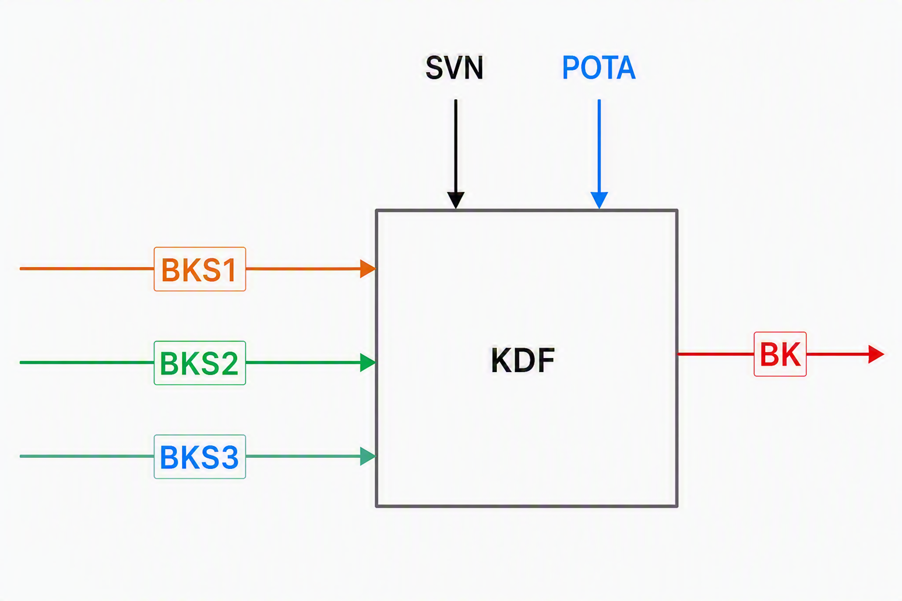
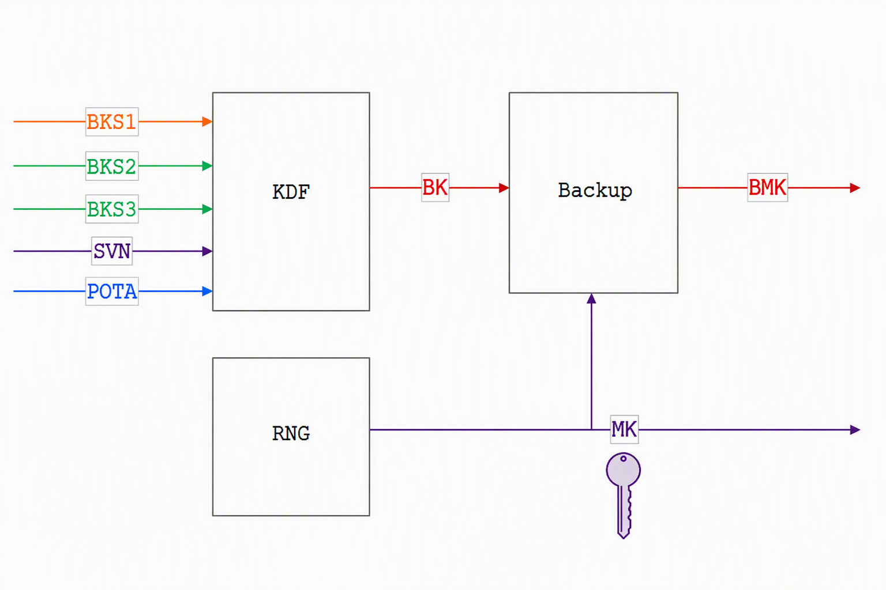
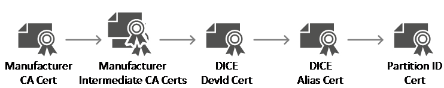
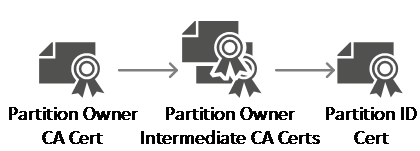
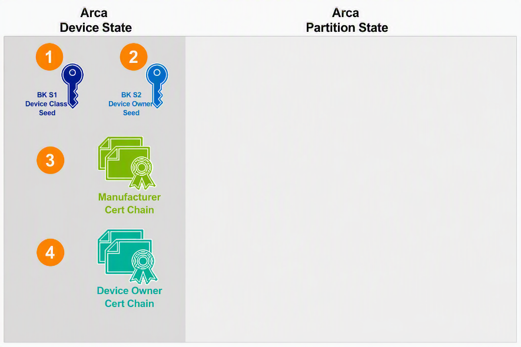
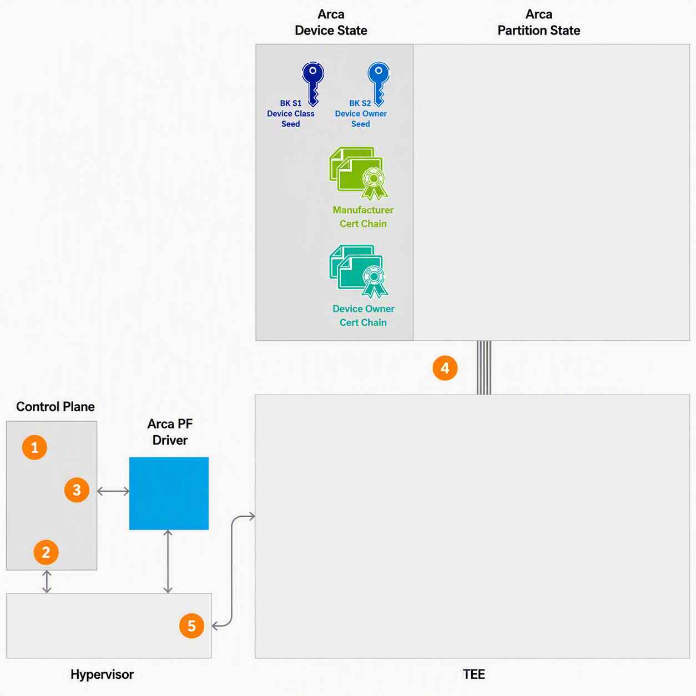
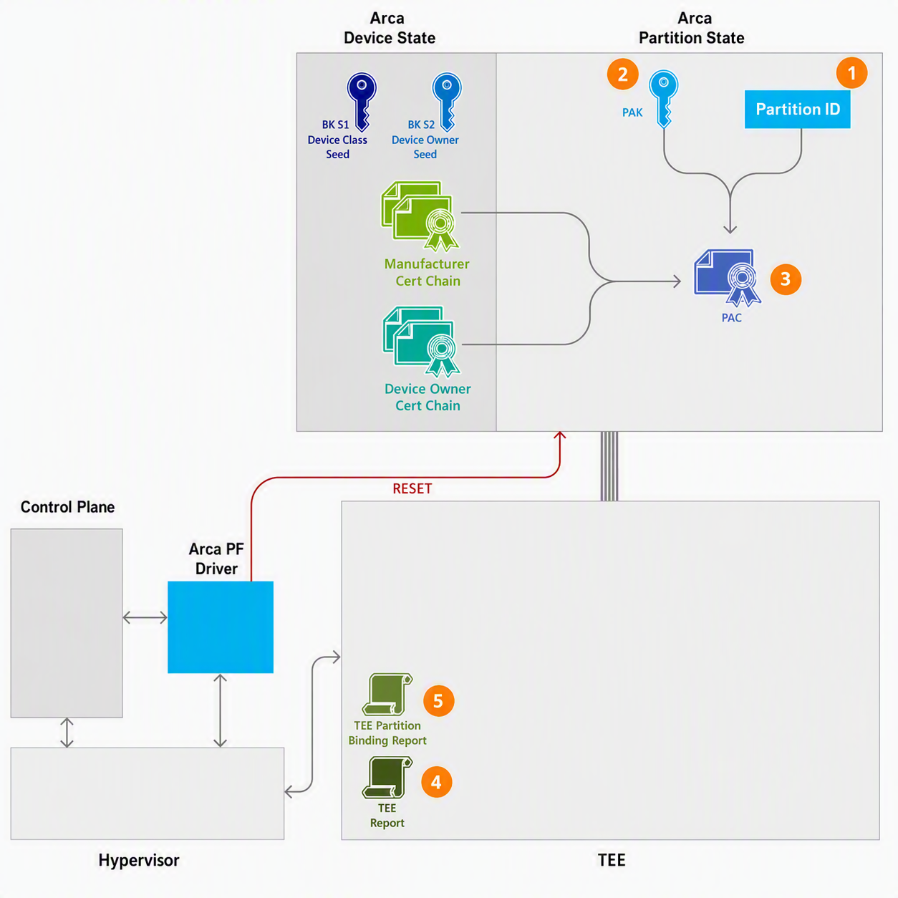
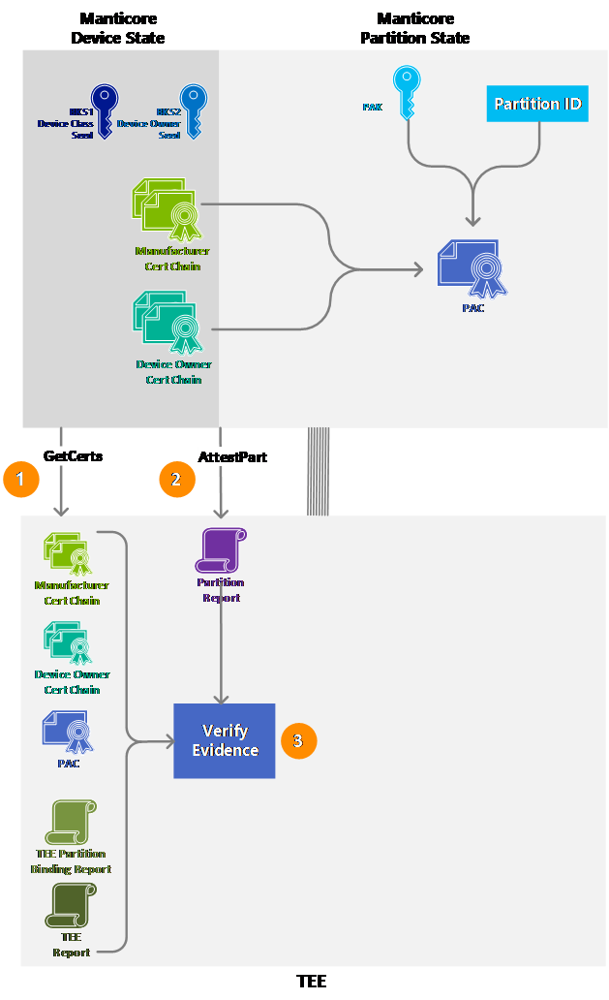
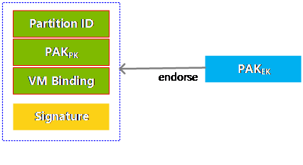

Arca – Integrated HSM

Sealing Service Primitives

0.3.0

Author: Bryan Kelly

Author: Vishal Soni

# Version History

Versions and revisions are made to this document and logged here. Errata is a separate document such that the contribution specification document it refers to was not revised. In alignment with Open Compute documentation, the version numbering for revisions follows <major>.<minor>.<errata>

|  |  |  |  |
| --- | --- | --- | --- |
| **Date** | **Version #** | **Author** | **Description** |
| 01/10/2025 | 0.1.0 | Bryan Kelly | Initial base derived from Azure Integrated HSM Sealing Service |
| 04/10/2026 | 0.3.0 | Bryan Kelly | Port to Arca and refine general flows. |
|  |  |  |  |
|  |  |  |  |
|  |  |  |  |
|  |  |  |  |

Contents

[1 Version History 2](#version-history)

[2 Introduction 4](#introduction)

[3 Concepts 4](#concepts)

[3.1 Backup Key 4](#backup-key)

[3.2 Masking Key 5](#masking-key)

[3.3 Partition 6](#partition)

[3.4 Security Domain 8](#security-domain)

[4 Architecture 10](#architecture)

[4.1 Partition & TEE Initial Setup 10](#partition-tee-initial-setup)

[4.1.1 Provisioned Device State 10](#provisioned-device-state)

[4.1.2 TEE Creation & Device Assignment 11](#tee-creation-device-assignment)

[4.1.3 TEE & Partition State after Boot 12](#tee-partition-state-after-boot)

[4.1.4 Initial Attestation 14](#initial-attestation)

[4.2 Sealing Service 16](#sealing-service)

Arca – Primitives for Sealing Services

# Introduction

Sealing is a critical capability that allows applications to securely save and restore their cryptographic secrets inside a HSM. This functionality is especially important during application bootstrap and recovery processes. For applications bound to dedicated hardware, local sealing using a unique platform secret is sufficient for robust resilience. For highly distributed applications that fail over onto different hardware, their resilience may need recovery to occur across different systems under their control. In these types of distributed systems, a HSM backed remote sealing mechanism can securely orchestrate the recovery process.

To facilitate remote recovery, a remote sealing service can verify the target system satisfies the configuration and attestation policy that was specified at the time the HSM partition configuration secrets were originally sealed. This ensures that only authorized entities can recover the encrypted data.

Unlike other keying services, the Sealing service is designed to be straightforward and stateless with respect to individual applications. It does not retain any application-specific information. Its sole responsibility is to manage sealing primitives and policy.

# Concepts

## Backup Key

The backup key methodology in Arca devices employs a structured approach involving two-part and three-part Backup Key Seeds (BKS). These seeds are essential components that contribute to the derivation of the final Backup Key, ensuring that backups are securely managed and can only be restored under appropriate conditions.

**BKS1: Device Class Seed**

This seed is controlled by both the manufacturer and operator and is shared across all devices belonging to the same class. The primary role of the Device Class seed is to guarantee that backups can only be restored to devices that are of the same type and produced by the same manufacturer and operated by the same operator. This restricts backup restoration to compatible hardware and helps maintain device integrity.

**BKS2: Device Owner Seed**

Provisioned into each device owned by a specific Arca owner, the Device Owner seed allows backups to be restored to any device under the same service or enterprise ownership. This ensures that only devices managed by the same owner can participate in the restoration process, further enhancing security by limiting restoration to both primitives BKS1 + BKS2.

**BKS3: Partition Owner Seed**

This seed adds an additional layer of restriction by enabling backup restoration only to devices that meet three criteria: they must be manufactured by the same entity, owned by the same device owner, and have a partition established under the same ownership. This multi-faceted requirement provides granular control over backup restoration, safeguarding partition-level secrets.

The Backup Key (BK) is derived using a cryptographic key derivation function that combines some asymmetric owner trust anchor keys described later and the seeds from BKS1, BKS2, and BKS3. This process ensures that the resulting key is unique to the specific device, owner, and partition, thereby maintaining the confidentiality and integrity of backups.

Additionally, the SVN (Secure Version Number) is incorporated into the derivation process. This design enables a hash-stick based construction, which allows older backup keys to be derived on Arca devices with newer SVN. However, it is important to note that it is not cryptographically possible to derive newer backup keys on Arca devices with older SVN. This ensures forward security and prevents unauthorized restoration using outdated device states.

Figure 1Backup Key Derivation

## Masking Key

The Masking Key (MK) is automatically generated within an Arca partition during partition configuration, after Partition Trust Anchor has been provisioned. The MK is only generated once POTA as been established, it’s primary function is to encrypt keys, resulting in Masked Key Objects that can be stored in durable storage. The MK is a highly privileged key, but its use is strictly limited to partitions that share the same ownership. This restriction enforces security boundaries and ensures that key usage remains confined to trusted environments.

To support renewability and lifecycle management, the Masking Key is versioned. Each partition attests to the versions of its Masking Key and consistently utilizes the most current Masking Key when creating new Masked Key Objects. This approach enables secure key rotation and renewal within the partition.

The Backup Key (BK) plays a crucial role in the secure backup of the Masking Key. Specifically, the BK is used to mask the Masking Key, resulting in the creation of a backed-up Masking Key (BMK). This process ensures that the MK can be securely stored and later restored.

Secure transfer of the Masking Key between HSMs relies on partition-cloning protocols that protect its confidentiality and integrity throughout the transfer, preventing unauthorized access or exposure.

Figure 2 Masking Key Derivation

## Partition

A partition represents a logical slice of a Arca device that is assigned to an individual service instance. In the context of Arca devices, the smallest assignable unit is a PCIe Virtual Function. Every time a VM boots and the partition resets, it creates a new random Partition ID and asymmetric key pair. This ephemeral nature of both the Partition ID and the key pair ensures that any cryptographic material bound to the partition can be automatically revoked, enhancing overall security.

Partitions can also be owned by services running within VMs. Establishing ownership over a partition is a two-step process:

**Partition ID Certificate Signing Request (CSR)**

The tenant or service that seeks to assert ownership of the partition initiates the process by requesting a Certificate Signing Request (CSR) for the Partition ID key. The Arca device responds to this request by generating a self-signed CSR using the Partition ID Key Pair.

**Partition Owner Trust Anchor and Partition ID Certificate Provisioning:**

Once the tenant or service obtains the Partition ID CSR, it presents this CSR to a Certification Authority, which issues a Partition ID Certificate and the corresponding Partition Owner chain. These credentials—the Partition ID Certificate and the Partition Owner chain—are then submitted back to the Arca device. The device verifies the validity of the Partition ID Certificate against the Partition Owner chain. Upon successful verification, the device extracts the signing authority's public key from the certificate chain. This public key is then designated as the Partition Owner Trust Anchor (POTA).

When a partition on a Arca device is fully initialized and ownership has been established, it contains several critical components that collectively define its identity and security posture. The following outlines each component and its role within the partition:

**Partition ID**

The Partition ID is generated by sampling the cryptographic entropy source within the device, ensuring a high degree of randomness and uniqueness. This identifier serves as the primary identity for the partition. It is embedded within the Subject Name or Subject Alternate Name fields of the X509 Certificate Signing Request (CSR) and any certificates subsequently issued for the partition.

**Partition ID Key Pair**

Associated with the Partition ID, the Partition ID Key Pair is an asymmetric key pair. Its primary function is to provide endorsement for the Partition ID, thereby enabling secure identity assertions. Additionally, this key pair is used to endorse both the partition and key attestation reports, supporting the integrity and trustworthiness of the partition’s cryptographic operations.

**Partition Owner Trust Anchor (POTA)**

Once an enterprise or service has established ownership of a partition through the partition ownership process, the Partition Owner Trust Anchor (POTA) key information is copied from the Partition ID certificate. This trust anchor is stored directly within the partition and used as known label information in the internal KDFs. The only way to establish POTA in an Arca device is to issue the Partition Owner Authentication Certificate over the Partition ID during partition configuration. The main role of the POTA is to guarantee that security domains are instantiated only on the correct owner authorized Arca devices.

**Manufacturer Certificate Chain**

The Manufacturer Certificate Chain includes the TCG Dice Certificate, which provides endorsement for the Partition ID. This certificate chain is securely stored on the device and serves as foundational evidence of the device’s manufacturing integrity and authenticity.

Figure 3 Manufacturer Certificate Chain

**Device Owner Certificate Chain**

The Device Owner Certificate Chain is used to further endorse the Partition ID. This chain is also stored on the device, adding another layer of attestation for the partition’s identity and its association with the device owner.

Figure 4 Device Owner Certificate Chain

**Partition Owner Certificate Chain**

The Partition Owner Certificate Chain serves to endorse the Partition ID from the perspective of the partition owner. In practice, this certificate chain may be stored within the virtual machine (VM) that is attached to the Arca device. As a part of the partition ownership verification process, the Partition ID certificate is validated, and the corresponding POTA is retained within the device.

Figure 5 Partition Owner Certificate Chain

**Security Domain ID**

Only one Security Domain can be instantiated on a particular partition at any given time. During the instantiation process, this Security Domain is established within the partition, and the resulting Security Domain ID becomes uniquely associated with that partition. This association ensures that the identity and security context of the partition are clearly defined and traceable within the system.

Services that operate within a virtual machine (VM) connected to a Arca Partition have the capability to request a Partition Attestation Report. This report is a crucial component in verifying the integrity and attributes of the partition. It is formally endorsed by the Partition ID Key, providing a trusted basis for its authenticity.

The Partition Attestation Report contains a comprehensive set of claims detailing all relevant properties of the partition. Specifically, it includes the Partition ID, which uniquely identifies the partition within the system, as well as the Partition ID Public Key, used for cryptographic verification. Additionally, the report provides information about the Partition Owner Trust Anchor (POTA) and the Security Domain ID, establishing both the ownership and security context for the partition. This structured approach ensures that all critical aspects of the partition's identity and security are clearly communicated and can be independently validated.

## Security Domain

A Security Domain is an abstraction designed to allow multiple partitions, all owned by the same Partition Owner (POTA), to efficiently share both a Partition Owner's Seed (BKS3) and the Masking Key (MK). Through this mechanism, Security Domains make it possible to share masked keys across multiple instances of Arca devices, provided they are associated with the same partition owner.

The lifecycle of a Security Domain involves a one-time process of bootstrapping and backup. Once a Security Domain has been bootstrapped, it can be instantiated on any number of Arca instances that share the same Owner hierarchy as the Security Domain itself. Upon instantiation, all these instances will possess the same BKS3 and MK. As a result, they gain the ability to unmask keys that were created by other Arca instances where the same Security Domain is loaded, thus enabling secure and efficient key sharing within the scope of the partition owner’s domain.

**Sealing Authority**

Bootstrapping a Security Domain is a critical step that necessitates the involvement of a Sealing Authority. The primary purpose of the Sealing Authority is to take encrypted backup of the Security Domain's key material, specifically the BKS3 (the Partition Owner's Seed). In this context, the Sealing Authority functions as an HPKE (Hybrid Public Key Encryption) Public Key.

During the bootstrapping process, the security domain is sealed utilizing the HPKE sealing primitively. This ensures that the sensitive key material associated with the security domain remains protected and can only be accessed by authorized entities with the corresponding decryption capability. By leveraging HPKE, the system benefits from standardized and robust cryptographic practices, providing both confidentiality and integrity for the security domain during its creation and transfer.

**Bootstrapping Security Domain**

Bootstrapping a Security Domain is a critical operation that requires both a Sealing Authority and a POTA Public Key. This process must always be performed on a Arca Partition that possesses the same BKS1 and BKS2 values as the service whose security domain is being established. Upon successful completion of the bootstrap procedure, an encrypted state of the security domain is generated. The security domain state comprises of sealed randomly generated Security Domain ID, BKS3, BMK and Sealing Authority.

This encrypted security domain can then be instantiated on any Arca instance that shares the same POTA as the security domain itself. The Trusted Execution Environment (TEE) associated with a virtual machine (VM) may impose additional restrictions on which Arca device is authorized to bootstrap the Security Domain.

**Instantiating a Security Domain**

Security Domain can be instantiated on any Arca Partition that wields the same POTA as the security domain. However, depending on whether the Sealing Authority is offline or online different procedures must be followed:

**Security Domain backed up with Online Sealing Authority**

When using an online Sealing Authority, all instances of the security domain can be instantiated directly from the backup. This process is accomplished by re-encrypting the security domain state to a KEK derived in a HPKE flow that verifies the POTA issued POAC of the target Arca device. As a result, new service instances can be provisioned efficiently and securely, ensuring rapid deployment while maintaining the confidentiality and integrity of the security domain data.

**Instantiating a Security Domain from Local Backup**

Once a security domain has been successfully instantiated, the Arca device can generate a local encrypted backup of that security domain. This backup is securely bound to both the Arca Unique Device Secret (UDS) and a unique binding factor produced by the CPU for the Confidential Computing Trusted Execution Environment that incorporates TEE measurements. The cryptographic binding ensures that the backup remains tightly coupled with the CVM and the specific Arca Partition attached to it. Importantly, the security domain can be instantiated locally from this backup without requiring any communication with external services. This capability is essential for minimizing service downtime during system boot cycles and for supporting rapid recovery following data center power failures.

# Architecture

## Partition & TEE Initial Setup

### Provisioned Device State

Arca devices have volatile and non-volatile state applied during the device life cycle. The device state is required to ensure proper operation within the deployed environment. Certain device state is established during the manufacturing process, operator onboarding process, and infrastructure deployment. The following outlines the minimal set of device state necessary for Arca devices:

Figure 7Provisioned Device State

**1. BKS1 – Device Seed**

The Device Seed is provisioned into the device during manufacturing and operator onboarding. This multi-part seed is installed in such a manner that it remains accessible solely by the Caliptra security processor hardware, ensuring that no other component can retrieve its plain text form. While firmware facilitates the initial process, it is never allowed to directly access the seed itself in an unencrypted format.

**2. BKS2 – Device Owner Seed**

The Device Owner Seed (BKS2) is securely provisioned into the device during the process of establishing device ownership. The owner provisioning process is designed to accommodate different operational environments. Specifically, distinct BKS2 seeds can be applied to various environments and locations. This approach ensures that the cryptographic materials derived from the BKS2 seed are strictly confined to their respective enterprise or cloud environments.

**3. Manufacturer Certificate Chain**

The IDevID certificate chain is provisioned by the device manufacturer during the manufacturing process. This certificate chain serves as a foundational layer of trust for Arca devices and is integral to the device’s overall security architecture. Once installed, the manufacturer certificate chain generally remains unchanged throughout the device's operational lifetime, providing a stable and consistent basis for anchoring attestation claims and cryptographic operations.

**4. Device Ownership Transfer (DoT) Certificate Chain**

The Device Owner certificate chain is provisioned by the device owner and serves as an important element in the overall security and trust model of the device. The device owner certificate chain has the flexibility to be rotated or replaced during the operational lifetime of the device. Rotation or change of the certificate chain may occur, particularly in scenarios where devices are moved between different cloud environments. This capability ensures that the security and trust boundaries are maintained as devices transition across operational domains, thereby supporting the continued protection of customer workloads and sensitive data.

### TEE Creation & Device Assignment

As part of the TEE creation process, the Arca PCIe Virtual Function (VF) is allocated directly to the TEE. This assignment is achieved by employing the hypervisor's PCIe direct device assignment facility, ensuring that the TEE has dedicated access to the Arca PCIe VF for secure and isolated operations.

Figure 8 TEE Creation & Device Assignment

This section outlines the process for creating a TEE with an assigned Arca Partition, detailing the roles and actions of the Control Plane (CP) agent and the configuration steps involved.

**Step 1: Initiation of TEE Creation Request**

The process begins when the CP agent receives a request to create a TEE that includes an Arca Partition. The creation policy associated with the TEE type defines specific resource allocations, such as key storage capacity and cryptographic operations, that must be provisioned within the Arca Partition.

**Step 2: TEE Creation Using Hypervisor API**

To fulfill the creation policy requirements, the CP agent uses the Hypervisor API to create a TEE with the necessary configuration. This includes specifying the number of virtual processors (VPs), the amount of memory, and other relevant resources to ensure the VM meets operational standards.

**Step 3: Partition Selection and Configuration**

Once the TEE configuration is determined, the CP agent identifies an available Arca Partition, also referred to as a Virtual Function. The agent then configures this partition with the resources defined by the container policy, ensuring that the partition is tailored to the TEE’s needs for secure key storage and cryptographic capacity.

**Step 4: Direct Assignment of Partition to TEE**

After configuring the Arca Partition, the CP agent uses the Hypervisor API to directly assign the partition to the TEE. This direct assignment leverages dedicated device assignment capabilities, providing the TEE with exclusive access to the partition for secure and isolated operations.

**Step 5: TEE Launch**

With the Arca Partition successfully assigned, the CP agent proceeds to launch the TEE. At this point, the TEE is fully operational, benefiting from the enhanced security and isolation provided by the dedicated Arca Partition.

### TEE & Partition State after Boot

Arca Partition is always cleared and reset at TEE boot. Resetting the partition clears all workload generated state including keys. This ephemeral property of the Arca Partition guarantees the state created by the workload never survives a reboot.

After a reset, the partition & TEE has following state:

Figure 9 Partition & TEE State after Boot

**1.Partition ID**

The Partition ID serves as a unique identifier for the partition. It is regenerated every time the TEE reboots, ensuring that each session has a distinct identity. The Partition ID is a 16-byte value, sampled from a cryptographically secure random source for enhanced security. This identifier is represented within the Subject Name field of the Partition Identity Certificate, providing a direct link between the partition and its cryptographic credentials.

**2. Partition Authentication Key Pair (PAK)**

Alongside the Partition ID, a corresponding Partition ID Key Pair is generated. This key pair consists of asymmetric keys produced using the ECC-384 algorithm, which offers robust cryptographic strength. The Partition ID Key Pair is also regenerated at each TEE reboot, maintaining the ephemeral nature of the partition’s security state. This key pair is primarily utilized for self-endorsing Certificate Signing Requests (CSRs) related to the Partition ID and for signing attestation reports, thereby supporting secure operations and authenticity verification.

**3. Partition Authentication Certificate (PAC)**

The Partition ID X.509 Certificate provides cryptographic proof of the association between the Partition ID and the Partition ID Key Pair. This certificate is regenerated every time the TEE reboots, mirroring the lifecycle of the other partition identity components. The Partition ID Certificate is endorsed by the Alias Key within the Device Owner Certificate chain, establishing trust and integrity for partition-based cryptographic operations.

**4. TEE Report**

TEE Report is a cryptographic process that proves a Trusted Execution Environment (TEE) is running on genuine hardware with verified software. It enables secure provisioning of secrets and trust in remote systems. TEE report comes in different formats based on the TEE:

Hardware based Trusted Execution Environments are a foundational element in confidential computing, offering hardware-enforced isolation from operator control plane services. One of the primary advantages of hardware-based TEEs is that they achieve this isolation without necessitating any modifications to existing application code, ensuring seamless integration for sensitive workloads requiring enhanced security. The evidence report associated with the TEE is generated by the CPU firmware and validated through hardware-issued certificates. This report contains critical information regarding the TEE configuration, providing assurance that the environment is protected and operating as intended.

**5. TEE Partition Binding Report**

The TEE Partition Binding Report delivers cryptographic proof that a specific partition is securely bound to the TEE. This evidence is critical for verifying the integrity and authenticity of the partition within the TEE context.

**TEE Binding**: For TEE’s such as confidential virtual machines, the Arca Partition functions as a TDISP device. TDISP, introduced by PCI-SIG, defines standard rules to secure the connection between a TEE’s and secure peripheral devices during. In this environment, binding evidence between the TEE and the partition is produced by the CPU in collaboration with the Arca Device. The attestation reports contain Trusted Computing Base (TCB) measurements of the partition's firmware (TCB Info) and properties documented in the TDISP Device Interface report. The CPU is responsible for cryptographically linking the TDISP report with the TEE Report, thereby establishing an inseparable trustworthy binding between the partition and the TEE.

### Initial Attestation

The initial attestation process is a critical sequence designed to establish trust between the Trusted Execution Environment (TEE) and the partition before any security-sensitive operations are performed. This process is comprised of several well-defined steps that ensure both the authenticity and integrity of the components involved.

Figure 10 Initial Partition Attestation

**Step 1: Retrieve Device Certificates**

The TEE begins by retrieving a set of certificates that serve as the foundation for trust. These include the Manufacturer Certificate Chain, the Device Owner Certificate Chain, and the Partition Authentication Certificate (PAC). The TEE collects these certificates directly from within the TEE environment, ensuring the source and authenticity of each credential.

**Step 2: Retrieve Partition Attestation Report**

Next, the TEE initiates a request for the partition to generate a Partition Attestation Report. This report is cryptographically endorsed using the PAK Private Key, providing assurance that the report comes from the expected partition. The TEE can utilize the PAC to verify that the attestation report was indeed generated by the partition, as the PAC serves as the certification for the PAK.

Figure 11 Partition Report at Partition Reset

**Step 3: Verify Evidence**

Finally, the TEE proceeds to verify the collected evidence by combining its own attestation reports with the data received from the partition. The verification process involves several key checks:

1. Ensuring that both the Manufacturer Certificate Chain and the Device Owner Certificate Chain are valid X.509 certificate chains.
2. Confirming that the PAC is a properly formed X.509 certificate.
3. Verifying that the PAC is explicitly endorsed by the Manufacturer Certificate Chain and the Device Owner Certificate Chain.
4. Checking that the Partition Attestation Report is endorsed by the PAK. Since the PAC certifies the PAK, the Subject Public Key Info field in the PAC can be used to confirm that the attestation report was indeed endorsed by the correct PAK.

## Sealing Service

The Sealing Service serves as the cornerstone of durable security services within a distributed environment. In the runtime state, a secure sealing service must function autonomously, maintaining both self-governance and self-healing capabilities. However, in practice, the initial bootstrap process for the Sealing Service necessitates a one-time (T0) audit, from that juncture forward all other updates are transparently recorded on a confidential ledger such as “Azure Confidential Ledger”.