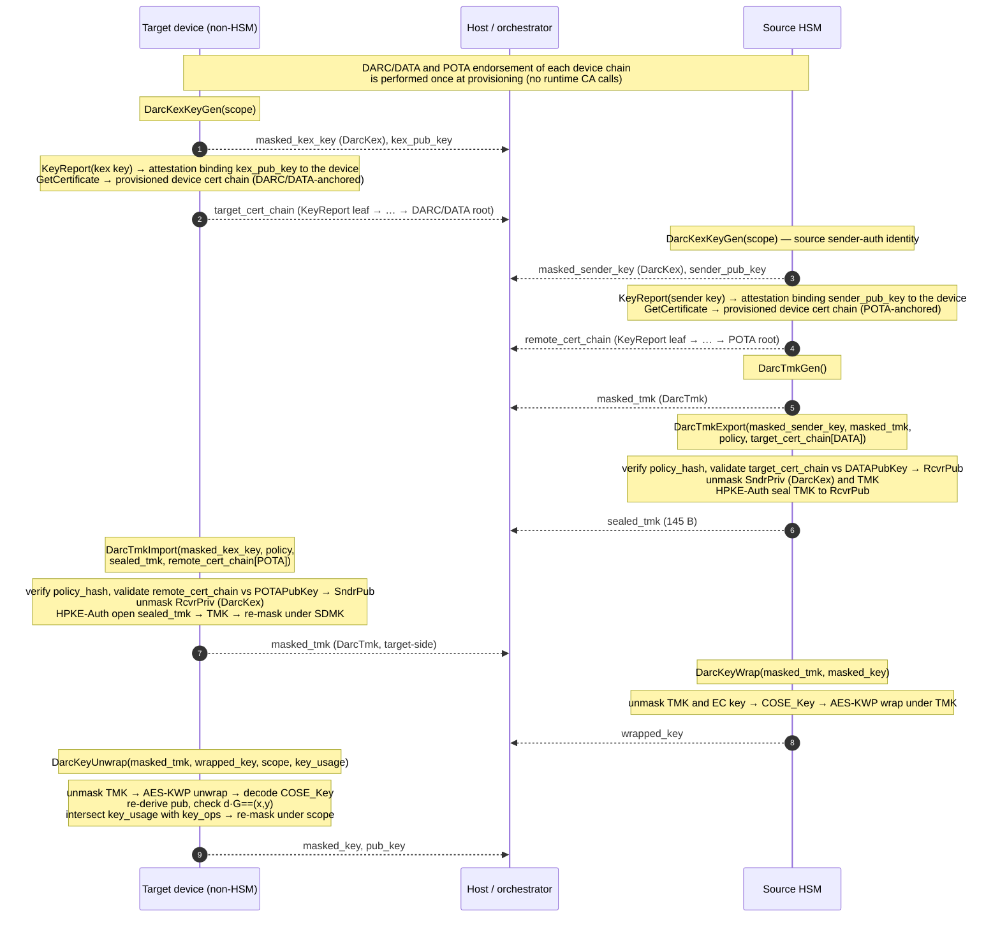

Tessera – Integrated HSM

DARC — Device Authentication Root Certificate

0.1.0


# Acknowledgements

The Contributors of this Specification:

|  |  |
| --- | --- |
| **Name** | **Company** |
| Bryan Kelly | Microsoft |
| Chandra Shekhar Reddy | Marvell |
| Craig Barner | Marvell |
| Jayant Gandhi | Microsoft |
| Mohan Kumar | Oracle |
| Vishal Soni | Microsoft |


# Version History

Versions and revisions are made to this document and logged here. Errata is a separate document such that the contribution specification document it refers to was not revised. In alignment with Open Compute documentation, the version numbering for revisions follows `<major>.<minor>.<errata>`.

| **Date** | **Version #** | **Author** | **Description** |
| --- | --- | --- | --- |
| 09/13/2026 | 0.1.0 | Craig Barner, Chandra Shekhar Reddy, Vishal Soni | Initial DARC architecture, realigned from the legacy LS2/Tiger DARC draft to the Tessera HPKE-Auth transfer model and the implemented `Darc*` command set (opcodes `0x20`–`0x25`). |

## Table of Contents

- [Overview](#darc-overview)
  - [Purpose](#darc-purpose)
  - [Scope](#darc-scope)
  - [Terminology](#darc-terminology)
  - [Conventions](#darc-conventions)
- [Part I — Architecture](#darc-part-i)
  - [Motivation](#darc-motivation)
  - [Trust Model and Roles](#darc-trust-model)
  - [Trust Anchors and Mutual Authentication](#darc-trust-anchors)
  - [DARC Provisioning and the Device Certificate Chain](#darc-provisioning)
  - [Key Hierarchy](#darc-key-hierarchy)
  - [Preconditions](#darc-preconditions)
- [Part II — Protocol Flow](#darc-part-ii)
  - [Command Summary](#darc-command-summary)
  - [End-to-End Sequence](#darc-sequence)
  - [Phase 1 — Target Key-Exchange Key Generation](#darc-phase-1)
  - [Phase 2 — TMK Origination](#darc-phase-2)
  - [Phase 3 — TMK Export and Seal](#darc-phase-3)
  - [Phase 4 — TMK Import](#darc-phase-4)
  - [Phase 5 — Key Wrap](#darc-phase-5)
  - [Phase 6 — Key Unwrap and Install](#darc-phase-6)
- [Part III — Policy, Lifecycle, and Security](#darc-part-iii)
  - [Transfer Policy and Key Restrictions](#darc-policy)
  - [TMK Properties and Domain Separation](#darc-tmk-props)
  - [Masked-Key Handling and Zeroization](#darc-zeroization)
  - [Trust-Anchor Lifecycle](#darc-lifecycle)
  - [Cryptographic Profile and FIPS](#darc-fips)
  - [Replay and Mutual-Authentication Guarantees](#darc-replay)
  - [Audit](#darc-audit)
- [Open Items](#darc-open-items)

---

<a id="darc-overview"></a>

## Overview

<a id="darc-purpose"></a>

### Purpose

The **Device Authentication Root Certificate (DARC)** is the trust anchor that authenticates a remote **target device that is a HSM of a different type, make, model or manufacturer** — for example, an Tessera workload-attached Integrated HSM, Tessera conformant device with matching certifications, or a device interface of an Tessera conformant device, before the **source HSM** releases a special private masking key. This specification defines the DARC-anchored protocol by which the key is moved as a protected object between two authenticated hardware boundaries, **never exposed in extractable plaintext form** to any intervening software.

DARC is the device-level, single-key counterpart to the partition-level [Masking Key Transfer Protocol](Tessera%20-%20Transfer%20Masking%20Key%20Protocol.md). Masking Key transfer *expands* a Security Domain by cloning a partition's Masking Key across peer HSM partitions. DARC deliberately does **not** expand the source Masking Key domain: it transports one designated key under an ephemeral **Transfer Masking Key (TMK)**, so that compromise of a target device cannot reveal the source partition's Masked Key Objects.

<a id="darc-scope"></a>

### Scope

This specification covers:

- The DARC trust model: the source HSM and target device roles, and the trust anchors that authenticate them.
- The **TMK** and its relationship to the DARC trust anchors and the partition Security Domain.
- The **key-exchange (KEX) key** used as the HPKE receiver identity on the target.
- The end-to-end protocol phases and the [`Darc*` commands](#darc-command-summary) (opcodes `0x20`–`0x25`) that realize them.
- Transfer policy, key restrictions, trust-anchor lifecycle, and security considerations.

This specification does **not** cover:

- The TBOR wire framing, DDI headers, or per-command TOC layout — see the [Tessera Command Specification](Tessera%20-%20Command%20Specification.md), which specifies the request and response body of every `Darc*` command.
- Partition provisioning, session establishment, and Security Domain creation — see the Command Specification and the [Masking Key Transfer Protocol](Tessera%20-%20Transfer%20Masking%20Key%20Protocol.md).
- The transport layer between host and device. DARC is transport-agnostic.

<a id="darc-terminology"></a>

### Terminology

Terms shared with the [Masking Key Transfer Protocol](Tessera%20-%20Transfer%20Masking%20Key%20Protocol.md) (HPKE, AOAC, Masked Key Object, runtime attestation) retain their meaning there. The Masking Key Transfer Protocol's **DRAC** (Device *Root* Authentication Certificate) and this specification's **DARC** (Device *Authentication Root* Certificate) name the same operator-issued device-root trust anchor (**DARC ≡ DRAC**); this specification uses **DARC** throughout. DARC-specific terms:

| Term | Meaning |
| --- | --- |
| **Source HSM** | The Tessera-conformant HSM partition that owns the key to be transferred. It mints, seals, and wraps under the TMK. Runs [`DarcTmkGen`](#darc-phase-2), [`DarcTmkExport`](#darc-phase-3), and [`DarcKeyWrap`](#darc-phase-5). |
| **Target device** | The remote, non-full-HSM endpoint receiving the key into volatile, masked form inside its own security boundary. Runs [`DarcKexKeyGen`](#darc-phase-1), [`DarcTmkImport`](#darc-phase-4), and [`DarcKeyUnwrap`](#darc-phase-6). |
| **DARC** | Device Authentication Root Certificate (≡ the Masking Key Transfer Protocol's **DRAC**). The root certificate / trust anchor that authenticates the **target device** (its identity and ownership) to the source HSM. In Tessera it is expressed as a policy-bound trust anchor public key, `DATAPubKey` (see **DATA**), against which the target's certificate chain is validated. |
| **DATA** | Device Authentication Trust Anchor. The Tessera policy-bound public key (`DATAPubKey`) form of the **DARC**: it roots the certificate chain that authenticates the **target device**. |
| **POTA** | Partition Owner Trust Anchor. The trust anchor (`POTAPubKey`) rooting the certificate chain that authenticates the **source HSM partition**. |
| **TMK** | **Transfer Masking Key**. A fresh 256-bit AES key that protects the transferred key under AES-KWP. Ephemeral to the transfer, Security-Domain-scoped, and distinct from the partition Masking Key. |
| **KEX key** | **DARC key-exchange key**. A P-384 ECDH keypair generated on an endpoint (via [`DarcKexKeyGen`](#darc-phase-1)) and used as the HPKE receiver (target) / sender-auth (source) identity when sealing the TMK. Held as a `DarcKex`-kind Masked Key Object; never persisted in the clear. |
| **Masked Key Object** | An on-device key returned to the host as an AEAD-GCM-256 masked blob (unmask-on-use). DARC keys (`DarcKex`, `DarcTmk`, and the transferred user key) are all returned masked; nothing is stored in the device vault. |
| **SDMK** | **Security-Domain Masking Key**. The masking key provisioned by Security-Domain setup, under which the TMK is masked on both endpoints. |
| **`COSE_Key`** | The RFC 9052 EC2 key encoding used as the plaintext key representation inside the TMK-wrapped payload, so key attributes travel with the key material. |

<a id="darc-conventions"></a>

### Conventions

The key words "MUST", "MUST NOT", "REQUIRED", "SHALL", "SHALL NOT", "SHOULD", "SHOULD NOT", "RECOMMENDED", "MAY", and "OPTIONAL" are to be interpreted as described in [RFC 2119](https://www.rfc-editor.org/rfc/rfc2119).

All DARC commands are **Crypto-Officer-only** and execute **in-session** against an `Initialized` partition whose Security Domain is initialized. Opcode and wire details are normative in the [Command Specification](Tessera%20-%20Command%20Specification.md).

---

<a id="darc-part-i"></a>

## Part I — Architecture

<a id="darc-motivation"></a>

### Motivation

Workload-attached and accelerator-class devices increasingly need to operate on private keys that originate in a central HSM, without those keys leaving a hardware-rooted boundary. The legacy Masking Key cloning protocol assumes both endpoints are peer HSM partitions carrying the same manufacturer certificate chain; a HSM devices from different manufacturers cannot satisfy that assumption, and traditional key export (`CKA_EXTRACTABLE`) sacrifices the very attribute enforcement HSMs exist to provide.

DARC provides a cryptographically authenticated path for a source HSM to (1) verify the identity and ownership of a remote target device **before** releasing any key, and (2) release exactly one designated key, protected under a dedicated TMK, such that the target installs it into its own masked-key protection domain with all source-defined attributes preserved. The source Masking Key is never shared, so the blast radius of a target compromise is a single transferred key rather than an entire Security Domain.

<a id="darc-trust-model"></a>

### Trust Model and Roles

DARC is a two-party protocol between a **source HSM** (key origin) and a **target device** (key recipient). The Tessera reference implementation ships **both** halves of the protocol as TBOR DDI commands so that an Tessera device (or the simulator) can act as either endpoint; the two command sets are the symmetric source-side and target-side halves of one protocol:

| Role | Endpoint | DARC commands it executes |
| --- | --- | --- |
| **Source** | HSM partition holding the key | [`DarcTmkGen`](#darc-phase-2) (`0x23`), [`DarcTmkExport`](#darc-phase-3) (`0x24`), [`DarcKeyWrap`](#darc-phase-5) (`0x25`) |
| **Target** | Non-full-HSM device | [`DarcKexKeyGen`](#darc-phase-1) (`0x20`), [`DarcTmkImport`](#darc-phase-4) (`0x21`), [`DarcKeyUnwrap`](#darc-phase-6) (`0x22`) |

Authorization is an **intersection**, not a single check: device authenticity, device ownership, partition ownership, policy binding, and key-attribute permission all contribute. A pass at one layer never compensates for a failure at another.

<a id="darc-trust-anchors"></a>

### Trust Anchors and Mutual Authentication

DARC binds two independent certificate-chain trust anchors, both carried in the partition **policy** and pinned to the partition's bound `policy_hash` (`SHA-384(policy)`):

- **DATA (`DATAPubKey`) authenticates the target.** `DATAPubKey` is the policy-bound public-key form of the target's **DARC** (Device Authentication Root Certificate). When the source seals the TMK, it validates the **target's** certificate chain against `DATAPubKey` and recovers the target's KEX public key as the HPKE receiver key. A target whose chain does not anchor to an enabled DARC/DATA is refused before any key is disclosed.
- **POTA (`POTAPubKey`) authenticates the source.** When the target imports the TMK, it validates the **source's** certificate chain against `POTAPubKey` and recovers the source's HPKE sender public key used for HPKE-Auth verification.

This yields **mutual authentication**: the source proves the target is a DATA-endorsed device before release, and the target proves the source is a POTA-endorsed partition before installation. Because the TMK is sealed with **HPKE in Auth mode**, a successful open simultaneously proves receiver possession of the KEX private key and sender possession of the authenticated source key — detecting unknown-key-share, endpoint confusion, and role confusion.

<a id="darc-provisioning"></a>

### DARC Provisioning and the Device Certificate Chain

DARC does not introduce a parallel PKI: it is layered onto the existing Caliptra DICE identity chain that every Tessera device already carries (see the [Deployment Models](Tessera%20%E2%80%93%20Deployment%20Models.md) specification). The target's DARC key-transfer certificate chain — the `target_cert_chain` the source validates in [`DarcTmkExport`](#darc-phase-3) — is an endorsement path from the target's KEX key up to the DARC root.

#### The Caliptra identity chain

Caliptra is the root of trust for all Tessera devices and provisions a DICE identity chain during manufacturing and onboarding:

```
Manufacturer CA ── IDevID ── LDevID ── FMC Alias ── … ── KEX-key endorsement (leaf)
   (manufacturer)  (device)  (operator) (Tessera owner)        (DARC key-exchange key)
```

- **IDevID** — the manufacturer-rooted device identity (IEEE 802.1AR IDevID over the Caliptra-generated `IDevK`). It provides device authenticity but is bound to the manufacturer's CA.
- **LDevID** — the Caliptra Locally-significant Device Identifier: an operator-controlled device identity issued over the device identity key, so authenticity can be asserted under an operator-controlled domain rather than the manufacturer CA.
- **FMC Alias** — the firmware-measured alias key (the AOAC / Tessera-owner endorsement point); subsequent alias/leaf certificates chain from it and carry the current measured firmware state.

IDevID and LDevID remain **distinct** and are never treated as interchangeable: IDevID is the manufacturer authentication certificate; LDevID expresses operator endorsement.

#### The DARC endorsement over LDevID

The **DARC** is the operator-issued **Device Authentication Root Certificate** that endorses the device's **LDevID** certificate chain. It is provisioned during device onboarding, after the LDevID field entropy is programmed:

1. **Manufacturing** provisions Caliptra `IDevK` and the `Manufacturer CA → IDevID` certificate; the manufacturer certificate chain is stored on the device and generally immutable for its lifetime.
2. **Onboarding** derives the operator LDevID. The device produces an LDevID CSR (self-endorsed via the Caliptra DICE chain), which the operator's **DARC trust anchor** signs, issuing a DARC-endorsed certificate over the LDevID. The DARC can therefore be *substituted for the LDevID* in DARC protocol exchanges, letting the operator control device authenticity across a fleet without depending on the manufacturer CA.
3. The **DARC public key** is registered on the **source HSM** as the policy-bound `DATAPubKey` (see [Trust Anchors](#darc-trust-anchors)), pinned by the partition `policy_hash`. This is the anchor the source validates the target chain against.
4. Per transfer campaign, the target's **DARC key-exchange key** ([`DarcKexKeyGen`](#darc-phase-1)) is endorsed by a leaf certificate that chains — through the FMC Alias / LDevID DICE certificates — back to the DARC root. The leaf's subject public key is the target's KEX public key, which the source recovers as the HPKE receiver key `RcvrPub`.

#### Chain validation during transfer

When the source runs [`DarcTmkExport`](#darc-phase-3), it validates `target_cert_chain` as a standard X.509 path terminating at `DATAPubKey` (the DARC root), and additionally binds the current device state carried by the FMC-Alias / DICE certificates (measured firmware, SVN) to the transfer-policy expectations. Only after the chain validates to the DARC anchor does the source recover `RcvrPub` and seal the TMK to it. A target whose KEX-key chain does not terminate at an enabled DARC/`DATAPubKey`, or whose alias certificates fail the policy's state constraints, is refused before any key material is disclosed.

The source's own sender chain is the mirror image: the source partition's HPKE sender key is endorsed by a chain terminating at the **POTA** (`POTAPubKey`) that the target validates in [`DarcTmkImport`](#darc-phase-4).

<a id="darc-key-hierarchy"></a>

### Key Hierarchy

| Key | Type | Lifetime | Protection at rest | Kind |
| --- | --- | --- | --- | --- |
| KEX key | P-384 ECDH keypair | Per transfer campaign | Masked under a partition masking key (`Ephemeral`/`Local` scope) | `DarcKex` |
| TMK | AES-256 | Ephemeral to the transfer | Masked under the SDMK | `DarcTmk` |
| Transferred key | EC private key (P-256/384/521) | Installed on target | Source: read from a Masked Key Object; Target: re-masked under the requested scope | `Ecc{256,384,521}Private` |

None of these keys is written to the device vault by any DARC command; each is returned as a Masked Key Object and re-imported (unmask-on-use) when next needed. Consequently no DARC command records a rollback on the undo log.

The transferred key travels inside the TMK-wrapped payload as an **EC2 `COSE_Key`** in private form (`kty`, `kid`, `alg`, `key_ops`, `crv`, and big-endian `x`/`y`/`d`). The `alg` is fixed by curve to the non-deprecated ESP family (P-256 → ESP256, P-384 → ESP384, P-521 → ESP512) and `key_ops` is derived from the source key's own vault attributes, so **usage and algorithm attributes are transported with the key** and re-enforced on the target.

<a id="darc-preconditions"></a>

### Preconditions

Before any DARC operation on either endpoint:

1. The partition is in the `Initialized` lifecycle state (`PartFinal` completed), and its Security Domain is initialized (the SDMK is provisioned).
2. The calling session is **Active** and holds the **Crypto-Officer** role; a Crypto-User session is rejected with `InvalidPermissions`.
3. The partition `policy` supplied to import/export hashes to the bound `policy_hash` and carries the required `POTAPubKey` / `DATAPubKey` anchor.

---

<a id="darc-part-ii"></a>

## Part II — Protocol Flow

<a id="darc-command-summary"></a>

### Command Summary

| Opcode | Command | Role | Consumes | Produces |
| --- | --- | --- | --- | --- |
| `0x20` | `DarcKexKeyGen` | Target | `scope` | masked KEX key (`DarcKex`), KEX public key |
| `0x23` | `DarcTmkGen` | Source | — | masked TMK (`DarcTmk`) |
| `0x24` | `DarcTmkExport` | Source | masked sender KEX key, masked TMK, policy, **target** cert chain (DATA) | `sealed_tmk` |
| `0x21` | `DarcTmkImport` | Target | masked KEX key, policy, `sealed_tmk`, **source** cert chain (POTA) | masked TMK (`DarcTmk`) |
| `0x25` | `DarcKeyWrap` | Source | masked TMK, masked EC key | `wrapped_key` |
| `0x22` | `DarcKeyUnwrap` | Target | masked TMK, `wrapped_key`, `scope`, `key_usage` | masked EC key, public key |

The source's own KEX key (its HPKE sender-auth identity) is likewise produced by `DarcKexKeyGen` on the source and certified under a POTA-anchored chain; the target's KEX key is certified under a DATA-anchored chain. A minted TMK (`DarcTmkGen`) and an imported TMK (`DarcTmkImport`) emit a **byte-identical** masked envelope and are interchangeable in later commands.

<a id="darc-sequence"></a>

### End-to-End Sequence



<a id="darc-phase-1"></a>

### Phase 1 — Target Key-Exchange Key Generation

The target generates a fresh P-384 KEX keypair with [`DarcKexKeyGen`](Tessera%20-%20Command%20Specification.md#cmd-darc_kex_key_gen). The private half is returned only as a `DarcKex`-kind Masked Key Object (`derive`-only, `local`, `private`, never-extractable, scope `Ephemeral`/`Local`); the public half is exported so it can be attested and delivered to the source. There is **no runtime call to the DARC/DATA CA** — the device chain was endorsed once at provisioning ([DARC Provisioning](#darc-provisioning)). At transfer time the target assembles its **DATA**-anchored `target_cert_chain` on-device from [`KeyReport`](Tessera%20-%20Command%20Specification.md#cmd-key_report) (attesting `kex_pub_key` to the device) and [`GetCertificate`](Tessera%20-%20Command%20Specification.md#cmd-get_cert) (the provisioned device certificate chain). The source performs the mirror-image step to obtain its own KEX key and assemble its **POTA**-anchored `remote_cert_chain` the same way.

<a id="darc-phase-2"></a>

### Phase 2 — TMK Origination

The source mints a fresh 256-bit TMK with [`DarcTmkGen`](Tessera%20-%20Command%20Specification.md#cmd-darc_tmk_gen). The raw TMK is drawn from the device RNG, masked under the SDMK, and returned as a `DarcTmk` Masked Key Object; the plaintext TMK is zeroized on every path. A new TMK SHALL be originated per transfer campaign and SHALL NOT be reused across unrelated targets.

<a id="darc-phase-3"></a>

### Phase 3 — TMK Export and Seal

The source seals the TMK to the authenticated target with [`DarcTmkExport`](Tessera%20-%20Command%20Specification.md#cmd-darc_tmk_export). The handler verifies `SHA-384(policy)` against the bound `policy_hash`, validates `target_cert_chain` against the policy `DATAPubKey` to recover the target's KEX public key (`RcvrPub`), unmasks the source's own KEX key to `SndrPriv`, unmasks the TMK, and produces `sealed_tmk` as an **HPKE-Auth** seal of the 32-byte TMK to `RcvrPub` with sender authentication `SndrPriv`. `SndrPriv` and the TMK are zeroized on every path.

<a id="darc-phase-4"></a>

### Phase 4 — TMK Import

The target opens the sealed TMK with [`DarcTmkImport`](Tessera%20-%20Command%20Specification.md#cmd-darc_tmk_import). The handler verifies the `policy_hash`, validates `remote_cert_chain` against the policy `POTAPubKey` to recover the source's HPKE sender public key (`SndrPub`), unmasks its own KEX key to `RcvrPriv`, HPKE-Auth-opens `sealed_tmk` (`sk_r = RcvrPriv`, sender-auth `SndrPub`) to recover the 32-byte TMK, and re-masks it under the SDMK as a `DarcTmk` Masked Key Object. `RcvrPriv` and the TMK are zeroized on every path. After this phase both endpoints hold the same TMK, each masked under its own SDMK.

<a id="darc-phase-5"></a>

### Phase 5 — Key Wrap

The source exports the designated key with [`DarcKeyWrap`](Tessera%20-%20Command%20Specification.md#cmd-darc_key_wrap). The handler unmasks the TMK and the local masked EC private key, converts the vault scalar to the big-endian COSE `d`, re-derives the public point, encodes an EC2 private `COSE_Key` (its `key_ops` from the key's vault attributes, `alg` from the curve, `kid` from the key's label), and **AES-KWP** (RFC 5649) wraps the `COSE_Key` under the TMK to produce `wrapped_key`. Only P-256/P-384/P-521 EC private keys are supported. Every recovered secret — TMK, vault scalar, big-endian `d`, and `COSE_Key` plaintext — is zeroized on every path.

<a id="darc-phase-6"></a>

### Phase 6 — Key Unwrap and Install

The target installs the key with [`DarcKeyUnwrap`](Tessera%20-%20Command%20Specification.md#cmd-darc_key_unwrap). The handler unmasks the TMK, AES-KWP-unwraps `wrapped_key` to the `COSE_Key` plaintext, decodes it (rejecting deprecated `alg` identifiers), re-derives the public key and enforces `d·G == (x, y)`, intersects the requested `key_usage` with the transported `key_ops` (empty/ambiguous → `InvalidPermissions`), and re-masks the recovered private key under the requested `scope`'s masking key, returning the Masked Key Object and its wire public key. The installed key thereby inherits the source-defined usage restrictions and lives only in the target's masked-key domain.

---

<a id="darc-part-iii"></a>

## Part III — Policy, Lifecycle, and Security

<a id="darc-policy"></a>

### Transfer Policy and Key Restrictions

- A partition whose policy carries no enabled **DATA** anchor SHALL NOT export a TMK: `DarcTmkExport` refuses a target chain that does not anchor to `DATAPubKey`.
- The source SHALL reject any target certificate chain that is missing, malformed, or not DATA-anchored, and any `policy` whose `SHA-384` does not equal the bound `policy_hash`.
- DARC places **no source-side eligibility restriction** on which keys may be transferred: any key may be released, and its full set of PKCS#11 attributes travels with it. The transported `COSE_Key` faithfully encodes those attributes (as `key_ops`, `alg`, etc.), and the target re-masks the key preserving them.
- The transfer is **single-key and directional**: each `DarcKeyWrap`/`DarcKeyUnwrap` pair moves exactly one key and does not expand the source Masking Key domain.

<a id="darc-tmk-props"></a>

### TMK Properties and Domain Separation

- The TMK is **AES-256** and is used only as the AES-KWP key-encryption key for transferred keys.
- The TMK SHALL be Security-Domain-scoped, masked under the SDMK, and SHALL NOT be derived from or related to the partition Masking Key. Compromise of a TMK therefore cannot affect partition-to-partition Masking Key synchronization, and vice versa.
- The TMK is never stored in the clear and never written to the vault; it exists only as a Masked Key Object between operations and as a transient plaintext within a single handler invocation.

<a id="darc-zeroization"></a>

### Masked-Key Handling and Zeroization

Every DARC handler recovers secrets into transient buffers and zeroizes them on **every** exit path, including error paths: KEX private keys, the TMK, the big-endian private scalar `d`, and the `COSE_Key` plaintext. Masked blobs decrypted in place during unmasking are scrubbed after use. Only non-secret values (public keys, `kid` labels) survive a handler. Secret scrubbing uses a volatile wipe so the store cannot be elided by the optimizer.

<a id="darc-lifecycle"></a>

### Trust-Anchor Lifecycle

DATA and POTA anchors are carried in the partition policy and pinned by `policy_hash`; rotating an anchor is a policy change that re-binds `policy_hash`. To retire a compromised or expired anchor:

1. Publish policy carrying the replacement anchor and re-bind `policy_hash`.
2. Cease accepting chains under the retired anchor (subsequent import/export against the old policy fail the `policy_hash` check).
3. Treat keys transferred under a compromised anchor as potentially exposed and re-transfer them under a fresh TMK.

Because the TMK is ephemeral to the transfer, revocation does not require TMK escrow; a new campaign starts from Phase 1 with fresh KEX keys and a fresh TMK.

<a id="darc-fips"></a>

### Cryptographic Profile and FIPS

| Function | Algorithm |
| --- | --- |
| KEX key | ECDH P-384 |
| TMK seal | HPKE (Auth mode), P-384 DHKEM, HKDF-SHA-384, AES-256-GCM |
| Key wrap | AES Key Wrap with Padding (RFC 5649) under the AES-256 TMK |
| Key encoding | EC2 `COSE_Key`, ESP256/384/512 by curve |
| Masked Key Object | AEAD-GCM-256 under the scope masking key / SDMK |
| Policy binding | SHA-384 |

All TMK derivation, sealing, and wrapping operations occur inside the device FIPS boundary. Hybrid/PQC HPKE profiles follow the negotiation and binding rules of the [Masking Key Transfer Protocol](Tessera%20-%20Transfer%20Masking%20Key%20Protocol.md); a downgrade that strips a PQC component SHALL cause key confirmation (the authenticated HPKE open) to fail.

<a id="darc-replay"></a>

### Replay and Mutual-Authentication Guarantees

The HPKE-Auth seal binds the transfer to both endpoints' KEX identities; an attacker cannot substitute a receiver (it lacks `RcvrPriv`) or forge the sender (it lacks the POTA-endorsed sender key). Certificate-chain validation against the policy-pinned DATA/POTA anchors prevents a mis-owned or unauthenticated device from participating. Because the TMK and KEX keys are fresh per campaign, a captured `sealed_tmk` or `wrapped_key` cannot be replayed into a different campaign.

<a id="darc-audit"></a>

### Audit

Consistent with the [Masking Key Transfer Protocol](Tessera%20-%20Transfer%20Masking%20Key%20Protocol.md) audit model, DARC operations SHOULD emit audit records for: KEX key generation, TMK origination, TMK export/seal (with target DATA chain digest), TMK import (with source POTA chain digest), key wrap, and key unwrap/install (with key identifier and result). Records exclude plaintext keys, the TMK, HPKE exporter secrets, and unprotected Masked Key Objects.

---

<a id="darc-open-items"></a>

## Open Items

| # | Item | Status |
| --- | --- | --- |
| 1 | Define the EKU/OID profile for DATA-anchored target device certificates and POTA-anchored source partition certificates. | Open |
| 2 | Extend `DarcKeyWrap`/`DarcKeyUnwrap` beyond EC private keys (e.g. RSA, symmetric) as `COSE_Key`/`COSE` payloads. | Open |
| 3 | Decide the trust-store model: whether a partition may hold multiple enabled **DATA (DARC)** anchors with runtime add/enable/disable/rotate management (the legacy TEKC "Trusted External Key Cache" analogue), or remains the single policy-bound `DATAPubKey` re-bound via `policy_hash`. | Open |
| 4 | Define revocation propagation to the target: signalling to terminate in-flight campaigns and re-transfer keys when a DATA/POTA anchor is retired (the legacy DARC-revocation-notification item). | Open |
| 5 | Pin the normative PQC/hybrid HPKE-Auth profile for DARC (e.g. ML-KEM + P-384/P-521 DHKEM) and a partition control that *requires* hybrid KEX. | Open |
| 6 | Define the normative mapping between the transported COSE `key_ops`/`alg` and source key attributes (PKCS#11 `CKA_*` / AKV JWK), so open-format attributes round-trip losslessly. | Open |
