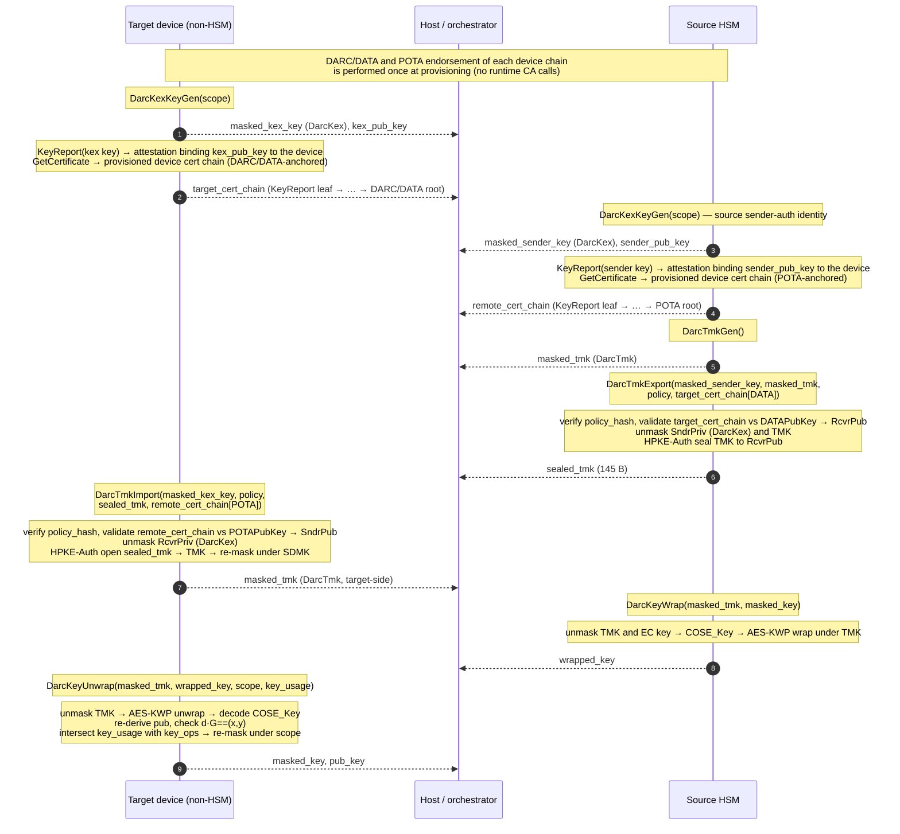

Tessera – Integrated HSM

DARC — Device Authentication Root Certificate

0.1.0


# Acknowledgements

The Contributors of this Specification:

|  |  |
| --- | --- |
| **Name** | **Company** |
| Bryan Kelly | Microsoft |
| Chandra Shekhar Reddy | Marvell |
| Craig Barner | Marvell |
| Jayant Gandhi | Microsoft |
| Mohan Kumar | Oracle |
| Vishal Soni | Microsoft |


# Version History

Versions and revisions are made to this document and logged here. Errata is a separate document such that the contribution specification document it refers to was not revised. In alignment with Open Compute documentation, the version numbering for revisions follows `<major>.<minor>.<errata>`.

| **Date** | **Version #** | **Author** | **Description** |
| --- | --- | --- | --- |
| 09/13/2026 | 0.1.0 | Craig Barner, Chandra Shekhar Reddy, Vishal Soni | Initial DARC architecture, realigned from the legacy LS2/Tiger DARC draft to the Tessera HPKE-Auth transfer model and the implemented `Darc*` command set (opcodes `0x20`–`0x25`). |

## Table of Contents

- [Overview](#darc-overview)
  - [Purpose](#darc-purpose)
  - [Scope](#darc-scope)
  - [Terminology](#darc-terminology)
  - [Conventions](#darc-conventions)
- [Part I — Architecture](#darc-part-i)
  - [Motivation](#darc-motivation)
  - [Trust Model and Roles](#darc-trust-model)
  - [Trust Anchors and Mutual Authentication](#darc-trust-anchors)
  - [DARC Provisioning and the Device Certificate Chain](#darc-provisioning)
  - [Key Hierarchy](#darc-key-hierarchy)
  - [Preconditions](#darc-preconditions)
- [Part II — Protocol Flow](#darc-part-ii)
  - [Command Summary](#darc-command-summary)
  - [End-to-End Sequence](#darc-sequence)
  - [Phase 1 — Target Key-Exchange Key Generation](#darc-phase-1)
  - [Phase 2 — TMK Origination](#darc-phase-2)
  - [Phase 3 — TMK Export and Seal](#darc-phase-3)
  - [Phase 4 — TMK Import](#darc-phase-4)
  - [Phase 5 — Key Wrap](#darc-phase-5)
  - [Phase 6 — Key Unwrap and Install](#darc-phase-6)
- [Part III — General Key Format](#darc-key-format)
  - [Profile Scope and Compatibility](#darc-key-fidelity)
  - [CBOR Object Structure](#darc-key-encoding)
  - [PKCS #11 Attribute Representation](#darc-key-pkcs11)
  - [Supported Attributes](#darc-key-supported-attrs)
  - [Unsupported Attributes](#darc-key-unsupported-attrs)
  - [Key Material and Algorithm Coverage](#darc-key-material)
  - [Identifiers and Labels](#darc-key-identifiers)
  - [Source Attributes and Target Semantics](#darc-key-mapping)
  - [Validation and Installation](#darc-key-validation)
  - [Format References](#darc-key-references)
- [Part IV — Policy, Lifecycle, and Security](#darc-part-iv)
  - [Transfer Policy and Key Restrictions](#darc-policy)
  - [TMK Properties and Domain Separation](#darc-tmk-props)
  - [Masked-Key Handling and Zeroization](#darc-zeroization)
  - [Trust-Anchor Lifecycle](#darc-lifecycle)
  - [Cryptographic Profile and FIPS](#darc-fips)
  - [Replay and Mutual-Authentication Guarantees](#darc-replay)
  - [Audit](#darc-audit)
- [Open Items](#darc-open-items)

---

<a id="darc-overview"></a>

## Overview

<a id="darc-purpose"></a>

### Purpose

The **Device Authentication Root Certificate (DARC)** is the trust anchor that authenticates a remote **target device that is a HSM of a different type, make, model or manufacturer** — for example, an Tessera workload-attached Integrated HSM, Tessera conformant device with matching certifications, or a device interface of an Tessera conformant device, before the **source HSM** releases a special private masking key. This specification defines the DARC-anchored protocol by which the key is moved as a protected object between two authenticated hardware boundaries, **never exposed in extractable plaintext form** to any intervening software.

DARC is the device-level, single-key counterpart to the partition-level [Masking Key Transfer Protocol](Tessera%20-%20Transfer%20Masking%20Key%20Protocol.md). Masking Key transfer *expands* a Security Domain by cloning a partition's Masking Key across peer HSM partitions. DARC deliberately does **not** expand the source Masking Key domain: it transports one designated key under an ephemeral **Transfer Masking Key (TMK)**, so that compromise of a target device cannot reveal the source partition's Masked Key Objects.

<a id="darc-scope"></a>

### Scope

This specification covers:

- The DARC trust model: the source HSM and target device roles, and the trust anchors that authenticate them.
- The **TMK** and its relationship to the DARC trust anchors and the partition Security Domain.
- The **key-exchange (KEX) key** used as the HPKE receiver identity on the target.
- The end-to-end protocol phases and the [`Darc*` commands](#darc-command-summary) (opcodes `0x20`–`0x25`) that realize them.
- A versioned CBOR key object preserving PKCS #11 key material, attributes, and restrictions without reducing them to COSE algorithm and operation identifiers.
- Transfer policy, key restrictions, trust-anchor lifecycle, and security considerations.

The [general key format](#darc-key-format) defines a new payload profile, not a claim that it is implemented by current endpoints. The current Command Specification limits `DarcKeyWrap`/`DarcKeyUnwrap` to EC private keys serialized as `COSE_Key`, with a 512-byte wrapped payload. The new PKCS #11 format requires an explicitly selected command profile and sufficient buffer limits before use; it MUST NOT be sent to an endpoint that supports only the existing EC profile. This document does not change command wire layouts or introduce a COSE message envelope.

This specification does **not** cover:

- The TBOR wire framing, DDI headers, or per-command TOC layout — see the [Tessera Command Specification](Tessera%20-%20Command%20Specification.md), which specifies the request and response body of every `Darc*` command.
- Partition provisioning, session establishment, and Security Domain creation — see the Command Specification and the [Masking Key Transfer Protocol](Tessera%20-%20Transfer%20Masking%20Key%20Protocol.md).
- The transport layer between host and device. DARC is transport-agnostic.

<a id="darc-terminology"></a>

### Terminology

Terms shared with the [Masking Key Transfer Protocol](Tessera%20-%20Transfer%20Masking%20Key%20Protocol.md) (HPKE, AOAC, Masked Key Object, runtime attestation) retain their meaning there. The Masking Key Transfer Protocol's **DRAC** (Device *Root* Authentication Certificate) and this specification's **DARC** (Device *Authentication Root* Certificate) name the same operator-issued device-root trust anchor (**DARC ≡ DRAC**); this specification uses **DARC** throughout. DARC-specific terms:

| Term | Meaning |
| --- | --- |
| **Source HSM** | The Tessera-conformant HSM partition that owns the key to be transferred. It mints, seals, and wraps under the TMK. Runs [`DarcTmkGen`](#darc-phase-2), [`DarcTmkExport`](#darc-phase-3), and [`DarcKeyWrap`](#darc-phase-5). |
| **Target device** | The remote, non-full-HSM endpoint receiving the key into volatile, masked form inside its own security boundary. Runs [`DarcKexKeyGen`](#darc-phase-1), [`DarcTmkImport`](#darc-phase-4), and [`DarcKeyUnwrap`](#darc-phase-6). |
| **DARC** | Device Authentication Root Certificate (≡ the Masking Key Transfer Protocol's **DRAC**). The root certificate / trust anchor that authenticates the **target device** (its identity and ownership) to the source HSM. In Tessera it is expressed as a policy-bound trust anchor public key, `DATAPubKey` (see **DATA**), against which the target's certificate chain is validated. |
| **DATA** | Device Authentication Trust Anchor. The Tessera policy-bound public key (`DATAPubKey`) form of the **DARC**: it roots the certificate chain that authenticates the **target device**. |
| **POTA** | Partition Owner Trust Anchor. The trust anchor (`POTAPubKey`) rooting the certificate chain that authenticates the **source HSM partition**. |
| **TMK** | **Transfer Masking Key**. A fresh 256-bit AES key that protects the transferred key under AES-KWP. Ephemeral to the transfer, Security-Domain-scoped, and distinct from the partition Masking Key. |
| **KEX key** | **DARC key-exchange key**. A P-384 ECDH keypair generated on an endpoint (via [`DarcKexKeyGen`](#darc-phase-1)) and used as the HPKE receiver (target) / sender-auth (source) identity when sealing the TMK. Held as a `DarcKex`-kind Masked Key Object; never persisted in the clear. |
| **Masked Key Object** | An on-device key returned to the host as an AEAD-GCM-256 masked blob (unmask-on-use). DARC keys (`DarcKex`, `DarcTmk`, and the transferred user key) are all returned masked; nothing is stored in the device vault. |
| **SDMK** | **Security-Domain Masking Key**. The masking key provisioned by Security-Domain setup, under which the TMK is masked on both endpoints. |
| **DARC Key Object** | The versioned [CBOR key representation](#darc-key-format) preserving one PKCS #11 key object, including its material and attributes, inside the TMK-wrapped payload. It is not a `COSE_Key` or a COSE message. |
| **PKCS #11 record** | A typed source-object snapshot interpreted under its identified PKCS #11 version and any applicable vendor schema. |

<a id="darc-conventions"></a>

### Conventions

The key words "MUST", "MUST NOT", "REQUIRED", "SHALL", "SHALL NOT", "SHOULD", "SHOULD NOT", "RECOMMENDED", "MAY", and "OPTIONAL" are to be interpreted as described in [RFC 2119](https://www.rfc-editor.org/rfc/rfc2119).

All DARC commands are **Crypto-Officer-only** and execute **in-session** against an `Initialized` partition whose Security Domain is initialized. Opcode and wire details are normative in the [Command Specification](Tessera%20-%20Command%20Specification.md).

---

<a id="darc-part-i"></a>

## Part I — Architecture

<a id="darc-motivation"></a>

### Motivation

Workload-attached and accelerator-class devices increasingly need to operate on private keys that originate in a central HSM, without those keys leaving a hardware-rooted boundary. The legacy Masking Key cloning protocol assumes both endpoints are peer HSM partitions carrying the same manufacturer certificate chain; a HSM devices from different manufacturers cannot satisfy that assumption, and traditional key export (`CKA_EXTRACTABLE`) sacrifices the very attribute enforcement HSMs exist to provide.

DARC provides a cryptographically authenticated path for a source HSM to (1) verify the identity and ownership of a remote target device **before** releasing any key, and (2) release exactly one designated key, protected under a dedicated TMK, such that the target installs it into its own masked-key protection domain with all source-defined restrictions preserved. The source Masking Key is never shared, so the blast radius of a target compromise is a single transferred key rather than an entire Security Domain.

<a id="darc-trust-model"></a>

### Trust Model and Roles

DARC is a two-party protocol between a **source HSM** (key origin) and a **target device** (key recipient). The Tessera reference implementation ships **both** halves of the protocol as TBOR DDI commands so that an Tessera device (or the simulator) can act as either endpoint; the two command sets are the symmetric source-side and target-side halves of one protocol:

| Role | Endpoint | DARC commands it executes |
| --- | --- | --- |
| **Source** | HSM partition holding the key | [`DarcTmkGen`](#darc-phase-2) (`0x23`), [`DarcTmkExport`](#darc-phase-3) (`0x24`), [`DarcKeyWrap`](#darc-phase-5) (`0x25`) |
| **Target** | Non-full-HSM device | [`DarcKexKeyGen`](#darc-phase-1) (`0x20`), [`DarcTmkImport`](#darc-phase-4) (`0x21`), [`DarcKeyUnwrap`](#darc-phase-6) (`0x22`) |

Authorization is an **intersection**, not a single check: device authenticity, device ownership, partition ownership, policy binding, and key-attribute permission all contribute. A pass at one layer never compensates for a failure at another.

<a id="darc-trust-anchors"></a>

### Trust Anchors and Mutual Authentication

DARC binds two independent certificate-chain trust anchors, both carried in the partition **policy** and pinned to the partition's bound `policy_hash` (`SHA-384(policy)`):

- **DATA (`DATAPubKey`) authenticates the target.** `DATAPubKey` is the policy-bound public-key form of the target's **DARC** (Device Authentication Root Certificate). When the source seals the TMK, it validates the **target's** certificate chain against `DATAPubKey` and recovers the target's KEX public key as the HPKE receiver key. A target whose chain does not anchor to an enabled DARC/DATA is refused before any key is disclosed.
- **POTA (`POTAPubKey`) authenticates the source.** When the target imports the TMK, it validates the **source's** certificate chain against `POTAPubKey` and recovers the source's HPKE sender public key used for HPKE-Auth verification.

This yields **mutual authentication**: the source proves the target is a DATA-endorsed device before release, and the target proves the source is a POTA-endorsed partition before installation. Because the TMK is sealed with **HPKE in Auth mode**, a successful open simultaneously proves receiver possession of the KEX private key and sender possession of the authenticated source key — detecting unknown-key-share, endpoint confusion, and role confusion.

<a id="darc-provisioning"></a>

### DARC Provisioning and the Device Certificate Chain

DARC does not introduce a parallel PKI: it is layered onto the existing Caliptra DICE identity chain that every Tessera device already carries (see the [Deployment Models](Tessera%20%E2%80%93%20Deployment%20Models.md) specification). The target's DARC key-transfer certificate chain — the `target_cert_chain` the source validates in [`DarcTmkExport`](#darc-phase-3) — is an endorsement path from the target's KEX key up to the DARC root.

#### The Caliptra identity chain

Caliptra is the root of trust for all Tessera devices and provisions a DICE identity chain during manufacturing and onboarding:

```
Manufacturer CA ── IDevID ── LDevID ── FMC Alias ── … ── KEX-key endorsement (leaf)
   (manufacturer)  (device)  (operator) (Tessera owner)        (DARC key-exchange key)
```

- **IDevID** — the manufacturer-rooted device identity (IEEE 802.1AR IDevID over the Caliptra-generated `IDevK`). It provides device authenticity but is bound to the manufacturer's CA.
- **LDevID** — the Caliptra Locally-significant Device Identifier: an operator-controlled device identity issued over the device identity key, so authenticity can be asserted under an operator-controlled domain rather than the manufacturer CA.
- **FMC Alias** — the firmware-measured alias key (the AOAC / Tessera-owner endorsement point); subsequent alias/leaf certificates chain from it and carry the current measured firmware state.

IDevID and LDevID remain **distinct** and are never treated as interchangeable: IDevID is the manufacturer authentication certificate; LDevID expresses operator endorsement.

#### The DARC endorsement over LDevID

The **DARC** is the operator-issued **Device Authentication Root Certificate** that endorses the device's **LDevID** certificate chain. It is provisioned during device onboarding, after the LDevID field entropy is programmed:

1. **Manufacturing** provisions Caliptra `IDevK` and the `Manufacturer CA → IDevID` certificate; the manufacturer certificate chain is stored on the device and generally immutable for its lifetime.
2. **Onboarding** derives the operator LDevID. The device produces an LDevID CSR (self-endorsed via the Caliptra DICE chain), which the operator's **DARC trust anchor** signs, issuing a DARC-endorsed certificate over the LDevID. The DARC can therefore be *substituted for the LDevID* in DARC protocol exchanges, letting the operator control device authenticity across a fleet without depending on the manufacturer CA.
3. The **DARC public key** is registered on the **source HSM** as the policy-bound `DATAPubKey` (see [Trust Anchors](#darc-trust-anchors)), pinned by the partition `policy_hash`. This is the anchor the source validates the target chain against.
4. Per transfer campaign, the target's **DARC key-exchange key** ([`DarcKexKeyGen`](#darc-phase-1)) is endorsed by a leaf certificate that chains — through the FMC Alias / LDevID DICE certificates — back to the DARC root. The leaf's subject public key is the target's KEX public key, which the source recovers as the HPKE receiver key `RcvrPub`.

#### Chain validation during transfer

When the source runs [`DarcTmkExport`](#darc-phase-3), it validates `target_cert_chain` as a standard X.509 path terminating at `DATAPubKey` (the DARC root), and additionally binds the current device state carried by the FMC-Alias / DICE certificates (measured firmware, SVN) to the transfer-policy expectations. Only after the chain validates to the DARC anchor does the source recover `RcvrPub` and seal the TMK to it. A target whose KEX-key chain does not terminate at an enabled DARC/`DATAPubKey`, or whose alias certificates fail the policy's state constraints, is refused before any key material is disclosed.

The source's own sender chain is the mirror image: the source partition's HPKE sender key is endorsed by a chain terminating at the **POTA** (`POTAPubKey`) that the target validates in [`DarcTmkImport`](#darc-phase-4).

<a id="darc-key-hierarchy"></a>

### Key Hierarchy

| Key | Type | Lifetime | Protection at rest | Kind |
| --- | --- | --- | --- | --- |
| KEX key | P-384 ECDH keypair | Per transfer campaign | Masked under a partition masking key (`Ephemeral`/`Local` scope) | `DarcKex` |
| TMK | AES-256 | Ephemeral to the transfer | Masked under the SDMK | `DarcTmk` |
| Transferred key | A native public, private, or secret key conforming to [Part III](#darc-part-iii); current commands support EC private keys (P-256/384/521) | Installed on target | Source: read from a Masked Key Object; Target: material, source record, and effective restrictions protected under the requested scope | Current commands: `Ecc{256,384,521}Private`; other kinds require command support |

None of these keys is written to the device vault by any DARC command; each is returned as a Masked Key Object and re-imported (unmask-on-use) when next needed. Consequently no DARC command records a rollback on the undo log.

In the new format, the transferred key travels inside the TMK-wrapped payload as a **DARC Key Object** containing its native material and supported source attributes. Key types, operation flags, identifiers, and supported metadata retain their PKCS #11 types and meanings; they are not collapsed into a single COSE `alg` or `key_ops`. Templates and allowed-mechanism lists are outside this profile; a key requiring those restrictions cannot be transferred by silently omitting them. The target MUST preserve the supported source record and enforce its applicable restrictions together with local policy. The existing command profile remains an EC2 private `COSE_Key` with ESP256/384/512 selected by curve; it MUST NOT be confused with the new format.

<a id="darc-preconditions"></a>

### Preconditions

Before any DARC operation on either endpoint:

1. The partition is in the `Initialized` lifecycle state (`PartFinal` completed), and its Security Domain is initialized (the SDMK is provisioned).
2. The calling session is **Active** and holds the **Crypto-Officer** role; a Crypto-User session is rejected with `InvalidPermissions`.
3. The partition `policy` supplied to import/export hashes to the bound `policy_hash` and carries the required `POTAPubKey` / `DATAPubKey` anchor.

---

<a id="darc-part-ii"></a>

## Part II — Protocol Flow

<a id="darc-command-summary"></a>

### Command Summary

| Opcode | Command | Role | Consumes | Produces |
| --- | --- | --- | --- | --- |
| `0x20` | `DarcKexKeyGen` | Target | `scope` | masked KEX key (`DarcKex`), KEX public key |
| `0x23` | `DarcTmkGen` | Source | — | masked TMK (`DarcTmk`) |
| `0x24` | `DarcTmkExport` | Source | masked sender KEX key, masked TMK, policy, **target** cert chain (DATA) | `sealed_tmk` |
| `0x21` | `DarcTmkImport` | Target | masked KEX key, policy, `sealed_tmk`, **source** cert chain (POTA) | masked TMK (`DarcTmk`) |
| `0x25` | `DarcKeyWrap` | Source | masked TMK, masked EC key | `wrapped_key` |
| `0x22` | `DarcKeyUnwrap` | Target | masked TMK, `wrapped_key`, `scope`, `key_usage` | masked EC key, public key |

The source's own KEX key (its HPKE sender-auth identity) is likewise produced by `DarcKexKeyGen` on the source and certified under a POTA-anchored chain; the target's KEX key is certified under a DATA-anchored chain. A minted TMK (`DarcTmkGen`) and an imported TMK (`DarcTmkImport`) emit a **byte-identical** masked envelope and are interchangeable in later commands.

This table and the following sequence describe the current EC command profile. An extension carrying DARC Key Objects MUST retain the same TMK protection while explicitly defining format selection, bounds, key kinds, and outputs as required by [Part III](#darc-part-iii).

<a id="darc-sequence"></a>

### End-to-End Sequence



<a id="darc-phase-1"></a>

### Phase 1 — Target Key-Exchange Key Generation

The target generates a fresh P-384 KEX keypair with [`DarcKexKeyGen`](Tessera%20-%20Command%20Specification.md#cmd-darc_kex_key_gen). The private half is returned only as a `DarcKex`-kind Masked Key Object (`derive`-only, `local`, `private`, never-extractable, scope `Ephemeral`/`Local`); the public half is exported so it can be attested and delivered to the source. There is **no runtime call to the DARC/DATA CA** — the device chain was endorsed once at provisioning ([DARC Provisioning](#darc-provisioning)). At transfer time the target assembles its **DATA**-anchored `target_cert_chain` on-device from [`KeyReport`](Tessera%20-%20Command%20Specification.md#cmd-key_report) (attesting `kex_pub_key` to the device) and [`GetCertificate`](Tessera%20-%20Command%20Specification.md#cmd-get_cert) (the provisioned device certificate chain). The source performs the mirror-image step to obtain its own KEX key and assemble its **POTA**-anchored `remote_cert_chain` the same way.

<a id="darc-phase-2"></a>

### Phase 2 — TMK Origination

The source mints a fresh 256-bit TMK with [`DarcTmkGen`](Tessera%20-%20Command%20Specification.md#cmd-darc_tmk_gen). The raw TMK is drawn from the device RNG, masked under the SDMK, and returned as a `DarcTmk` Masked Key Object; the plaintext TMK is zeroized on every path. A new TMK SHALL be originated per transfer campaign and SHALL NOT be reused across unrelated targets.

<a id="darc-phase-3"></a>

### Phase 3 — TMK Export and Seal

The source seals the TMK to the authenticated target with [`DarcTmkExport`](Tessera%20-%20Command%20Specification.md#cmd-darc_tmk_export). The handler verifies `SHA-384(policy)` against the bound `policy_hash`, validates `target_cert_chain` against the policy `DATAPubKey` to recover the target's KEX public key (`RcvrPub`), unmasks the source's own KEX key to `SndrPriv`, unmasks the TMK, and produces `sealed_tmk` as an **HPKE-Auth** seal of the 32-byte TMK to `RcvrPub` with sender authentication `SndrPriv`. `SndrPriv` and the TMK are zeroized on every path.

<a id="darc-phase-4"></a>

### Phase 4 — TMK Import

The target opens the sealed TMK with [`DarcTmkImport`](Tessera%20-%20Command%20Specification.md#cmd-darc_tmk_import). The handler verifies the `policy_hash`, validates `remote_cert_chain` against the policy `POTAPubKey` to recover the source's HPKE sender public key (`SndrPub`), unmasks its own KEX key to `RcvrPriv`, HPKE-Auth-opens `sealed_tmk` (`sk_r = RcvrPriv`, sender-auth `SndrPub`) to recover the 32-byte TMK, and re-masks it under the SDMK as a `DarcTmk` Masked Key Object. `RcvrPriv` and the TMK are zeroized on every path. After this phase both endpoints hold the same TMK, each masked under its own SDMK.

<a id="darc-phase-5"></a>

### Phase 5 — Key Wrap

The source exports the designated key with [`DarcKeyWrap`](Tessera%20-%20Command%20Specification.md#cmd-darc_key_wrap). The current handler supports only P-256/P-384/P-521 EC private keys: it unmasks the TMK and key, converts the scalar to big-endian `d`, re-derives the public point, encodes an EC2 private `COSE_Key`, and **AES-KWP** (RFC 5649) wraps that plaintext under the TMK.

An extension selecting the new format MUST instead obtain the complete native key object through an authorized in-boundary path, validate and encode the [DARC Key Object](#darc-key-format), and AES-KWP-wrap the entire object under the TMK. Key material and attributes MUST NOT be split into an encrypted key plus unauthenticated side metadata. All recovered secrets and serialized plaintext are zeroized on every exit path.

<a id="darc-phase-6"></a>

### Phase 6 — Key Unwrap and Install

The target installs the key with [`DarcKeyUnwrap`](Tessera%20-%20Command%20Specification.md#cmd-darc_key_unwrap). The handler unmasks the TMK, AES-KWP-unwraps `wrapped_key` to the `COSE_Key` plaintext, decodes it (rejecting deprecated `alg` identifiers), re-derives the public key and enforces `d·G == (x, y)`, intersects the requested `key_usage` with the transported `key_ops` (empty/ambiguous → `InvalidPermissions`), and re-masks the recovered private key under the requested `scope`'s masking key, returning the Masked Key Object and its wire public key. The installed key thereby inherits the source-defined usage restrictions and lives only in the target's masked-key domain.

This describes the current EC command. An extension selecting the new format MUST instead decode a DARC Key Object and apply [Validation and Installation](#darc-key-validation) before making a usable target key. Symmetric keys have no public key to return; support for them requires an explicit command response definition rather than exposing secret bytes in the public-key output.

---

<a id="darc-part-iii"></a>
<a id="darc-key-format"></a>

## Part III — General Key Format

The **DARC Key Object, version 1**, is a CBOR representation of one key using a defined subset of PKCS #11 attributes. It preserves the supported material and attributes without projecting them into the smaller `COSE_Key` model. It is a Tessera-defined PKCS #11 profile, not a full serialization of every PKCS #11 attribute, an OASIS-defined wire format, `COSE_Key`, or COSE message.

The entire object is the plaintext of DARC's existing AES-KWP wrapper under the TMK. No COSE encryption layer is added. COSE encodings used elsewhere for key reports or attestations are unaffected.

<a id="darc-key-fidelity"></a>

### Profile Scope and Compatibility

**Fidelity applies to the supported attribute subset, not the entire PKCS #11 object model.** Templates and allowed-mechanism lists are deliberately excluded. The format carries an explicitly versioned PKCS #11 record, including admitted vendor-defined attributes. A source key whose material or effective restrictions cannot be represented within this profile MUST NOT be exported; a target that cannot enforce the transported restrictions MUST reject installation rather than discard or weaken them.

A conforming exporter MUST preserve every applicable supported source attribute and all material needed to reconstruct the key, including admitted vendor-defined attributes and native byte encodings. Absent attributes, explicit defaults, empty values, and zero values MUST remain distinguishable within the supported subset. Unsupported attributes may be omitted only when their semantics under the identified PKCS #11 version and trusted source policy establish that omission loses no material, effective restriction, or required provenance; otherwise export MUST fail. API enumeration or read failures MUST NOT be treated as evidence that an attribute is absent. The source implementation must obtain the record through its authorized internal key-object interface; the format does not make sensitive values readable through a public API.

Object attributes are not a snapshot of the entire token. Any source-enforced restriction that depends on external policy, access-control state, or another object MUST be represented by standard or vendor-specific attributes whose semantics the target understands and enforces. If the target cannot resolve and enforce that dependency, installation MUST fail; omission of external policy MUST NOT broaden access.

The fidelity guarantee covers PKCS #11 values and their semantics. It does not cover C memory addresses, handles, structure padding, integer ABI widths, or a historical transport message. Such process-local values MUST NOT be treated as portable key material. A stateful or hardware-bound key is installable only when its state, dependencies, and ownership can also be transferred safely under an explicit profile.

A target MUST retain the authenticated source record with the installed key, protected inside its key-object boundary or masking envelope, for subsequent enforcement and round-trip export. It MUST NOT discard attributes merely because it does not expose them through its local API. A protected blob can be forwarded without interpreting its attributes; making its key usable requires all checks in [Validation and Installation](#darc-key-validation).

The object carries a format version but no magic-string discriminator. Its type is identified by the authenticated payload profile, selected through transfer policy or a binding specified by a future command definition. Endpoints MUST NOT infer the profile or support from the object's fields or a CBOR opening byte, retry a failed native-object decode as `COSE_Key`, or silently downgrade to the old format. The existing EC-only commands and their 512-byte limit remain unchanged until that extension is defined.

<a id="darc-key-encoding"></a>

### CBOR Object Structure

Each AES-KWP plaintext MUST contain exactly one DARC Key Object. It MUST use the core deterministic encoding requirements of RFC 8949 Section 4.2.1: definite lengths, preferred serialization, and bytewise lexicographic map-key ordering. Duplicate map keys and trailing data MUST be rejected. Byte sequences use `bstr` without Base64 conversion; no floating-point values, undefined values, or CBOR tags are admitted by version 1.

The following CDDL defines the structure. Native-type validation imposes additional constraints described below.

```cddl
DarcKeyObject = {
  1 => 1,                            ; DARC key-object format version
  2 => P11Version,                   ; PKCS #11 semantic version
  3 => [+ P11Attribute],             ; supported source attributes and material
  4 => 0..65535,                     ; vid: PCI Vendor ID
  5 => 0..65535,                     ; pid: PCI Device ID
  6 => uint                          ; rev: vendor attribute-schema revision
}

P11Version = [major: uint, minor: uint]

P11Attribute = [
  attribute: uint,
  value: P11Value
]

P11Value =
    [0, bool]
  / [1, uint]
  / [2, bstr]
  / [5, bstr]
```

`DarcKeyObject` carries the supported source attribute set directly, without a nested record:

| Label | Field | Requirement | Meaning |
| --- | --- | --- | --- |
| `1` | Format version | REQUIRED; integer `1` | Selects this specification's CBOR schema and interpretation rules, independently of the PKCS #11 version |
| `2` | PKCS #11 version | REQUIRED; `[major, minor]` | Identifies the PKCS #11 semantics of the attributes, for example `[3, 2]` |
| `3` | Attributes | REQUIRED; non-empty array of `P11Attribute` | Complete list of applicable supported source attributes, including key material; not a PKCS #11 creation template |
| `4` | `vid` | REQUIRED; unsigned 16-bit integer | PCI-SIG-assigned Vendor ID identifying the schema owner |
| `5` | `pid` | REQUIRED; unsigned 16-bit integer | PCI Device ID within that vendor's identifier space |
| `6` | `rev` | REQUIRED; unsigned integer | Vendor attribute-schema revision used to interpret the object's vendor-specific semantics |

No outer label `0` or magic string is needed because the authenticated DARC payload profile identifies the object type. A format version alone does not identify a protocol; this object MUST NOT be decoded outside that established context.

The map keys and value-kind codes are assigned only by this specification. They are not COSE or OASIS registry assignments. PKCS #11 attribute, key-type, and mechanism identifiers retain their original numeric values and namespaces.

The PKCS #11 version is REQUIRED; the baseline semantic reference is version 3.2. Other PKCS #11 versions require explicitly admitted version-specific import/export rules. Unknown DARC Key Object map keys require a format revision and MUST be rejected in version 1. No generic extension container is defined; additional vendor data is carried as vendor-specific PKCS #11 attributes.

The `vid` and `pid` fields use the **PCI** identifier space only: `vid` is the PCI-SIG-assigned Vendor ID, and `pid` is that vendor's PCI Device ID (DID), called PID in this format. Both are unsigned 16-bit values encoded as CBOR integers, not byte strings. `rev` is a vendor-assigned unsigned **attribute-schema revision**, not the PCI hardware Revision ID, firmware version, or DARC format version.

The `vid`, `pid`, and `rev` combination MUST identify one immutable schema defining all vendor-specific attribute types, key types, mechanism identifiers, enumeration values, and structured encodings present in the object. The vendor MUST allocate a different revision when their definitions change. The same vendor attribute number under different `vid`, `pid`, or `rev` values MUST NOT be assumed equivalent. Objects requiring incompatible vendor schemas MUST be rejected rather than merged into one ambiguous attribute list.

All three fields, `vid` (key `4`), `pid` (key `5`), and `rev` (key `6`), MUST be present in every object, even when it contains only standard PKCS #11 attributes. Missing values MUST cause rejection; implementations MUST NOT substitute defaults. Standard attribute IDs are identified by PKCS #11 itself; vendor-specific attribute IDs retain their original values in the `CKA_VENDOR_DEFINED` range. Vendor-defined values inside standard attributes, such as key types and mechanisms, use the same object-level schema. No per-attribute namespace string or repeated VID/PID/rev is encoded.

These fields identify the source schema, not a required target product or proof of authenticity. A target with different PCI identifiers MAY import the object if it implements and is authorized to use that exact source schema. The target MUST NOT substitute its own IDs, infer support from a matching VID/PID alone, or treat these fields as device authentication. Schema admission is governed by trusted local policy; DARC's authenticated transfer remains the trust path.

Unknown vendor schema revisions, vendor attributes, and vendor enumeration semantics MUST cause installation to fail unless trusted target policy explicitly recognizes them as non-operative metadata that may be preserved without interpretation. Unlisted standard attributes remain prohibited by the [supported-attribute allowlist](#darc-key-supported-attrs). A source declaration alone MUST NOT make an unknown restriction optional. The target MUST NOT fall back to another revision or fetch untrusted definitions dynamically.

<a id="darc-key-pkcs11"></a>

### PKCS #11 Attribute Representation

The attribute array carries the supported attributes of one PKCS #11 key object, not a `CK_ATTRIBUTE` memory dump or a creation template. `CKA_CLASS` MUST identify a public, private, or secret key and `CKA_KEY_TYPE` MUST identify its native key type. Each entry is `[attribute, [kind, value]]`, using the original numeric `CK_ATTRIBUTE_TYPE`. Standard attributes are interpreted under `P11Version`; vendor-specific semantics are interpreted under the schema identified by the object's `vid`, `pid`, and `rev`.

| Value kind | CBOR representation | Native use |
| --- | --- | --- |
| `0` | `bool` | `CK_BBOOL`, with `CK_FALSE`/`CK_TRUE` mapped to `false`/`true` |
| `1` | `uint` | `CK_ULONG`, object/key types, mechanism identifiers, flags, counts and lengths |
| `2` | `bstr` | Byte arrays, key components, DER values, and native string bytes |
| `5` | `bstr` | Self-contained vendor structures whose portable encoding is defined for this attribute by the object's `vid`, `pid`, and `rev` schema |

Value-kind codes `3` and `4` are not supported and MUST be rejected; they MUST NOT be reassigned to other meanings in version 1. Attribute templates and unsigned-integer array values are not part of this profile.

Integers MUST be encoded by mathematical value, not host byte order. Byte-array attributes MUST retain their original octets, including leading zeroes, DER wrappers, and native string encoding; they MUST NOT be silently normalized into COSE components. Attribute value lengths are reconstructed from the typed value; C pointers, `ulValueLen` ABI layouts, and pointer-bearing mechanism structures MUST NOT be serialized directly.

Attribute arrays preserve order. Duplicate attribute IDs within one object MUST be rejected where PKCS #11 prohibits them. Known standard attributes MUST use their specified native type; a sender cannot evade validation by relabeling them opaque. Kind `5` requires a vendor-specific attribute and an admitted schema for the object's `vid`, `pid`, and `rev`; it MUST NOT contain process-local pointers or handles or tunnel excluded standard attributes.

<a id="darc-key-supported-attrs"></a>

### Supported Attributes

The following table is the standard-attribute allowlist for this format, not a claim that current DARC commands implement every listed key family. Attribute identifiers are the original numeric `CKA_*` values from PKCS #11 3.2. Supported means representable by the profile; each endpoint MUST still validate key-class applicability, native semantics, and its own algorithm capabilities.

`CKA_CLASS` and `CKA_KEY_TYPE` are REQUIRED. Every other listed attribute MUST be retained when applicable and present on an eligible source object; required key material and native key-type requirements MUST also be satisfied. Inapplicable attributes MUST NOT be added or assigned guessed defaults.

| Supported attribute | Attribute ID | Value kind | Values / use / applicability |
| --- | --- | --- | --- |
| `CKA_CLASS` | `0x00000000` | `1` (`uint`) | REQUIRED. `CKO_PUBLIC_KEY` = `2`, `CKO_PRIVATE_KEY` = `3`, `CKO_SECRET_KEY` = `4`. No other object classes are supported. |
| `CKA_KEY_TYPE` | `0x00000100` | `1` (`uint`) | REQUIRED. `CKK_RSA`, `CKK_EC`, `CKK_GENERIC_SECRET`, `CKK_AES`, `CKK_AES_XTS`, `CKK_SHA256_HMAC`, `CKK_SHA384_HMAC`, `CKK_SHA512_HMAC`, `CKK_ML_KEM`, `CKK_ML_DSA`; admitted vendor-defined key types. |
| `CKA_ID` | `0x00000102` | `2` (`bstr`) | Native key identifier bytes |
| `CKA_LABEL` | `0x00000003` | `2` (`bstr`) | Native label bytes |
| `CKA_UNIQUE_ID` | `0x00000004` | `2` (`bstr`) | Source object identity |
| `CKA_SUBJECT` | `0x00000101` | `2` (`bstr`) | Native subject bytes |
| `CKA_TOKEN` | `0x00000001` | `0` (`bool`) | Source token/session placement |
| `CKA_PRIVATE` | `0x00000002` | `0` (`bool`) | Authentication visibility |
| `CKA_MODIFIABLE` | `0x00000170` | `0` (`bool`) | Attribute-modification permission |
| `CKA_COPYABLE` | `0x00000171` | `0` (`bool`) | Object-copy permission |
| `CKA_DESTROYABLE` | `0x00000172` | `0` (`bool`) | Object-destruction permission |
| `CKA_ENCRYPT` | `0x00000104` | `0` (`bool`) | Encryption permission |
| `CKA_DECRYPT` | `0x00000105` | `0` (`bool`) | Decryption permission |
| `CKA_WRAP` | `0x00000106` | `0` (`bool`) | Key-wrapping permission |
| `CKA_UNWRAP` | `0x00000107` | `0` (`bool`) | Key-unwrapping permission |
| `CKA_SIGN` | `0x00000108` | `0` (`bool`) | Signature/MAC generation permission, where applicable |
| `CKA_VERIFY` | `0x0000010a` | `0` (`bool`) | Signature/MAC verification permission, where applicable |
| `CKA_DERIVE` | `0x0000010c` | `0` (`bool`) | Derivation permission |
| `CKA_ENCAPSULATE` | `0x00000633` | `0` (`bool`) | KEM encapsulation permission |
| `CKA_DECAPSULATE` | `0x00000634` | `0` (`bool`) | KEM decapsulation permission |
| `CKA_SENSITIVE` | `0x00000103` | `0` (`bool`) | Key-material sensitivity control |
| `CKA_EXTRACTABLE` | `0x00000162` | `0` (`bool`) | Key-extraction permission |
| `CKA_WRAP_WITH_TRUSTED` | `0x00000210` | `0` (`bool`) | Requires a trusted wrapping key |
| `CKA_TRUSTED` | `0x00000086` | `0` (`bool`) | Native trusted-key designation |
| `CKA_LOCAL` | `0x00000163` | `0` (`bool`) | Source generation history, not blindly replayed as a target creation value |
| `CKA_ALWAYS_SENSITIVE` | `0x00000165` | `0` (`bool`) | Source sensitivity history, not blindly replayed as a target creation value |
| `CKA_NEVER_EXTRACTABLE` | `0x00000164` | `0` (`bool`) | Source extractability history, not blindly replayed as a target creation value |
| `CKA_VALUE_LEN` | `0x00000161` | `1` (`uint`) | Value-length metadata where defined; MUST agree with material |
| `CKA_VALUE_BITS` | `0x00000160` | `1` (`uint`) | Value-bit-length metadata where defined; MUST agree with material |
| `CKA_MODULUS_BITS` | `0x00000121` | `1` (`uint`) | RSA modulus bit length; MUST agree with material |
| `CKA_VALUE` | `0x00000011` | `2` (`bstr`) | Native public/private key or symmetric bytes, according to key class/type |
| `CKA_SEED` | `0x00000637` | `2` (`bstr`) | Native PQ private seed where present |
| `CKA_PARAMETER_SET` | `0x0000061d` | `1` (`uint`) | Native parameter-set identifier, including ML-DSA/ML-KEM |
| `CKA_EC_PARAMS` | `0x00000180` | `2` (`bstr`) | Native EC parameter encoding |
| `CKA_EC_POINT` | `0x00000181` | `2` (`bstr`) | Native EC public-point encoding |
| `CKA_MODULUS` | `0x00000120` | `2` (`bstr`) | RSA modulus |
| `CKA_PUBLIC_EXPONENT` | `0x00000122` | `2` (`bstr`) | RSA public exponent |
| `CKA_PRIVATE_EXPONENT` | `0x00000123` | `2` (`bstr`) | RSA private exponent |
| `CKA_PRIME_1` | `0x00000124` | `2` (`bstr`) | RSA first private prime factor |
| `CKA_PRIME_2` | `0x00000125` | `2` (`bstr`) | RSA second private prime factor |
| `CKA_EXPONENT_1` | `0x00000126` | `2` (`bstr`) | RSA first CRT exponent |
| `CKA_EXPONENT_2` | `0x00000127` | `2` (`bstr`) | RSA second CRT exponent |
| `CKA_COEFFICIENT` | `0x00000128` | `2` (`bstr`) | RSA CRT coefficient |
| `CKA_PUBLIC_KEY_INFO` | `0x00000129` | `2` (`bstr`) | Native public-key information; validate consistency |
| `CKA_PUBLIC_CRC64_VALUE` | `0x00000636` | `2` (`bstr`) | Native public-key CRC64 value; validate consistency |
| `CKA_CHECK_VALUE` | `0x00000090` | `2` (`bstr`) | Native key check value where defined; validate consistency |
| Vendor-defined attribute (`CKA_VENDOR_DEFINED` range) | `>= 0x80000000` | `0`, `1`, `2`, or `5` | Only under an admitted schema identified by `vid`, `pid`, and `rev`; excluded standard restrictions MUST NOT be relabeled as vendor data |

`CKA_CLASS` MUST be consistent with `CKA_KEY_TYPE` and the supplied material. All other class values, including non-key and vendor-defined classes, MUST be rejected. Vendor-defined attributes do not extend the supported object classes.

The standard key-type allowlist is limited to the ten `CKK_*` types listed above. Their values are the native PKCS #11 3.2 numeric constants, not encoded names or DARC-specific assignments. Other standard key types MUST be rejected. `CKK_ECDSA` is a deprecated alias of `CKK_EC` (`0x03`), not an additional wire value. Other PKCS #11 versions require their explicitly admitted version-specific enumeration rules.

RSA private keys with and without CRT components both use `CKK_RSA`; AES-GCM keys use `CKK_AES`, and ECDH shared secrets use `CKK_GENERIC_SECRET`. Curves, key sizes, PQ parameter sets, and supported operation permissions remain separate attributes. A listed family does not authorize transfer of internal session, masking, sealing, or other role-bound keys; source eligibility and target capability checks still apply. The existing EC-only DARC command profile is unchanged.

Vendor-defined key types start at `CKK_VENDOR_DEFINED` (`0x80000000`). A value in that range is valid only when its exact meaning and material requirements are defined by the admitted `vid`, `pid`, and `rev` schema; the range alone does not grant support. Every key type remains subject to supported-attribute, class/material consistency, capability, and policy checks.

`CK_UNAVAILABLE_INFORMATION` and API query errors are not attribute values. A source MUST NOT encode a query failure as zero, an empty byte string, or an omitted security attribute. If the authorized internal exporter cannot produce complete required material and restrictions, it MUST fail the transfer.

For example, `[0, [1, 4]]` identifies a `CKO_SECRET_KEY` object: `0` is the attribute identifier, `1` is the value kind, and `4` is the class. `[256, [1, 31]]` denotes `CKK_AES`, `[256, [1, 73]]` denotes `CKK_ML_KEM`, and `[256, [1, 74]]` denotes `CKK_ML_DSA`. Enum names are documentation labels, not strings encoded in the object.

Diagnostic example of the object structure and selected attributes only; the attribute list is abbreviated, VID/PID values are illustrative, and this is not a complete importable source snapshot:

```cbor
{
  1: 1,
  2: [3, 2],
  3: [
    [0,   [1, 4]],                         / CKA_CLASS: CKO_SECRET_KEY /
    [256, [1, 31]],                        / CKA_KEY_TYPE: CKK_AES /
    [258, [2, h'0102']],                   / CKA_ID /
    [3,   [2, h'646174612d6b6579']],         / CKA_LABEL: data-key /
    [259, [0, true]],                      / CKA_SENSITIVE /
    [354, [0, false]]                      / CKA_EXTRACTABLE /
  ],
  4: 0x1234,                              / vid /
  5: 0x5678,                              / pid /
  6: 1                                    / rev /
}
```

<a id="darc-key-unsupported-attrs"></a>

### Unsupported Attributes

The following attributes are explicitly excluded from this profile. Native types are shown for identification only; they do not define additional supported value kinds.

| Unsupported attribute | Attribute ID | Native PKCS #11 type | Reason |
| --- | --- | --- | --- |
| `CKA_ALWAYS_AUTHENTICATE` | `0x00000202` | `CK_BBOOL` | Per-use authentication is not supported |
| `CKA_START_DATE` | `0x00000110` | `CK_DATE` | Start-date metadata is not supported |
| `CKA_END_DATE` | `0x00000111` | `CK_DATE` | End-date metadata is not supported |
| `CKA_SIGN_RECOVER` | `0x00000109` | `CK_BBOOL` | Signature generation with recovery is not supported |
| `CKA_VERIFY_RECOVER` | `0x0000010b` | `CK_BBOOL` | Signature verification with recovery is not supported |
| `CKA_KEY_GEN_MECHANISM` | `0x00000166` | `CK_MECHANISM_TYPE` | Source generation-mechanism provenance is not supported |
| `CKA_OBJECT_VALIDATION_FLAGS` | `0x0000061e` | `CK_FLAGS` | Source object-validation flags are not supported |
| `CKA_WRAP_TEMPLATE` | `0x40000211` | `CK_ATTRIBUTE` array | Attribute templates are not supported |
| `CKA_UNWRAP_TEMPLATE` | `0x40000212` | `CK_ATTRIBUTE` array | Attribute templates are not supported |
| `CKA_DERIVE_TEMPLATE` | `0x40000213` | `CK_ATTRIBUTE` array | Attribute templates are not supported |
| `CKA_ALLOWED_MECHANISMS` | `0x40000600` | `CK_MECHANISM_TYPE` array | Allowed-mechanism lists are not supported |

These attributes MUST NOT appear in the attribute array, including as opaque byte strings or vendor aliases. This table is not exhaustive: all standard attributes outside the [supported-attribute allowlist](#darc-key-supported-attrs) are unsupported and MUST be rejected if received.

The exporter MUST reject a source key with an effective restriction that depends on an unsupported attribute, including per-use authentication, template or allowed-mechanism restrictions, or source-policy-enforced dates. An excluded attribute may be omitted only when its native semantics and trusted source policy establish that omission loses no material, effective restriction, or required provenance; a false, empty, or unreadable value MUST NOT automatically be treated as safe to omit. These checks occur before wrapping, not by stripping attributes after serialization.

<a id="darc-key-material"></a>

### Key Material and Algorithm Coverage

Material remains in its PKCS #11 attributes; it is not duplicated into a second, potentially conflicting COSE representation. The key type, algorithm parameters, and material attributes collectively determine interpretation. Exporters MUST NOT infer a signing algorithm from an EC curve, an AES mode from key size, or an HMAC/KMAC profile from generic secret bytes.

| Key family | PKCS #11 representation |
| --- | --- |
| RSA | `CKA_MODULUS`, `CKA_PUBLIC_EXPONENT`, `CKA_PRIVATE_EXPONENT`, `CKA_PRIME_1`, `CKA_PRIME_2`, `CKA_EXPONENT_1`, `CKA_EXPONENT_2`, and `CKA_COEFFICIENT` as applicable |
| EC, including agreement keys | `CKA_EC_PARAMS`, public `CKA_EC_POINT` where applicable, private `CKA_VALUE`, and supported usage flags |
| ML-DSA | `CKK_ML_DSA`, `CKA_PARAMETER_SET`, public `CKA_VALUE`; private `CKA_SEED` and/or expanded private `CKA_VALUE` exactly as supplied |
| ML-KEM | `CKK_ML_KEM`, `CKA_PARAMETER_SET`, public `CKA_VALUE`; private `CKA_SEED` and/or expanded private `CKA_VALUE` exactly as supplied |
| AES, including XTS | Native key type, exact `CKA_VALUE` and length attributes, and supported usage flags |
| HMAC and generic secrets | Listed native key type, exact value, and supported usage/parameter attributes |
| Vendor-defined keys | Only when all required material and restrictions fit the supported-attribute profile and admitted vendor schema |

In particular, PKCS #11 3.2 permits ML-DSA/ML-KEM private objects to carry a seed, an expanded private value, or both under its rules. The DARC representation MUST preserve what is present; it MUST NOT impose a seed-only COSE representation, silently discard an expanded value, or fabricate an unavailable seed. If both representations are present, the target MUST verify that they describe the same key.

Native encodings MUST be validated before use: RSA parameter consistency; EC parameter/point/scalar validity and public/private correspondence where available; PQ parameter-set, seed and expanded-key validity; symmetric key size and format consistency; and state/dependency safety for stateful keys. Conversion needed by the target is separate from retention of the original source bytes. Additional public parameters MAY be derived for installation, but MUST NOT be written back as though they were present in the source snapshot.

No COSE algorithm registration or private-use `alg` is needed to represent a native key. Algorithm availability, FIPS approval, mechanism parameter constraints, nonce/tweak rules, and authorization remain obligations of the native profile and deployment policy. An unsupported or prohibited algorithm MUST NOT become enabled merely because its attributes can be preserved.

<a id="darc-key-identifiers"></a>

### Identifiers and Labels

**`kid/klabel` denotes the identifier-and-label information, not a single interchangeable field.** The profile preserves these native distinctions:

| Native field | Meaning | Preservation rule |
| --- | --- | --- |
| PKCS #11 `CKA_ID` | Byte-array key identifier, potentially shared by related objects | Retain exact bytes, including an empty value |
| PKCS #11 `CKA_LABEL` | Human-readable native string | Retain exact native string bytes separately from `CKA_ID` |
| PKCS #11 `CKA_UNIQUE_ID` | Token-generated object identity | Retain as source provenance; do not overwrite a target-generated unique identity |

Matching labels or identifiers do not prove key equality or ownership. Source identifiers MUST remain associated with their authenticated source partition; local identity is not assumed to be globally unique. A target-generated handle or identifier MUST be kept distinct from the source identifier. An importer MUST NOT overwrite `CKA_ID` with `CKA_LABEL` or use an unrecorded fallback when one is absent.

<a id="darc-key-mapping"></a>

### Source Attributes and Target Semantics

The source record remains authoritative evidence of the transferred object's PKCS #11 values. The target creates a separate local key under its admitted PKCS #11 import rules and MUST retain the source record unchanged. Re-export of the source snapshot and export of the current target object are different operations: the latter MUST include current effective restrictions and MUST NOT re-enable permissions removed at installation or afterward.

`DarcKeyWrap` MUST export the current effective object, not simply rewrap a retained historical snapshot. Source provenance and constraints not expressible in standard attributes MUST be carried in vendor-specific attributes under an admitted schema identified by `vid`, `pid`, and `rev`, with all constraints enforced by the next recipient. If no admitted encoding can preserve both provenance and current restrictions, re-export MUST fail. Historical snapshot retrieval MUST NOT be offered as a way to bypass this rule.

| PKCS #11 attribute group | Target behavior |
| --- | --- |
| Object class, key type and material | Validate the combination and preserve original component encodings |
| Supported usage flags | Enforce every flag together with local policy; unsupported template or mechanism-list restrictions prevent export |
| ID, label and token-generated unique identity | Preserve source identity roles; allocate target-local identity independently where required |
| Sensitivity/extractability and trusted wrapping | Preserve and enforce restrictions under the identified PKCS #11 version |
| Supported history attributes | Preserve source history as provenance; calculate target-maintained fields under target rules |
| Token/session, authentication, modification/copy/destruction controls | Require compatible target behavior or reject installation; do not silently omit restrictions |

`CKA_LOCAL`, `CKA_ALWAYS_SENSITIVE`, and `CKA_NEVER_EXTRACTABLE` MUST NOT be blindly replayed as a creation template. The target MUST apply its PKCS #11 import rules and keep source assertions separate from target-generated facts. A source's read-only provenance is not authority to mark a newly imported key locally generated or to reset its history.

Absence of a one-to-one field does not permit dropping a restriction. The target MAY enforce it using protected local metadata only if that enforcement applies to every use, mutation, copy, wrap, unwrap, derivation, and export path affected by the restriction. Otherwise installation MUST fail explicitly. Merely storing an unimplemented attribute is not enforcement.

<a id="darc-key-validation"></a>

### Validation and Installation

Before export, the source MUST validate that its authorized internal record is complete and consistent and that transfer is permitted. Before installation, the target MUST:

1. Select the authenticated payload profile and successfully AES-KWP-unwrap the complete object before interpreting or releasing any key material.
2. Decode exactly one deterministic CBOR object; reject duplicate map keys, trailing bytes, unknown format versions, invalid PKCS #11 versions/types, and missing or unadmitted vendor schemas. Enforce explicit limits on total bytes, nesting depth, attribute counts, and component lengths before allocation.
3. Validate the supported-attribute allowlist, value kinds, PKCS #11 object class, required attributes, cardinality, vendor schema identity, algorithm/parameter combinations, encodings, material consistency, and all version-specific constraints. Reject excluded or unlisted standard attributes regardless of their supplied value kind. No material or mandatory restriction may be supplied by an unauthenticated host-side correction.
4. Classify source fields under the admitted PKCS #11 or vendor schema as enforceable constraints, source provenance, or non-operative metadata. Unknown semantics MUST cause rejection unless trusted policy explicitly admits preservation as non-operative metadata.
5. Establish the effective target policy as the intersection of authenticated source constraints, requested usage/scope, and target policy. An empty or ambiguous permission set, unsupported mandatory constraint, unresolved dependency, incompatible target scope, or inability to retain the source record MUST cause rejection.
6. Apply target import rules without altering the authenticated source record. A fixed `key_usage` bitfield is only an additional restriction; it MUST NOT replace supported PKCS #11 authentication, object-control, or other policy attributes. [Unsupported attributes](#darc-key-unsupported-attrs), including per-use authentication, dates, templates, and allowed-mechanism lists, MUST NOT be accepted through another value kind.
7. Create and protect the local projection, retained source record, and effective restrictions atomically. No usable key or partial success may be returned before all restrictions are installed. Persist subsequent policy tightening and lifecycle changes with the key; never replace current restrictions with an older retained snapshot.

The new command profile MUST define unsupported-format/attribute results, payload bounds, output conventions, and scope handling. It MUST NOT truncate oversized records into the current 512-byte buffer, guess a key kind, or return secret bytes through a public-key output. The existing `InvalidPermissions` result remains applicable to current-command empty/ambiguous usage intersections.

Serialization permission is not export permission. PKCS #11 `C_WrapKey` rules, including extractability and sensitivity requirements, still apply when that API is used. A DARC-specific hardware-to-hardware path for otherwise non-extractable material requires an explicit source authorization and assurance model; this format does not itself authorize a bypass or change PKCS #11 attribute semantics.

Every private component, seed, expanded key, symmetric value, and opaque vendor payload MUST be treated as potentially sensitive. Entire decoded records MUST remain protected and MUST NOT be logged or exposed in diagnostics. All temporary plaintext is zeroized on every exit path as required by [Masked-Key Handling and Zeroization](#darc-zeroization).

A public export is a separately constructed public-key object under its native rules, not a copy of the transfer record with one scalar removed. It MUST exclude private/symmetric components and secret-bearing attributes, vendor structures, and retained source snapshots; unknown fields prevent public export unless their disclosure safety is established. Symmetric keys have no public-key representation.

<a id="darc-key-references"></a>

### Format References

| Reference | Application |
| --- | --- |
| [PKCS #11 Specification v3.2](https://docs.oasis-open.org/pkcs11/pkcs11-spec/v3.2/pkcs11-spec-v3.2.html) | Native object classes, key types, attributes, mechanisms, templates, and import/export semantics |
| [RFC 8949](https://www.rfc-editor.org/rfc/rfc8949), [RFC 8610](https://www.rfc-editor.org/rfc/rfc8610) | CBOR deterministic encoding and CDDL |
| [RFC 5649](https://www.rfc-editor.org/rfc/rfc5649) | Existing DARC AES Key Wrap with Padding protection |
| [RFC 9052](https://www.rfc-editor.org/rfc/rfc9052) | Existing COSE attestations and legacy `COSE_Key`; not the new native key-object schema |

An update to PKCS #11 or a vendor schema does not automatically enable a new algorithm, grant extra permissions, or change a stored source record's interpretation. New PKCS #11 versions and import/export rules MUST be explicitly admitted and versioned.

---

<a id="darc-part-iv"></a>

## Part IV — Policy, Lifecycle, and Security

<a id="darc-policy"></a>

### Transfer Policy and Key Restrictions

- A partition whose policy carries no enabled **DATA** anchor SHALL NOT export a TMK: `DarcTmkExport` refuses a target chain that does not anchor to `DATAPubKey`.
- The source SHALL reject any target certificate chain that is missing, malformed, or not DATA-anchored, and any `policy` whose `SHA-384` does not equal the bound `policy_hash`.
- Source authorization and transfer policy MUST permit release, the selected PKCS #11 payload format MUST be supported, and the target MUST preserve the supported source record and enforce every applicable source restriction. A source key whose effective restrictions fall outside this profile MUST be rejected, not weakened by omitting attributes. Any DARC-specific release of otherwise non-extractable material requires an explicit authorization and assurance model; serialization alone does not bypass PKCS #11 export rules (see [Validation and Installation](#darc-key-validation)).
- The transfer is **single-key and directional**: each `DarcKeyWrap`/`DarcKeyUnwrap` pair moves exactly one key and does not expand the source Masking Key domain.

<a id="darc-tmk-props"></a>

### TMK Properties and Domain Separation

- The TMK is **AES-256** and is used only as the AES-KWP key-encryption key for transferred keys.
- The TMK SHALL be Security-Domain-scoped, masked under the SDMK, and SHALL NOT be derived from or related to the partition Masking Key. Compromise of a TMK therefore cannot affect partition-to-partition Masking Key synchronization, and vice versa.
- The TMK is never stored in the clear and never written to the vault; it exists only as a Masked Key Object between operations and as a transient plaintext within a single handler invocation.

<a id="darc-zeroization"></a>

### Masked-Key Handling and Zeroization

Every DARC handler recovers secrets into transient buffers and zeroizes them on **every** exit path, including error paths: KEX private keys, the TMK, EC scalars, RSA private and CRT parameters, PQ seeds and expanded working keys, symmetric key bytes, and the entire serialized/decoded key object. Native attributes and vendor values are treated as potentially sensitive, not merely the principal key component. Masked blobs decrypted in place during unmasking are scrubbed after use. Only explicitly authorized non-secret outputs and masked objects survive a handler. Secret scrubbing uses a volatile wipe so the store cannot be elided by the optimizer.

<a id="darc-lifecycle"></a>

### Trust-Anchor Lifecycle

DATA and POTA anchors are carried in the partition policy and pinned by `policy_hash`; rotating an anchor is a policy change that re-binds `policy_hash`. To retire a compromised or expired anchor:

1. Publish policy carrying the replacement anchor and re-bind `policy_hash`.
2. Cease accepting chains under the retired anchor (subsequent import/export against the old policy fail the `policy_hash` check).
3. Treat keys transferred under a compromised anchor as potentially exposed and re-transfer them under a fresh TMK.

Because the TMK is ephemeral to the transfer, revocation does not require TMK escrow; a new campaign starts from Phase 1 with fresh KEX keys and a fresh TMK.

<a id="darc-fips"></a>

### Cryptographic Profile and FIPS

| Function | Algorithm |
| --- | --- |
| KEX key | ECDH P-384 |
| TMK seal | HPKE (Auth mode), P-384 DHKEM, HKDF-SHA-384, AES-256-GCM |
| Key wrap | AES Key Wrap with Padding (RFC 5649) under the AES-256 TMK |
| Key encoding | Versioned PKCS #11 CBOR DARC Key Object from [Part III](#darc-part-iii); existing command profile remains EC2 `COSE_Key`, ESP256/384/512 by curve |
| Masked Key Object | AEAD-GCM-256 under the scope masking key / SDMK |
| Policy binding | SHA-384 |

All TMK derivation, sealing, and wrapping operations occur inside the device FIPS boundary. Hybrid/PQC HPKE profiles follow the negotiation and binding rules of the [Masking Key Transfer Protocol](Tessera%20-%20Transfer%20Masking%20Key%20Protocol.md); a downgrade that strips a PQC component SHALL cause key confirmation (the authenticated HPKE open) to fail.

Defining a native key representation does not establish FIPS approval for its algorithm or implementation. Native mechanisms, vendor formats, and legacy algorithms remain subject to the endpoint's validated operating mode and deployment policy; they MUST NOT be enabled merely because their records can be preserved.

<a id="darc-replay"></a>

### Replay and Mutual-Authentication Guarantees

The HPKE-Auth seal binds the transfer to both endpoints' KEX identities; an attacker cannot substitute a receiver (it lacks `RcvrPriv`) or forge the sender (it lacks the POTA-endorsed sender key). Certificate-chain validation against the policy-pinned DATA/POTA anchors prevents a mis-owned or unauthenticated device from participating. Because the TMK and KEX keys are fresh per campaign, a captured `sealed_tmk` or `wrapped_key` cannot be replayed into a different campaign.

<a id="darc-audit"></a>

### Audit

Consistent with the [Masking Key Transfer Protocol](Tessera%20-%20Transfer%20Masking%20Key%20Protocol.md) audit model, DARC operations SHOULD emit audit records for: KEX key generation, TMK origination, TMK export/seal (with target DATA chain digest), TMK import (with source POTA chain digest), key wrap, and key unwrap/install (with key identifier and result). Records exclude plaintext keys, the TMK, HPKE exporter secrets, and unprotected Masked Key Objects.

---

<a id="darc-open-items"></a>

## Open Items

| # | Item | Status |
| --- | --- | --- |
| 1 | Define the EKU/OID profile for DATA-anchored target device certificates and POTA-anchored source partition certificates. | Open |
| 2 | Define authenticated payload-profile selection and extend `DarcKeyWrap`/`DarcKeyUnwrap` bounds, key kinds, masked-object metadata, errors, and output conventions for the DARC Key Object in [Part III](#darc-part-iii). | Native representation defined; command extensions open |
| 3 | Decide the trust-store model: whether a partition may hold multiple enabled **DATA (DARC)** anchors with runtime add/enable/disable/rotate management (the legacy TEKC "Trusted External Key Cache" analogue), or remains the single policy-bound `DATAPubKey` re-bound via `policy_hash`. | Open |
| 4 | Define revocation propagation to the target: signalling to terminate in-flight campaigns and re-transfer keys when a DATA/POTA anchor is retired (the legacy DARC-revocation-notification item). | Open |
| 5 | Pin the normative PQC/hybrid HPKE-Auth profile for DARC (e.g. ML-KEM + P-384/P-521 DHKEM) and a partition control that *requires* hybrid KEX. | Open |
| 6 | Define PKCS #11 profile import/export conformance vectors covering supported attribute round trips, rejection of excluded templates/mechanism lists, source history versus target facts, and subsequent policy tightening. | Supported subset and fail-closed installation rules defined; conformance vectors open |
