Tessera - Integrated HSM

Architectural Specification

0.5.0

# Acknowledgements

The Contributors of this Specification:

|  |  |
| --- | --- |
| **Name** | **Company** |
| Bryan Kelly | Microsoft |
| Craig Barner | Marvell |
| Mohan Kumar | Oracle |
| Vishal Soni | Microsoft |

# Version History

Versions and revisions are made to this document and logged here. Errata is a separate document such that the contribution specification document it refers to was not revised. In alignment with Open Compute documentation, the version numbering for revisions follows <major>.<minor>.<errata>

|  |  |  |  |
| --- | --- | --- | --- |
| **Date** | **Version #** | **Author** | **Description** |
| 01/10/2025 | 0.1.0 | Bryan Kelly | Initial base ported from Azure Integrated HSM |
| 04/10/2026 | 0.3.0 | Bryan Kelly | Port to Tessera and refine general flows. |
|  |  |  |  |
|  |  |  |  |
|  |  |  |  |
|  |  |  |  |
|  |  |  |  |

Contents

[Version History](#version-history)

[Tessera Models](#tessera-models)

[HSM Overview](#hsm-overview)

[Certificate Overview](#certificate-overview)

[Initial Device Identifier (IDevID) Authentication Certificate](#initial-device-identifier-idevid-authentication-certificate)

[Tessera Owner Authentication Certificate (AOAC)](#tessera-owner-authentication-certificate-aoac)

[Partition Authentication Certificate (PAC)](#partition-authentication-certificate-pac)

[Partition Owner Authentication Certificate (POAC)](#partition-owner-authentication-certificate-poac)

[Establishing Partition Ownership](#establishing-partition-ownership)

[Required Keys](#required-keys)

[Backup Keys](#backup-keys)

[Masking Key](#masking-key)

[Key Provisioning in Tessera](#key-provisioning-in-tessera)

[Partition Cloning Protocol](#partition-cloning-protocol)

[Users and Roles](#users-and-roles)

[Passwords](#passwords)

[Attestation](#attestation)

[Tessera HSM cache](#tessera-hsm-cache)

[Key Release Wrap/UNWrap](#key-release-wrapunwrap)

[Key Resiliency](#key-resiliency)

[Masking and Resilience Goals](#masking-and-resilience-goals)

[Provisioning BKS](#provisioning-bks)

[VF Reset](#vf-reset)

[Partition Authentication Certificate (PAC) Validation](#partition-authentication-certificate-pac-validation)

[Partition Owner Authentication Certificate (POAC) Provisioning](#partition-owner-authentication-certificate-poac-provisioning)

[Provisioning BKS3](#provisioning-bks3)

[Partition Persistence](#partition-persistence)

[Initial State](#initial-state)

[Key Sealing](#key-sealing)

[Local Key Recovery](#local-key-recovery)

[Live Migration Key Recovery](#live-migration-key-recovery)

[Tessera As HSM Service Endpoint](#tessera-as-hsm-service-endpoint)

[Physical Function (PF) and Virtual Function (VF)](#physical-function-pf-and-virtual-function-vf)

[HSM Service Partitions](#hsm-service-partitions)

[Services Mode Difference](#services-mode-difference)

[Partition Owner Authentication Certificate (POAC) Provisioning](#partition-owner-authentication-certificate-poac-provisioning-1)

[Creating, Cloning and Restoring Partitions](#creating-cloning-and-restoring-partitions)

[To create a partition](#to-create-a-partition)

[To clone a partition](#to-clone-a-partition)

[To recover a partition](#to-recover-a-partition)

[Tessera Service and HSM cache Integration](#tessera-service-and-hsm-cache-integration)

Tessera – Deployment Models

# Tessera Models

Tessera has two deployment models built from the same device HSM primitives:

1. Tessera as a FIPS 140-3 Level 3 stateless HSM cache attached to every server, TEE and VM to ensure keys are never exposed outside the bounds of a FIPS level 3 certified HSM. This model has no HSM service dependencies and operates ephemerally as a key caching tier.

1. Tessera as a clustered FIPS 140-3 Level 3 HSM service, with HSM infrastructure-based sealing service as a HSM configuration and ring broker.

The purpose of this paper is to describe how the HSM cache and HSM service models operate on the same device primitives, with only the level of user interaction with the service layer above the device changing. We discuss further collapsing of these two deployment modes into a distributed service layer that merges both modes, with the only difference being the autonomy of key provisioning. To explain these differences between HSM cache and distributed HSM service, we first explain HSM key hierarchies and concepts. Understanding these concepts provides a basis for how HSMs operate in compliance with the security standards that govern their operations.

# HSM Overview

HSMs have three distinct identity and authorization domains: device manufacturer, adapter, and partition.

Historically, the device manufacturer domain relied on manufacturer-specific personalization, limiting authentication to devices from the same manufacturer. With the introduction of the Tessera Device Authentication Root Certificate (DARC), this authentication model now supports trusted authentication across multiple manufacturers.

The AOAC domain represents the entire physical HSM device. However, Tessera-level identity and authorization can also be personalized to support region-specific or service-specific deployments, allowing a single hardware platform to be tailored for different operational environments.

The AOAC domain embodies a complete device instance. The AOAC role is responsible for the creation of sub device security domains known as partitions. Within a single Tessera device, partitions isolate resources and cryptographic key material without interference from other partitions. There is no privilege inheritance between the Tessera device and partition domains. In fact, the AOAC role cannot access any key material stored within a partition.

The Tessera owner is responsible for personalizing the instance of the device, and that personalization influences control-plane operations as well as backup key derivation processes.

.

Figure 1 HSM Structure

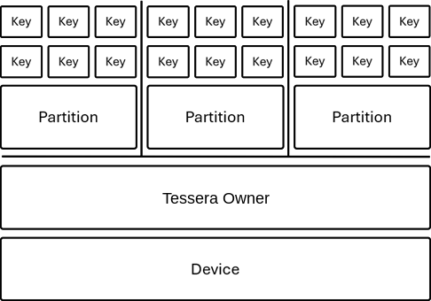

Traditional centralized, service-based HSMs typically do not rely on PCIe virtualization. Instead, they expose a single PCIe Physical Function (PF), or a small number of virtual functions, and implement security partitions that are isolated through TLS-based communication.

Tessera takes a different approach by fully embracing PCIe virtualization. It exposes both Physical Functions (PFs) and Virtual Functions (VFs). In Tessera, partitions are resource groups that form hardware-isolated security domains. Each VF provides a DMA interface that connects a Trusted Execution Environment (TEE) directly to a partition.

The Physical Function is responsible for creating and managing both VFs and partitions. Once a partition is created, all partition configuration, including user provisioning and certificate enrollment, is performed through the associated VF. FIPS authentication sessions and role-based access control (RBAC) operations also run over the VF interface, creating a direct binding between the HSM partition and the TEE.

In confidential computing environments, a device interface that conforms to the TDISP standard is referred to as a Trusted Device Interface (TDI). Because Tessera supports TDISP, the terms TDI and VF can be used interchangeably when referring to the interface between the TEE and the HSM partition.

## Certificate Overview

Key hierarchies and certificates map to HSM identity and authorization domains: Manufacturer, Operator, Tessera Owner, and Partition Owner. Together these key hierarchies form the ownership authentication chain from partitions within the device to the owner of the device and to manufacturer of the device. The following section describes the certificate chains and their purpose:

### Initial Device Identifier (IDevID) Authentication Certificate

Initial Device Identifier (IDevID) Authentication Certificate uniquely identifies each device as being owned by the manufacturer. IDevID is essentially the IEEE 802.1AR device identity. The key pair behind this certificate is known as the Initial Device Identifier Key (IDevK) and are generated inside the device at manufacturing, when the manufacturers Certificate Authority (CA) issues a certificate over IDevK, it is known as IDevID Authentication Certificate. This is shortened to IDevID throughout the document.

*Figure 1 IDevID Certificate*

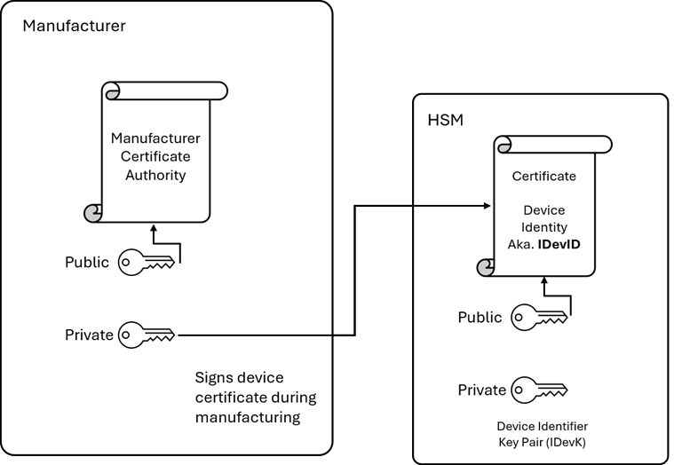

Caliptra, which is the root of trust for all Tessera devices, supports Locally Significant Device Identifiers (LDevID). Tessera supports a Device Root Authentication Certificate (DARC), which can be substituted for the LDevID in protocol exchanges. This lets the operator control device authenticity across their hardware fleet without relying on the manufacturer’s CA infrastructure.

### Tessera Owner Authentication Certificate (AOAC)

HSMs define an Tessera Owner role that is responsible for device-level management. The Tessera Owner role enables HSM device owners to further personalize the device beyond the manufactured base configuration. This personalization allows HSMs to be organized into service-managed groups, ensuring that partitions and partition cloning operations can occur only between HSMs that share the same Tessera Owner.

The Tessera Owner Trust Anchor (AOTA) is a Certificate Authority (CA) operated by the Owner. AOTA issues the Tessera Owner Authentication Certificate (AOAC) by endorsing a CSR derived from IDevID/DARC endorsed keys. In Caliptra key hierarchy, the AOAC maps into the FMCAlias.

As a Caliptra Subsystem device, Tessera supports persistent OCP Device Ownership Transfer (DOT). DOT enables device owners, cloud service providers, and cloud customers to control device-level certificate chains, including authorization keys and firmware-signing keys.

In addition to enforcing Caliptra's hardware-based double-signature model, OCP DOT influences the FMCAlias key derivation, and subsequent AOAC identity.

The resulting trust relationships are:

* Manufacturer trust chain:  
  Manufacturer CA → IDevID → LDevID → FMCAlias
* Tessera Owner trust chain:
  AOTA → FMCAlias

The FMCAlias key pair is therefore endorsed by both the manufacturer (through the IDevID/DARC hierarchy) and the Tessera Owner, with the Tessera Owner Trust Anchor providing the owner-specific signature that establishes device ownership and authorization.

*Figure 2 Tessera Owner Authentication Certificate (AOAC)*

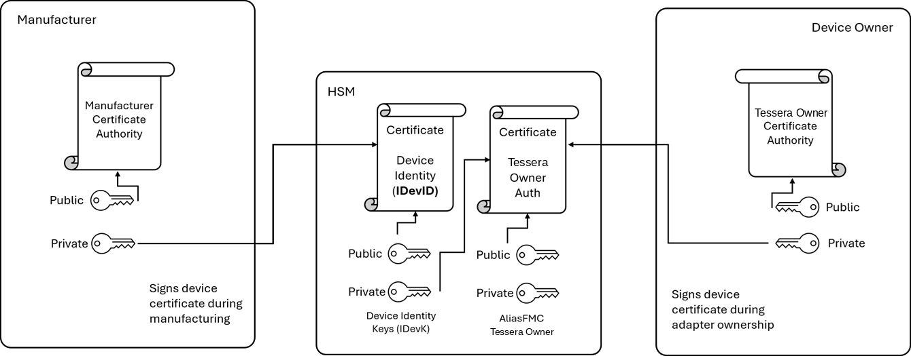

### Partition Authentication Certificate (PAC)

A Partition Authentication Key (PAK) pair is generated within each HSM partition during partition initialization, establishing a unique cryptographic identity for that partition. The PAK is associated with two certificates associated with the following 3 chains:

* PAC (Partition Authentication Certificate) – anchored by the device/root manufacturer.
* PAC (Partition Authentication Certificate) – anchored by Tessera owner
* POAC (Partition Owner Authentication Certificate) – anchored by the partition owner.

The PAC is signed by the AliasFMC private key which includes an AOAC issued by AOTA, along with a parallel certificate chain issued by IDevID/DARC. Together, these certificate chains establish a trusted path from the partition to both the device manufacturer / root owner and the Tessera owner.

Figure 2 Partition Authentication Certificate (PAC)

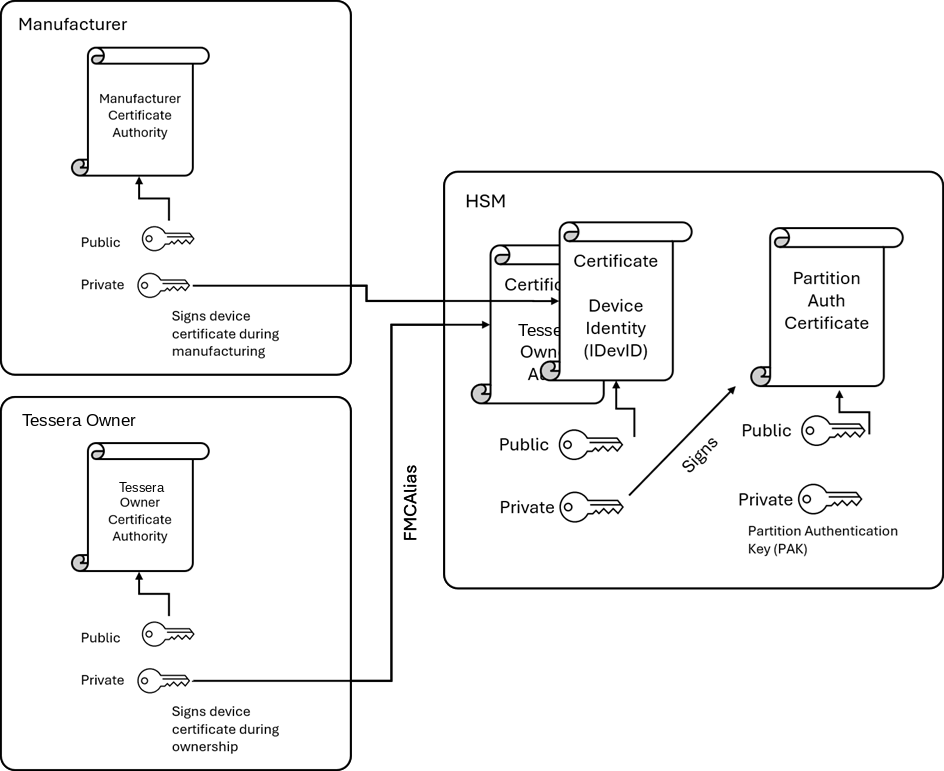

### Partition Owner Authentication Certificate (POAC)

A partition must have ownership endorsement, which is the issuing of a certificate over the PAK by a Partition Owner Trust Anchor (POTA). This certificate is known as the POAC, which is signed by the POTA to establish partition ownership. The POTA is typically a CA authorized by the partition owner.

*Figure 3 Partition Owner Authentication Certificate (POAC)*

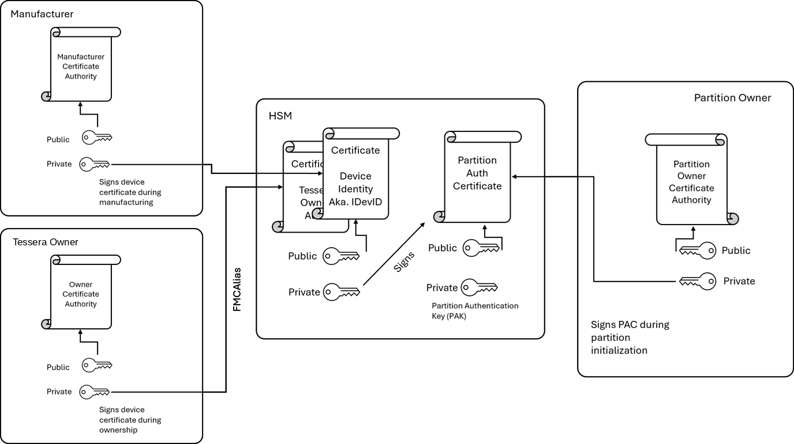

The three certificate chains for Device Manufacturer/Root, Tessera Owner and Partition Owner can be distilled down into a single key chain with different certificate endorsements.

At the foundation is the IDevK, a device-unique identity key rooted in either the Manufacturer Device Identity (IDevID) or operator device root (LDevID), and the Tessera owner (AliasFMC) key. The PAK certificate issued by the IDevID chain is the PAC. The PAK certificate POTA issued is the POAC.

Together, these endorsements establish a triple-chain ownership model that validates the device manufacturer/root owner, Tessera owner, and partition owner. Successful ownership verification requires all three certificate chains to be present and valid.

## Establishing Partition Ownership

Upon initialization of a partition, a randomly generated Partition Authentication Key (PAK) pair that uniquely identifies the partition is created. The life cycle of this PAK is bound to the HSM partition. The PAK certificate is the PAC, issued by a chain anchored back to the IDevID/DARC. The PAC is a hardware endorsement that identifies the partition as an Tessera device partition.

The primary purpose of partition ownership is to establish owner of the partition for the distribution of Masking Key objects. In provisioning PAK ownership, the partition owner requests the Tessera device interface to internally generate a certificate signing request (CSR) for the PAK. The partition owner then creates a Partition Owner Authentication Certificate (POAC) from the CSR and returns this Partition Owner Trust Anchor signed certificate to the Tessera partition. This newly installed certificate becomes the authentication evidence of ownership for the partition.

Genuine device authenticity is established with Device ID, aka IDevID/DARC, issuing a certificate over the PAK to form the PAC. Partition owner authentication is established with the Partition Owner Certificate Authority signing the PAK to form the POAC. The FMCAlias/AOAC is an intermediate certificate in the PAC chain, that provides authenticity of Tessera ownership for a given service or enterprise.

## Required Keys

In addition to Identity keys for the device (IDevK), operator (LDEV/DARC), owner (AliasFMC), partition (PAK), and various import/export KEKs and session keys, HSMs also support two additional unique key concepts:

(1) Backup Keys for resilience and disaster recovery.

(2) Masking Key for encrypting and partition access to Masked Key objects.

### Backup Keys

The backup key methodology typically has two part and three-part Backup Key Seed (BKS) that feed into the derivation of the final Backup Key: Manufacturer/Root seeds, Tessera Owner seed, and Partition Owner seed:

The backup key architecture supports both two-part and three-part Backup Key Seed (BKS) models. The final Backup Key is derived from a combination of seed values associated with three distinct ownership domains:

* Manufacturer/Root Owner Seed (BKS1)
* Tessera Device Owner Seed (BKS2)
* Partition Owner Seed (BKS3)

BKS1 is controlled by the manufacturer or root owner and is shared across all devices produced by that manufacturer or operating under the same root authority. BKS1 is a composite seed used in the context of the KDF, and permits owner personalization. Its purpose is to ensure that backup data can only be restored to compatible devices that belong to the same manufacturer or root owner domain.

BKS2 is provisioned to all devices belonging to a specific Tessera Owner. The seed is securely installed on each device using an Tessera Owner Authorization Certificate (AOAC)-endorsed sealing key. This ensures that backup data can only be restored to devices owned by the same Tessera Owner.

BKS3 is incorporated into the derivation of the Partition Owner Key Backup Key (POKBK). In Tessera, this seed is provisioned using a Partition Owner Authorization Certificate (POAC)-endorsed key. As a result, partition backup and restore operations are restricted to devices that:

* Originate from the same manufacturer or root authority,
* Belong to the same Tessera Owner, and
* Contain a partition managed by the same Partition Owner Trust Authority (POTA).

This layered derivation model provides strong ownership-bound authorization for backup restoration.

### Masking Key

A Masking Key is automatically generated within an HSM partition during partition initialization. It is used to encrypt HSM keys, creating Masked Key Objects that can be safely stored outside the HSM for durable storage and backup purposes. This enables key material to be preserved across hardware failures while remaining protected.

The Masking Key can also be securely transferred to other partitions belonging to the same Partition Owner (POTA) through a process and protocol known as partition cloning. Partitions that share the same Masking Key can operate as an HSM ring, allowing them to access and use the same Masked Key Objects without requiring traditional key export, import, wrap, or unwrap operations.

Because the Masking Key provides access to all Masked Key Objects protected by that key, it is a highly privileged asset. However, its use is strictly constrained to partitions that share the same ownership hierarchy, including the DARC, AOAC, and POAC trust domains. Transfer of a Masking Key is only permitted through the Transfer Masking Key protocol, which is defined as part of the Tessera Partition Cloning specification.

To support long-term operation and cryptographic agility, Masking Keys are versioned and renewable. Partitions attest to the Masking Key versions they possess and always use the most recent version when creating new Masked Key Objects. This allows Masking Keys to be periodically rotated while maintaining access to previously protected objects and enabling a controlled migration to newer key versions.

## Key Provisioning in Tessera

In Tessera devices, the three backup key constructions are built from nested combinations of the composite backup seeds (BKS1, BKS2, and BKS3) that feed into the creation of backup keys.

BKS1 is provisioned in two stages. The first component is installed during manufacturing, while the second component is provisioned during device onboarding after the DARC has been issued over the LDEV. Together, these components establish the manufacturer and root-ownership portion of the backup key hierarchy.

BKS2 seed is typically provisioned for a specific service or enterprise deployment. The seed may be shared across all Tessera devices under the same ownership domain or assigned uniquely to a particular service. When provisioned, BKS2 must always be wrapped with a Key Encryption Key (KEK) endorsed by the device IDevID/DARC and the Tessera Owner Authorization Certificate (AOAC).

BKS3 is provisioned into an individual partition and forms the basis of the Partition Owner Key Backup Key (POKBK). During provisioning, the seed is always wrapped using a POAC-endorsed KEK. Before final provisioning, the device verifies the IDevID/DARC, AOAC, POAC, and the partition attestation evidence to ensure the partition is authorized to receive the seed.

In the Tessera security model, BKS3 is typically provisioned by one of the following mechanisms:

* A remote sealing service.
* A partition-bound Trusted Execution Environment (TEE) using hardware-backed sealing primitives.
* Hardware key derivation functionality.

For TEE-based deployments, the seed is protected using the platform's hardware key derivation capability. An alternative approach allows BKS3 to be generated directly within the Tessera partition; however, without a sealing service this limits partition durability to recover the BKS3 if the partition is lost.

The BKS1, BKS2, and BKS3 seeds are combined through a Key Derivation Function (KDF) to derive the Tessera partition backup key, also known as the Backup Master Key (BMK). The KDF supports three backup models, each with different availability and recovery characteristics:

1. Volatile – survives only for the lifetime of the partition.

BKS3 is not imported through a POAC KEK, instead the BKS3 is randomly generated inside the Tessera device partition. The implication is the partition and partition key are volatile, and the partition is tied to the life cycle of the VM/TEE on a given node. This is non-reboot resilient and optionally-migratable.

1. Resilient, Non-Migratable – durable across failures but bound to a specific environment.

This backup key can be made a unique device, with Unique Device Secret (UDS), which restricts backup and restoration to a specific device. The UDS and/or stable entropy is added to the KDF. This restriction allows a policy whereby Masking Key is non-restorable on other Tessera devices. This key backs up the partition state, including the Masking Key for local resilience only. This provision for BKS3 restricts Live Migration to partition cloning and rehydration, a process of re-instantiation.

1. Resilient and Migratable – durable and transferable between authorized environments.

The backup key access authorization is restricted to Tessera device, Tessera owner, and partition owner. The backup master key KDF includes BKS owner seeds and internally adds DARC pub, AOTA pub, and POAT pub. In this KDF for the Backup Key, there are no restrictions on resilience or live migration. The seed refresh and life cycle are owner defined.

These options allow deployments to balance security, durability, and portability according to their operational requirements.

## Partition Cloning Protocol

The partition cloning protocol establishes a Transfer Masking Key, which wraps the Masking Key for secure transport between partitions owned by the same partition owner. This protocol is a Hybrid Public Key Encryption (HPKE) to establish an ephemeral Transfer Masking Key. The Tessera-to-Tessera HPKE does mutual auth with triple certificate chain verification, parsing both the IDevID/DARC, AOAC, and PAC certificate chains, in addition ensuring the environment meets the minimum-security policy, such as SVN and policy measurement.

Provisioning and Partition Cloning flow for Tessera A and Tessera B

1. Tessera A and Tessera B have IDevID/DARC established at Manufacturing and device operator onboarding.
2. During Manufacturing BKS1 is established in the Tessera. This is released only to the Tessera devices through the IDevID.
3. Upon deployment into the data center, Tessera A and Tessera B are verified with is provisioned with DARC and BKS1 part 2. The process typically occurs after the LDEV field entropy provisioning stage.
4. After OCP Device Ownership Transfer is established on the device, AOTA then issues AOAC against the owner infused AliasFMC. BKS2 is then released into an AOAC endorsed ephemeral key, unique to each Tessera.

By default, Tessera Owner should be enterprise or service specific. If BKS2 is not provisioned, BKS2 is further derived from BKS1 part 2.

1. Tessera A has Partition X initialized. The PAK is signed by the Partition Owner Trust Anchor (POTA) creating POAC for Tessera A Partition X.
2. Tessera A has Masking Key generated.
3. BKS3 is released to Tessera into a POAC endorsed ephemeral key. BKS3 can come from within the TEE or a remote sealing service, but is always provisioned into the Tessera POAC KEK for the partition, only after the partition is verified. The combination of all parts of BKS1, BKS2 and BKS3 form the POKBK for masking key backup.
4. Tessera B has Partition X initialized. The POAT signs PAK CSR, same step as 5) above, creating a POAC on Tessera B Partition X, issued by the same POTA as Tessera A Partition X.

Note: It is also possible to restore a backup from Tessera A to Tessera B, provided Tessera A and Tessera B have the same IDevID/DARC, AOAC and PAC.

1. Partition Cloning Protocol establishes Transfer Masking Key by HPKE with both IDevID/DARC, AOAC and POAC with tripple certificate verification.
2. Tessera A uses Transfer Masking Key to encrypt the Masking Key. Tessera B uses the Transfer Masking Key to decrypt the Masking Key.
3. Tessera A and Tessera B have the same Masking Key to decrypt wrapped key objects.

BKS3 should be provisioned into one or more of the partitions in the HSM ring for the partition owner.

## Users and Roles

Traditional HSMs, roughly follow PKCS#11 Security Officer and User roles, mapping them to the following primary user roles:

Tessera Crypto Officer (ACO). The CO role is akin to a device administrator. This role is responsible for managing and configuring the HSM. Creating and deleting partitions. Assigning users and managing security settings, updating firmware and performing backup and restore operations.

Partition Crypto Officer (PCO). Partition Crypto Officer manages partitions settings, creates and deletes keys within their partition. Assigns user to key access control within the partition.

Partition Crypto User (PCU). User of keys within the partition. This is the least privileged role for using keys within a designated partition.

In Tessera, user roles are collapsed, the Tessera owner controls partition generation and creates partitions with the desired security configuration. The process of POTA issuing POAC verifies the Tessera owner configuration. The default user is created within the partition combining a limited version of PCO and PCU functions, with restrictions applied to created state of the partition. The limited user acts as a superuser. For most scenarios, this single user is sufficient. Additional PCU level users can be created if desired.

### Passwords

User passwords are set upon creation and rotated as necessary; challenges exchanged as part of HPKE sessions perform authentication. Passwords are updated/changed under session. The default is certificate-based authentication.

## Attestation

HSMs typically have 3 levels of attestation, device, partition and key. Tessera and TEEs extend this by having TEE and TDI attestations. As such there are 4 types of attestation in Tessera:

1. TEE Report: This report includes the TCB measurements for the TEE. This report includes TDI binding information based on IDevID, and extended information includes partition binding information (POTA and POAC).

CVM - TEE Report [TDI – Device Interface Report Digest]

The binding between TEE and TDI is based on TEE report. This is a standard TDISP mechanism, examples are Intel TDX-Connect and AMD SEV SNP-IO. The TDI information is extended into TCB measurements and binds the TDI to the TEE. The TDI binding includes a digest of the Device Interface Report. The device interface report on Tessera will include the IDevID/DARC, PAK pub, and measurements for the partition. The TEE TSM for the CPU binds the Device Interface Report and the TEE Report.

It is possible to further extend this report at runtime, but the launch mechanism includes a binding to TDI.

1. TDI Report: The TDI report includes measurements of the TDI endorsed by the IDevID, signed by PAK private.

TCB measurements

AOTA and AOCA.

BKS2 version, sealing certificate (must be AOCA).

PAC

The PAC and TDI measurements are listed in the TDISP DEVICE\_INTERFACE\_REPORT -> DEVICE\_SPECIFIC\_INFO. The TDI report provides more precise information about the TDI. This includes device wide properties, such as AOTA and AOCA chains. The BKS2 key, which is identified by label and provisioned by AOCA, is represented in the TDI report. The PAC public key is the PAK public, which is also the POAC public key.

1. Partition: This report includes information about the partition. This report is signed by POAC, PAK private, and includes the following information:

Partition TCB measurements

MAC, PAC, POTA, POAC

BKS2 version, BKS3 version, sealing certificate (must be POAC), label and derivation methodology.

Masking key versions (important for HSM).

(migratable/non-migratable) method.

Sealing Service PK.

User Public Keys

Persistance/non-persistance.

Mode (cache/HSM).

Partition config lock state.

The Partition report is the richest report on providing partition configuration information. This includes partition configuration information which informs a relying party about the partition information. The PAC/POAC chains are represented in this report, which binds the other reports.

1. Key: This is endorsed by the POAC chain and includes information about the key usage:

Key attributes: ML-DSA, ECC, RSA etc.

Key Type: session or token.

Key attestation is used in key release, sealing and binding. The key attestation contains information about the key attributes. The key attestation is endorsed by the PAK chain which anchors to Partition -> MAC - > TDI -> TEE. The TEE/Application can have outer attestation or claims about the key.

The attestations can be joined/bound on IDevID - PAC which share the PAK public key, which is POTA endorsed in the issuing of POAC.

# Tessera HSM cache

Tessera HSM Cache is an operating mode in which an HSM partition is bound to a Trusted Execution Environment (TEE). Partition ownership and seed provisioning are bound to the state of the TEE, through a cryptographic technique known as sealing. This allows service independent resilience, where the HSM cache can recovery from, reboots, service failures, without requiring calls to a remote sealing service. Instead, resiliency is provided through partition persistence and local TEE sealing, allowing workloads to continue operating even during platform disruptions.

In this mode, the Tessera HSM partition functions as an ephemeral HSM cache, sealing is a critical design consideration for secure resilience. Local sealing is a means of decoupling operational dependencies on external or remote HSM sealing service.

## Key Release Wrap/UNWrap

Traditional HSM deployments are typically separated from the compute resources that use them, requiring remote calls for cryptographic operations. While this model provides strong security isolation, it also introduces network round-trip latency and additional service dependencies. To mitigate these performance impacts, applications often adopt workarounds that reduce latency but weaken key security.

One of the most common key management anti-patterns is “extractable keys”, where keys are expoted/released from the HSM. In this model, keys stored within an HSM are marked as extractable and exported into application or workload environments. These environments frequently lack the same security properties, controls, and assurance levels provided by the HSM itself, such as FIPS 140-3 Level 3 protections. As a result, exported keys are exposed to greater risk, including unintended use due to the loss of HSM-enforced key policies and potential compromise due to weaker security boundaries.

This key-release anti-pattern is widely observed across the industry and can undermine the fundamental security objectives that HSMs are designed to provide.

Tessera addresses this challenge by extending the HSM security domain to system-attached HSMs, enabling consistent enforcement of hardware-rooted security protections across distributed environments. The same security-domain primitives, trust models, and protocols can be extended to devices and platforms that meet equivalent attested security standards. This allows cryptographic keys to move between distributed HSM instances without becoming extractable and without ever leaving the boundaries of the HSM security domain. As a result, workloads gain the performance benefits of local cryptographic services while maintaining the security guarantees traditionally associated with centralized HSM deployments.

## Key Resiliency

Once the HSM security domain is extended to a server-attached Tessera HSM, keys can be securely utilized by the workload in an oracle-like manner, similar to the operation of traditional HSM resiliency rings. Key resiliency ensures that cryptographic protections, threat model assumptions, and key availability are maintained throughout the workload lifecycle, even as infrastructure services undergo failures, maintenance, or migration events.

Key resiliency must address the following operational scenarios:

Reboot and Reset  
Keys must remain correct and securely bound to the intended workload during VM resets, system reboots, PCIe Function Level Resets (FLR), VF detach and reattach operations, and TDISP-related state transitions. The design must also prevent malicious or accidental hypervisor actions from causing PCIe Virtual Functions to be reassigned in a manner that compromises key ownership or isolation.

Unexpected Device Failure  
If device firmware crashes or enters an unrecoverable state, the device must preserve the integrity of the key vault while securely clearing all active key material and runtime cryptographic state.

Impactless Updates  
Certain standards, certifications, and operational procedures require cryptographic keys to be cleared during maintenance activities, including impactless updates. The platform must support secure key re-establishment without compromising workload availability or security guarantees.

Service Healing  
When hardware issues require workloads to be moved to a different physical server, the migrated VMs must be able to securely re-establish access to their required keys on the destination system. Any key material associated with the original device must be securely erased to prevent unauthorized access.

Live Migration  
Cloud operations may live migrate VMs between hosts within the same region or availability zone. As workloads transition to a new machine, the required cryptographic keys must be securely re-established on the destination platform while ensuring that all key material on the source system is securely removed.

Disaster Recovery  
Datacenter-wide events, such as power outages or natural disasters, may require large-scale recovery operations. When services are restored, workloads must be able to regain access to their cryptographic keys and resume normal operation. These scenarios must account for the possibility that supporting infrastructure services, such as remote sealing services, may be temporarily unavailable, necessitating a resilient and self-sufficient key recovery mechanism.

By maintaining key availability and security across these events, Tessera enables workloads to benefit from locally accessible cryptographic services without sacrificing the security guarantees traditionally provided by centralized HSM deployments.

## Masking and Resilience Goals

Masking keys are the fundamental mechanism that enables resiliency in HSMs. Masking keys encrypt HSM-protected objects, allowing them to be stored outside a single physical device, such as in distributed, durable storage systems, while maintaining their confidentiality and integrity.

Tessera applies a similar cryptographic model to achieve key resiliency. In the Tessera architecture, objects are encrypted, or *masked*, and can be stored durably outside the device. However, those objects can only be unmasked and used within an owner-authorized Tessera partition. This approach ensures that durability and recoverability do not come at the expense of isolation, ownership, or access control.

Ownership within Tessera is established through a combination of asymmetric and symmetric cryptographic primitives:

* Asymmetric (certificate-based)
  + IDevID / DARC
  + AOAC
  + POAC
* Symmetric (seed-derived)
  + BKS1
  + BKS2
  + BKS3

The IDevID, AOAC, and POAC are certificate-based credentials containing asymmetric key material. In contrast, BKS1, BKS2, and BKS3 are multi-part seed values that serve as inputs to key derivation functions, which generate the symmetric keys used by the platform.

Together, these certificates and seed-values represent the minimum set of inputs required to construct an Tessera masking key. Possession of only a subset of these elements is insufficient to recover protected objects, preserving strong ownership and authorization boundaries.

For deployments where device-level resiliency is not required, device-unique entropy can be incorporated into the masking key construction. This binds protected objects to a specific physical device and prevents recovery elsewhere. Similarly, for session-scoped objects, session-specific entropy can be blended into the masking key derivation process, ensuring that the resulting objects remain valid only within the context of the originating session.

By combining durable storage with cryptographically enforced ownership, Tessera provides resilient object recovery while preserving the security guarantees expected from an HSM security domain.

Provisioning of asymmetric and symmetric security primitives occurs at different stages of the system lifecycle:

* IDevID + BKS1 are provisioned partly during manufacturing and completed during device onboarding.
* AOAC + BKS2 are provisioned during operator onboarding, such as when a service or business unit takes OCP DOT ownership of a whole device.
* POAC + BKS3 are provisioned during deployment of a sub-service, application, or workload.

This layered provisioning approach improves operational resilience by distributing trust across multiple phases of the infrastructure lifecycle:

* IDevID/BKS1 and AOAC/BKS2 are associated with infrastructure-level provisioning across manufacturer and operator.
* POAC/BKS3 are managed at the service or workload level, enabling independent control and isolation.

To further strengthen resilience, POAC and BKS3 are sealed to the workload. This sealing can be achieved through:

* Local mechanisms, such as Trusted Execution Environment (TEE)-based primitives.
* Remote services, as described in the *Tessera Security Domain Primitives* documentation.

The following section provides a high-level overview of the provisioning process, with local and remote workflow sealing.

In both local and remote sealing, the following conditions remain true:

* Keys may only be unsealed on an Tessera device that shares the same Device Manufacturer Root (IDevID/DARC) Certificate Trust Anchor, Tessera Owner Authorization Chain (AOAC), and Partition Owner Authorization Chain (POAC).
* Keys may only be unsealed inside an Tessera device bound to the VM or Trusted Execution Environment (TEE) authorized to use them. This constraint must remain valid across VM lifecycle events, including Live Migration.
* Session keys may only be unsealed inside the Tessera device and under the specific session that created them.
* Sealing operations must enforce exact or forward security postures. For example; A key created on an Tessera device with a newer SVN must not be live migrated and unsealed on a device with an older SVN. However, a key created on an older SVN may be unsealed on a device with a newer SVN.
* Sealing must support device-specific bindings on a per-partition basis, ensuring that keys can be cryptographically tied to a particular device when required.

These requirements establish the foundation for secure key portability, workload isolation, platform attestation, and resilience across the infrastructure lifecycle.

## Provisioning BKS

After establishing partition ownership with POAC, the seed personalization factors provide cache consistency.

**BKS2:** As described earlier, portions of BKS1 are provisioned to the Tessera device by both manufacturers and operators using IDevID/DARC-endorsed Key Encryption Keys (KEK). The BKS2 seed is typically provisioned by the Tessera owner, it can be configured across multiple Tessera devices under the same ownership domain. Once the AOAC has been established, the BKS2 seed is released into an AOAC endorsed KEK and incorporated into the key derivations for the ownership key hierarchy.

**BKS3:** The BKS3 seed forms a base personalization factor for the Partition Owner Key Backup Key (POKBK). BKS3 is encrypted using a KEK endorsed by the POAC. A service, application, or TEE may choose to use a common BKS3 value across all partitions for simplified management, or it may provision a unique BKS3 value for each partition

This model enables ownership to be established in layers, with adapter-level controls managed through BKS2 and partition-level personalization provided through BKS3. The result is a flexible hierarchy that supports both centralized administration and fine-grained workload isolation

**Partition Owner Trust Anchor (POTA)**  
The Partition Owner Trust Anchor (POTA) is an asymmetric key pair, typically certificate that serves as the certificate authority for issuing Partition Ownership Authentication Certificates. A service or user may choose to use the same POTA across multiple partitions or provision a unique POTA for each partition, depending on their desired HSM ring setup and management requirements.

In typical deployments, the POTA certificate is stored in a remote HSM based sealing service. In some caching models, the POTA can be ephemerally generated and either discarded or protected using TEE-based sealing primitives. From the perspective of an Tessera device, the POTA endorses the Partition Authentication Key (PAK), forming the Partition Owner Authorization Certificate (POAC).

**Masking Key (MK)**  
The Masking Key (MK) is always generated within the Tessera partition and never leaves the device in plaintext form. It is used to encrypt HSM-protected objects, including keys that are generated or imported into the partition. The resulting masked key objects are returned to the caller for durable storage.

To provide resilience across power loss, recovery operations, and migration events, the Masking Key (MK) is protected through a backup mechanism. The Backup Masking Key (BMK) is derived from the provisioning factors BKS1, BKS2, and BKS3, and can be recovered only by Tessera partitions under the same AOAC, POAC and crypto officer credentials.

For deployments that require specific device affinity, the device Unique Device Secret (UDS) may be included in the BMK key derivation process. When enabled, this binding restricts partition recovery and key restoration to a specific device.

**Backup Masking Key (BMK)**  
The Backup Masking Key (BMK) encrypts the Masking Key (MK). After the MK is generated within an established owner Tessera partition, it can be encrypted using the BMK and exported as a protected backup object.

The encrypted object can be returned to the TEE, which can securely persist it in durable storage for future use. During recovery, migration, or partition restoration, the BMK is used to restore the original Masking Key, enabling access to previously protected HSM objects without requiring the keys to be re-created.

This approach provides resilience across resets and recovery events while preserving the security boundaries and ownership model of the partition.

Figure 6 BMK Creation

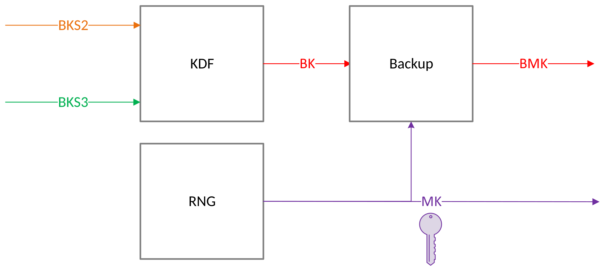

**Provisioning BKS2**: BKS2 must be securely provisioned in the Tessera device during bootstrap or onboarding of the device. This is necessary for security domain separation across different HSM scenarios. BKS2 persisted in the device, and survives reboots, crashes, recovery etc. BKS2 is provisioned into the AOAC (aka, FMCAlias KEK) of the Tessera device. The BKS2 provisioning is bound to Transfer of Ownership flows. Periodic forward rotation of BKS2 is recommended for good key hygiene. BKS2 is attested with an alias name.

Figure 7 BKS2 (AOAC) Provisioning

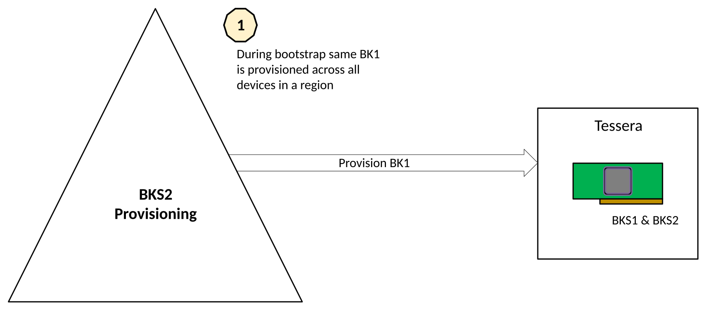

**Provisioning BKS3**: BKS3 must be securely provisioned into the POAC endorsed partition assigned interface. The provisioning of BKS3 must be wrapped by the POAC KEK. BKS3 must only be released into a POAC derived KEK for the partition.

### VF Reset:

When a Virtual Function (VF) is reset, all cryptographic state associated with that VF is cleared. To improve resilience and operational efficiency, however, the Partition Authentication Key (PAK) is treated as a semi-persistent credential. Once the Partition Owner Authorization Chain (POAC) has been established over the PAK, the key can survive non-destructive resets, provided the VF remains attached to the same VM or Trusted Execution Environment (TEE).

### Partition Authentication Certificate (PAC) Validation

During boot TEE needs to verify the identity of the device before it provisions ownership artifacts. The following are the steps:

1. TEE requests the DICE certificate chain for the device. The certificate chain will contain the Hardware CA Root Certificate, DICE Device ID Certificate and DICE Device Alias Certificate.
2. TEE will request the Partition Authentication Certificate (PAC). PAC is endorsed by DICE Device Alias Certificate.
3. Validation of the PAC involves following steps
   1. Validate the Hardware CA Root Certificate, DICE Device ID Certificate and DICE Device Alias Certificate match against the TDISP SPDM attestation evidence generated by the TSM part of assigning the TDISP device to the CVM.
   2. Validate the certificate chain Hardware CA Root Certificate, DICE Device ID Certificate, DICE Device Alias Certificate and PAC form a valid certificate chains. PAC is certificate endorsement over the Partition Authentication Key.
   3. If the validation succeeds the CVM can proceed with partition ownership provisioning.

Figure 7 PAC Verification

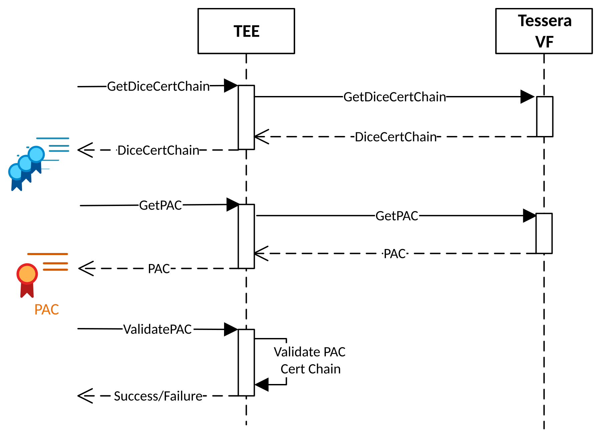

### Partition Owner Authentication Certificate (POAC) Provisioning:

A workload may choose to establish ownership of the Partition by endorsing (signing) the PAK CSR with a HSM sealing service-controlled trust anchor or TEE derived ephemeral key. The successful provisioning of POAC indicates the CVM or owner has taken ownership of the partition.

The following steps are involved for non-service-based provisioning of the POAC:

1. TEE requests a Certificate Signing Request (CSR) for PAK from the Tessera VF assigned to the TEE. Tessera VF generates a CSR for PAK.
2. TEE checks the validity of the CSR and makes sure the public key in the CSR matches the public key in PAC (obtained during PAC Validation phase)
3. If CSR validation succeeds, TEE will derive a Partition Owner Authentication Certificate (POAC). POAC will be endorsed by the POTA private key.
4. TEE will provision the POTA CA Certificate and POCA into Tessera VF. Tessera VF will retain these certificates in its volatile memory until the next VF reset.
5. Once POTA CA Certificate and POCA have been successfully provisioned, the device is owned by the TEE it is attached to.

Once POAC has been established, the caller may cache this for efficiency on future bindings. POAC provides verification of the PAC and underlying PAK pair. BKS3 which is wrapped into a POAC endorsed key, and only retrievable on an interface in position of POAC private. BKS1 (device level), BKS2 (Adapter/owner level) and BKS3 (partition level), are combined to generate the Backup Key, which restores the Masking Key.

Figure 8 POAC provisioning

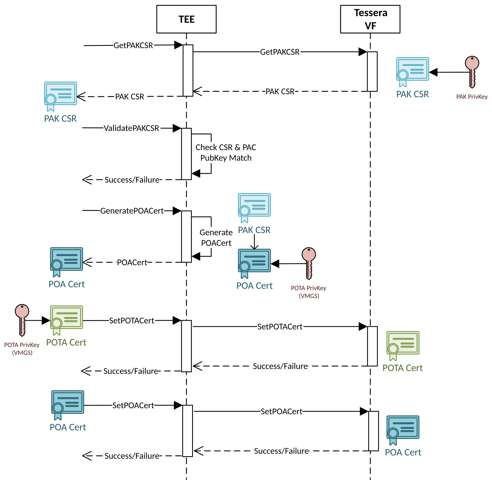

### Provisioning BKS3

Once POAC is successfully provisioned, TEE can proceed to the provision BKS3 into the POAC. For VM/CVM, the BKS3 can be a seed sealed with the CC sealing primitives. The following are the steps to provision BKS3:

1. TEE requests the POAC from the VF and validates the POAC is endorsed by the POTA
2. TEE or sealing service HSM uses its identity to derive an HPKE and generates a certificate for PKE Key Pair. PKE Cert is endorsed by POTA. TEE encrypts the BKS3 with PKE Key Pair. The encrypted BKS3 and PKE Certificate are sent to VF.
3. VF will check if the PKE Certificate is endorsed by POTA. If the PKE Certificate is valid, VF will decrypt the BKS3 using KEK and store the PKS3 in the partition.

Figure 9 BKS3 Provisioning in POAC

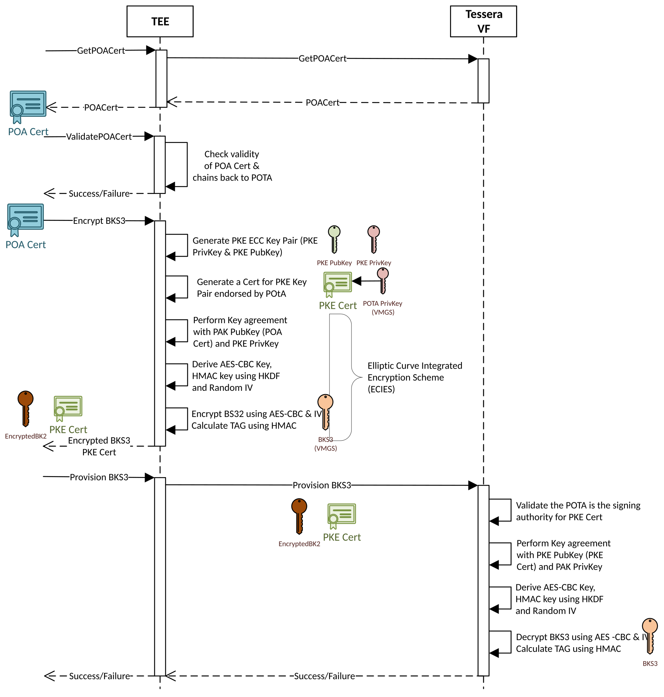

## Partition Persistence

The Tessera device can persist the partition information using sealing. The sealed key acts as a unlock token for a provisioned device. This persistence prevents reprovisioning on partition loss across destructive partition flows.

The POTA is needed to issue POAC over PAK, and the POAC is required to receive BKS3 and derive MK. In a distributed HSM model, the POTA & BKS3 should be provisioned through a sealing service. In such a model, the PAC is verified, and the POTA issues POAC over the PAK by the HSM backed sealing service. The BKS3 is then provisioned into a POAC endorsed KEK by the sealing service.

The challenge with sealing service dependencies is resilience across TEE and VF lifecycle changes. To address, partitions can optionally be created with a persistent flag. This allows a device to internally seal and unseal POAC using a composite token cross sealed TEE metadata and Tessera device metadata. Therefore, if a persistent partition under the same device instance and interface is bound to the same TEE and unsealing succeeds the POAC can be restored within the device.

### Initial State

Tessera partitions are assigned to a VM/TEE has no state (blank) on power-on, for VM level resets the POAC and underlying PAK can persist once the VF remains attached. At a hardware level, the partition is presented as a PCIe Virtual Function (VF) and must be initialized and configurated to make it operational. This configuration procedure includes setting up partition credentials and establishing ownership. It mimics the mechanisms available in classical HSMs. Once the partition is configured it will generate a random masking key (MK). As described in Masking Key (MK), the Backup Key (BK) will be used to take a backup of the masking key and created and encrypted blob. The resulting backed-up including the masking key, is known as the BMK.

## Key Sealing

Keys are created in Tessera as a HSM cache partition through key generation APIs, or distributed to the device. Once the keys are in the Tessera partition, the VM can perform cryptographic operations against those keys. Tessera partitions are ephemeral, and their state needs to be reconstructed across destructive flows. Being ephemeral, keys are cleared in the device resets.

To provide resiliency challenges local sealing and/or remote HSM service-based sealing is used. The goal of sealing is to re-establish POAC and BKS3 to enable the partition re-construct the Backup Masking Key and restore the Masking Key within the partition. Masked objects are stored in durable storage but can only be unmasked inside the Tessera portion once the Masking Key has been restored.

Figure 12 Key Sealing with BMK

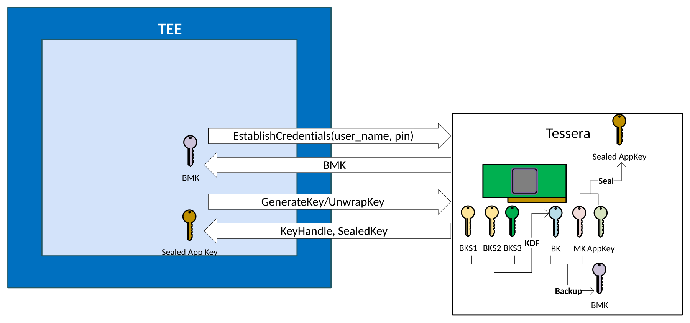

## Local Key Recovery

The following are the potential events in Tessera that VM can lose state:

* Tessera VF Reset (without POAC caching)
* VM Rest
* Impactless Device update (in certain scenarios state is flushed).
* Non-Partition preserving operations
* TDI Unlock transitions

Keys inside a Tessera partition are encrypted with MK and the encrypted objects are returned to VM to store in memory or on disk. After a key loss event the TEE can recover its keys inside the Tessera partition by restoring MK from BMK, which is in-turn is recovered through sealing and interface unlock flow. Once the keys are restored in the partition, the application can continue using the keys.

Tessera native API will have clear indication of the key loss event via a specific error code. Tessera API can leverage the error code to initiate the Masking Key restore. Tessera native API is used underneath the Windows KSP and OpenSSL provider. Enlightening Tessera API to do key resiliency will make the save and restore of objects transparent.

Figure 13 Reset and reprovisioning flow

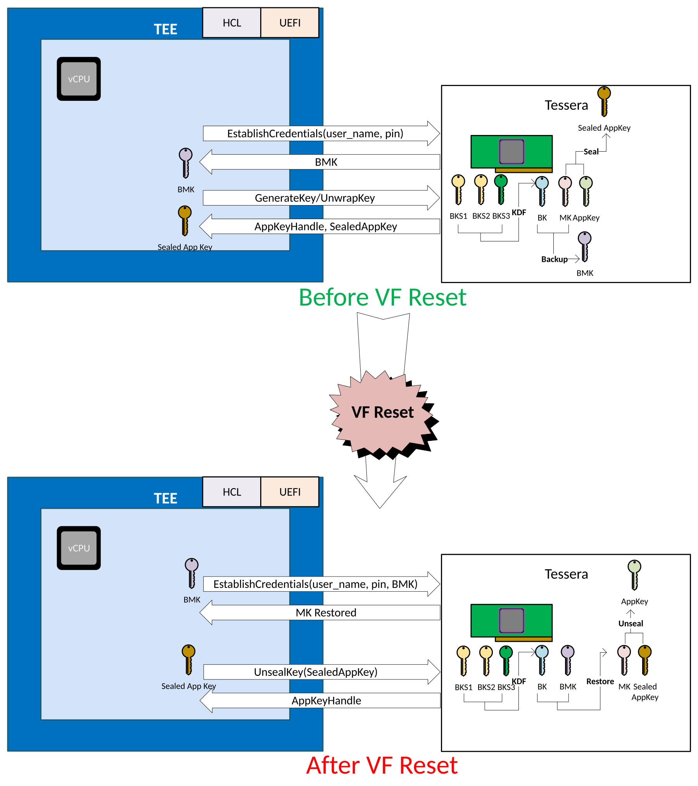

## Live Migration Key Recovery

Live Migration can be considered a special case of recovery where the recovery happens on the new node.

Tessera devices support live migration as follows:

* We use HPKE HSM cloning protocol in Live Migration to migrate the Tessera VF Controller, Queues, and Queue state from source VM to target VM. The HPKE flow follows the 3 certificate chain walks over the same chain: IDevID, AOAC, POAC
* The BMK & encrypted key blogs are stored in VM Memory so they will be migrated part of VM Memory migration
* BKS2 for the Tessera owner must already be provisioned in the target Tessera device.
* POAC and BKS3 will be provisioned in target device via TEE executing the POAC and BKS3 loading flow, or a remote sealing service.

Note: If BMK is provisioned as non-migratable (device UDS blended) then Live Migration cannot use BKS3 flow. The non-migratable attribute is set upon partition creation.

After a live migration the application can recover the lost keys by restoring MK from BMK and decrypting the key blogs inside the Tessera partition. Once the keys are restored in the partition, the application can continue using the key.

Figure 14 Live Migration Flow

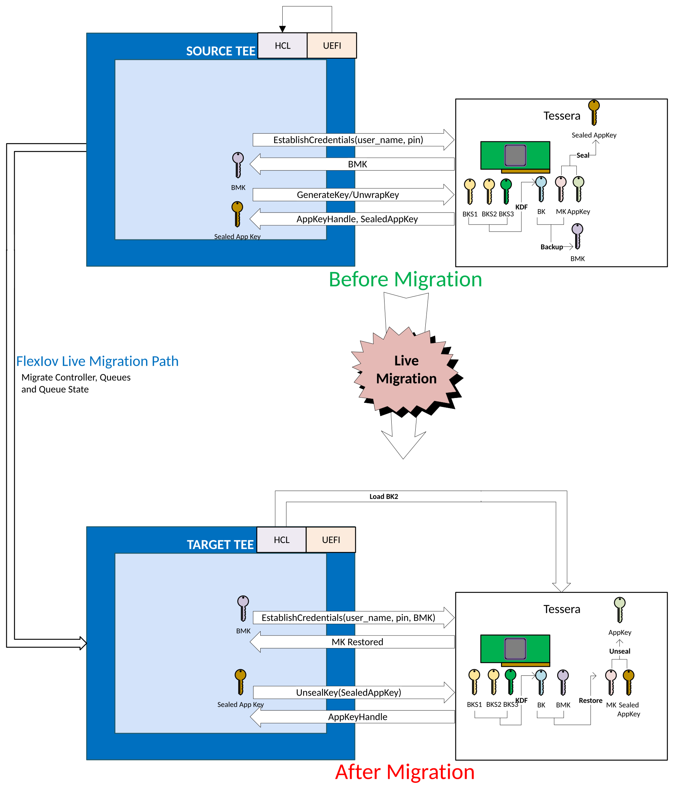

# Tessera As HSM Service Endpoint

The flows for Tessera as an HSM Service endpoint are similar to those as Tessera as a distinguished client cache of the HSM service. The same foundational device primitives for BKS1, BKS2, BKS3, DARC, PAC and POAC are used for partition establishment. The main difference between Tessera HSM client and Tessera HSM server is the service layer that interacts with the device. In the distinguished client the flows are made autonomous. In HSM service mode, the partition setup is always performed from a HSM sealing service, however the Tessera devices primitives remain consistent across both client, and Tessera HSM service. The Partition Cloning Protocol is more broadly used for availability pairs in the HSM mode. The HSM mode can distinctly provision AOAC for the HSM service and establish a service specific BKS2. The Tessera – Security Domain Guide describes the service setup and primitives for sealing service.

## Physical Function (PF) and Virtual Function (VF)

In the HSM client, the PF is assigned to the host partition and interacts with deployment services to autonomously assign a VF to a VM. In the Tessera HSM service mode, the PF is directly assigned to the L1 TEE/VM or host for the HSM Service. This enables the Tessera HSM service to manage resource assignments, and bindings for different managed HSM partitions.

In HSM management, the service layer provides critical functionality in key management, such as more in-depth RBAC, and HSM management flows.

## HSM Service Partitions

Tessera HSM service partitions are usually long-lived; for resilience they are cloned across multiple Tessera devices under the same ownership and provisioned with the same POTA and share the same masking key. The masking key enables these Tessera partitions on different devices to operate on the same Masked Key Objects.

The primary focus of HSM mode is for more advanced scenarios, involving explicitly managed long-lived partitions implemented on top of a set of Tessera devices. To this end, a sealing service is necessary to coordinate peer to peer HSM provisioning across multiple devices.

The key difference in the Tessera HSM mode is the POTA is service managed to configuration POAC on partitions in different Tessera devices. For cloning to work, and maintain HSM interoperability, IDevID/DARC, AOTA on AOAC, POTA on POAC verification is required. A non-ephemeral BKS3 for the Tessera HSM service ring is required for Masking Key derivation and disaster recovery. The POTA and BKS3 are managed by separate sealing services.

Figure 15 HSM Service with Tessera

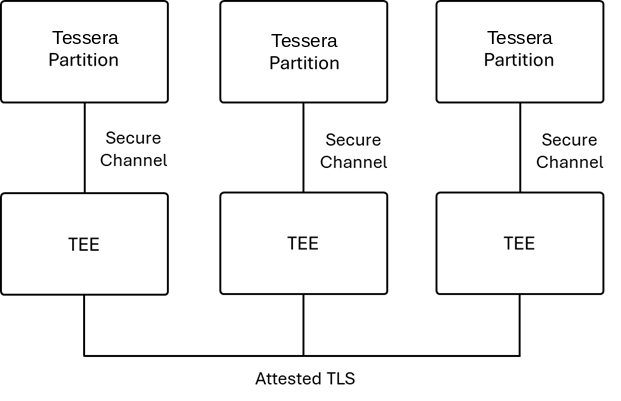

In HSM mode, the service TEE has a binding to a Tessera partition signed with the Tessera PAC, which proves the authenticity of the device, and the POAC which proves ownership of HSM.

The cloning protocol runs from Tessera to Tessera, doing HPKE verifying IDevID, AOAC, POAC, certificate chains, and verifying device measurements. The TEE facilities the Partition Cloning Protocol by performing the message parsing, however the masking key exchange is done Tessera to Tessera with the TEE supporting only the transport of encrypted messages.

The HSM key objects are only accessible to the TEE in masked, encrypted and integrity protected, form. These objects are typically retrieved from durable remote storage and fetched by the service layer in the TEE and presented to the Tessera device. In addition to maintaining masked key objects in durable storage, the service layer is also responsible for maintaining backups of masked objects in durable storage. Only an Tessera partition under the same ownership, included in the same HSM ring, can share a Masking Key and can consume the same owners masked key objects.

## Services Mode Difference

While the Tessera HSM primitives are consistent in HSM cache and HSM mode, there are there are six pivotal differences in how these capabilities are utilized:

1. Partition Owner Authentication Certificate. Although the primitive is available in HSM cache mode, it can be largely optional in basic modes of operation. In the HSM mode, this plays a pivotal role in the authentication of Key exchange among partition peers. Each partition needs to be provisioned
2. The BKS3 seed of the BMK key must be durable. The BKS2 and BKS3 derived backup key is responsible for key backups, and particularly the Masking Key.
3. Username/Passwords, while these are largely certificate-based authentication, user entities are expected RBAC primitives. While TDISP provides strong binding and POAC is needed for partition restore, the user authentication is still required in HSM partition session establishment.
4. Cloning Protocol. This protocol facilitates the replication and migration of security assets across partitions under the same POAC, AOAC, DARC. The cloning protocol ensures that cryptographic keys and policies are consistently synchronized across partitions on different Tessera devices. The Cloning Protocol is not used in Tessera HSM cache, as such partitions creation in HSM mode requires special flags.
5. Durability. The life cycle of Tessera as a HSM cache is bound to the VM life cycle. Tessera as a service is bound to the service life cycle. Resiliency maybe accomplished differently in cache vs service mode. For example, in the HSM cache live migration is expected. In the HSM mode, new ring members provide resilience, and the cloning protocol brings new instances on board. Cloning requires a provisioning service with POTA access to author new partitions, while recommended for Tessera as HSM cache, it is not required.

## Partition Owner Authentication Certificate (POAC) Provisioning

In Tessera HSM mode, the ownership of partitions is needed to establish partition rings or peers on different Tessera devices. Partition ownership is two levels, first the PAC identifies the partition as being a partition on a Tessera device using a partition unique key pair known as the PAK. The POAC adds partition owner endorsement to the PAK signing with a partition owner trust anchor. Therefore, attestations claims endorsed by the PAK key pair can be validated both the PAC, AOAC, and POAC. Similarly, the HPKE from partitions across different Tessera devices verify both the PAC, AOAC, chains and the POAC chain.

The POAC indicates the partition is owned by the same entity. From a service perspective, the following steps are involved in the provisioning of POAC:

1. TEE validates the PAC and attestation report from the device.
2. TEE requests a Certificate Signing Request (CSR) for PAK from the Tessera VF assigned to the TEE. Tessera VF generates a CSR for PAK.
3. TEE checks the validity of the CSR and makes sure the public key in the CSR matches the public key in PAC (obtained during step 1)
4. If CSR validation succeeds, TEE will request the certificate is issued by a the Partition Owner Trust Anchor. This results in a POAC over PAK being issued by the POTA.
5. TEE will provision the POTA CA Certificate Pub and POCA into Tessera VF. Tessera VF will retain these certificates in its volatile memory until the next VF reset.
6. Once POTA CA Certificate and POCA have been successfully provisioned, the device is owned by the TEE it is attached to.

Once POAC has been established, the TEE may cache this for efficiency on future bindings. POAC provides verification of the PAC and underlying PAK pair. BKS3 is wrapped into the POAC pub, and only retrievable on a Tessera partition with POAC private. BKS1 (device level), BKS2 (device owner level) and BKS3 (partition level), are combined to generate the Backup Key, which restores the Masking Key, and other security attributes relevant for the Partition.

## Creating, Cloning and Restoring Partitions

### To create a partition

The PF provides the functionality to create partitions.

* TEEs are assigned on or more VFs by the PF. The TEE initializes the partition, with configuration flags, attests the bindings (TEE Report & TDI Report), sets the credentials and establishes POAC by signing the PAK CSR with the POTA.
* TEE then uses the POAC KEK to have BKS3 wrapped into the partition
* TEE then locks the partition configuration. Creates the bundle, TEE Report, TDI Report, and Partition Report.

### To clone a partition

* TEE SW facilitates the cloning by moving messages over attested TLS sessions from Tessera Partition to Tessera Partition.
* Target TEE provides attestation bundle of TEE Report, TDI Report, TDI Binding, and Partition Report to Verifier for Source TEE.
* Source Tessera performs HPKE to establish session key with Target Tessera, doing triple certificate verification. POAC is verified chain is verified, the AOAC chain is verified, and the PAC chain is verified.
* Source Tessera verifies the Partition configuration verification of Target Tessera.
* Source Tessera encrypts Masking Key with session key between Target Tessera. Target Tessera decrypts and installs the Masking Key.
* Source Tessera and Target Tessera finalize with Masking Key exchange.

### To recover a partition

There are 2 key and 3 Key backups.

**2 Key Backups**

In two key backups the Tessera Owner can backup partitions on the cards. Note: AOAC can only issue into the partitions existing sealing service.

**3 Key Backups**

A partition must be created under the same AOTA and POTA from the original partition. The restore key needs BKS2 provisioned by AOTA into the target Tessera device and BKS3 provisioned POAC into the target partition. This allows BMK derivation KDF (BKS1, BKS2, BKS3, POTA). BMK can then restore the Masking Key, partition configuration and credentials.

* TEE SW facilitates the ownership transfer to establish AOCA on the device.
* The establishment of AOCA requires verification of the IDevID cert chain, device attestation and the signing of FMCAlias. This creates an additional certificate chain to AOTA.
* TEE uses AOAC chain (FMCAlias), IDevID chain, TEE report, and device attestation to have BKS2 released into the Tessera device.
* TEE creates a partition on the bound Tessera device.
* TEE has a remote sealing service verify, TEE Report, TDI Report, Partition Report. Then verify certificate chains for IDevID, AOAC, and POAC before having BKS3 released into the POAC KEK.
* Target Tessera partition can derive BMK and restore the Masking Key, partition configuration credentials and key blogs.

## Tessera Service and HSM cache Integration

Whether Tessera devices are backing a Sealing Service or operating as part of a durable HSM service, the Tessera HSM cache acts as a privileged client of the HSM service. Each cache is attached to a TEE with a secure binding to its partition and provides only oracle-style access to keys stored within that HSM partition.

Given this model, keys should not be released to the cache using traditional key-release mechanisms. Those mechanisms typically require keys to be marked as exportable, which weakens or eliminates their hardware-protected status. Instead, the HSM service can employ a transport mechanism similar to the existing Cloning Protocol to securely transfer bulk keys to Tessera cache devices.

This approach relies on a Transport Key established through HPKE. As with the Cloning Protocol, both the service and the client participate in mutual authentication during Transport Key establishment. The client validates the DARC, AOAC, and POAC certificate chains, while the HSM service validates the TEE attestation, token authentication, POAC, PAC endorsements, and other policy requirements to determine which keys may be transferred from the service to the client.

Establishment of the Transport Key requires mutual authentication between the service partition and the Tessera cache device, including validation of PAC and POAC credentials, as well as client attestation information such as BMK derivation. The Transport Key derived through HPKE is distinct from the Masking Key and serves only as a temporary mechanism for secure key transport.

The Masking Key used by the HSM service is never released outside the service ring. Likewise, the Masking Key of an Tessera cache device is never exported to any other device. This separation preserves the trust boundaries of both the service and the cache infrastructure.

Mutual authentication is required to ensure that an Tessera cache can perform only those operations explicitly authorized by the HSM service. When keys are transported from the service HSM to an Tessera cache under DARC governance, the Tessera partition refresh policy must be enforced. Each transferred key carries a validity-period attribute, and upon expiration the cache device must cease using that key until it is refreshed by the service.

This model enables high-performance local key operations while preserving the hardware protection, authorization controls, and lifecycle management guarantees provided by the HSM service.

Figure 16 Tessera Transport Key Release

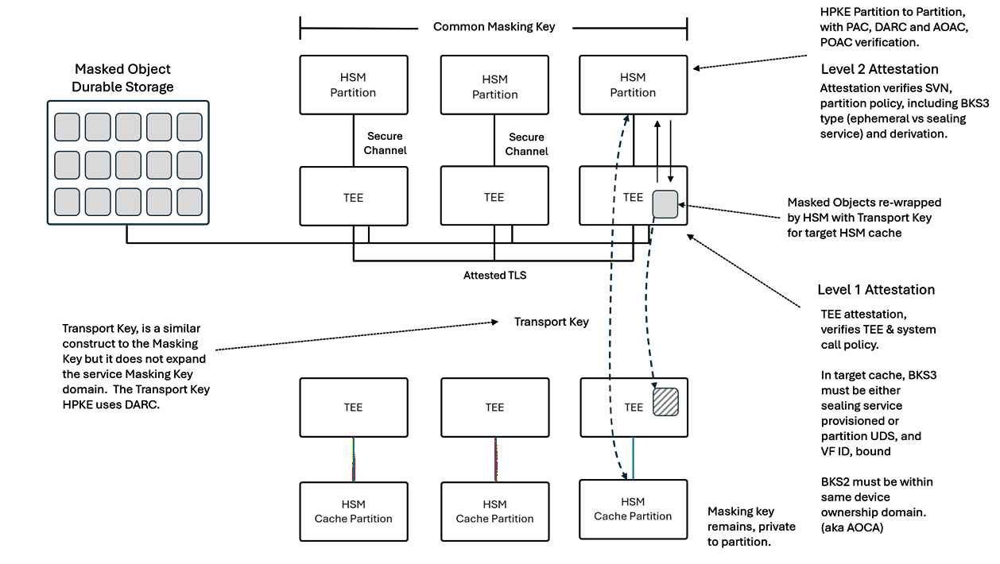

In the flow, Tessera HSM Partitions are established using the sealing service methods described in HSM Partitions. The flows are indifferent from most HSMs. The most significant difference is the Tessera Owner in Tessera is made more powerful with OCP Device Ownership Transfer (DOT), as it includes enforcement of firmware signing. In this mode, hardware will enforce dual signature on firmware updates, one from the manufacturer and the other from the Tessera owner (service).

The steps for the Transport Key Release are as follows:

1. HSM service with Tessera is established as per: Physical Function (PF) and Virtual Function (VF)
   1. In HSM mode, partitions are cloned across multiple devices and form a service ring.
   2. Partitions share the same Masking Key.
   3. Partitions fetch Masked Key Objects from the same durable storage.
   4. Partitions share must share the same BKS3.
2. Tessera HSM cache is established as per: Provisioning Partition Ownership
3. Client TEE requests Transfer of keys from HSM Service TEE.
4. Client TEE must furnish, PAC, POAC, Partition attestations endorsed by PAC. TEE measurements and device bindings.
5. HSM Service TEE verifies client attestations, which can include offloaded attestation verification and tokens.
6. HSM Service reviews key transfer policy, including validity and fetches Masked Key Objects from durable storage.
7. After attestation of the client evidence bundle, the HSM Service TEE passes the Tessera evidence which includes PAC, POAC, and attestations to its attached Tessera partition.
8. Tessera validates evidence and does asynchronous HPKE with Tessera client to derive the Transport Key.
9. The TEE provides Masked Key Objects to the HSM Service Tessera device.
10. The Service Tessera device decrypts and re-encrypts the Masked Keys with the Transport Key, preserving all HSM key attributes, and including a new validity counter, then returns Transport key Masked Objects to its local Service TEE.
    1. The validity counter will be used by the client Tessera HSM cache to invalidate the use of the key after the counter value elapses. All Tessera devices have clocks and internal monotonic counters.
11. The Service Tessera TEE transfers the Transport Key Masked Objects to the Client TEE.
12. The Client TEE presents the Transport Key Masked Objects to the Tessera Partition.
13. The HSM cache Tessera partition decrypts and re-encrypts the Transport Key Masked Objects with the Tessera HSM cache partition unique Masking Key.

Note: In the Tessera HSM mode, the Transfer Masking Key exchanges the Masking key with peers. In the Tessera HSM to cache mode as a distinguished client, the Transfer Masking Key transfers keys temporarily encrypted under the HPKE encryption key. The receiving Tessera HSM cache decrypts and re-encrypts the keys with its local Masking Key.
